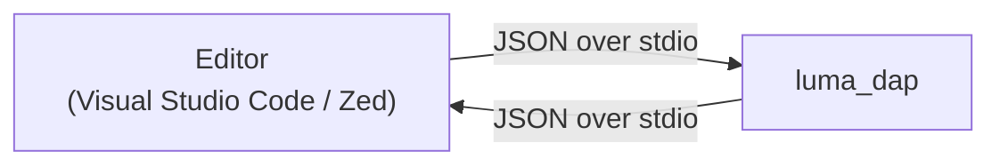
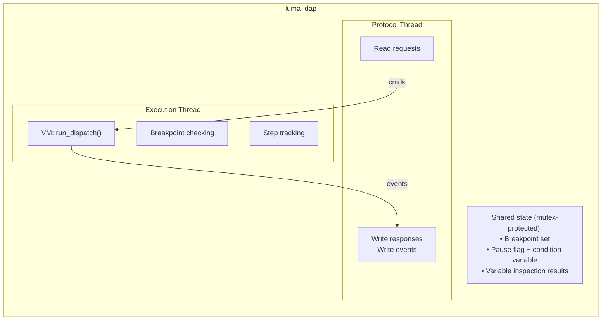

# Luma — Debugger

This document describes the design goals, scope, and architecture of the Luma debugger, as well as the implementation strategy, module decomposition, data flow, and DAP protocol handling.

---

## Table of Contents

1. [Overview](#1--overview)
2. [Goals](#2--goals)
3. [Non-Goals](#3--non-goals)
4. [Architecture](#4--architecture)
5. [Supported DAP Requests](#5--supported-dap-requests)
6. [Breakpoints](#6--breakpoints)
7. [Stepping](#7--stepping)
8. [Variable Inspection](#8--variable-inspection)
9. [Concurrency Support](#9--concurrency-support)
10. [Exception Handling](#10--exception-handling)
11. [Platform Support](#11--platform-support)
12. [Usage](#12--usage)
13. [Editor Integration](#13--editor-integration)
14. [File Layout](#14--file-layout)
15. [Module Responsibilities](#15--module-responsibilities)
16. [Data Flow](#16--data-flow)
17. [VM Instrumentation](#17--vm-instrumentation)
18. [Local Variable Names](#18--local-variable-names)
19. [Output Capture](#19--output-capture)
20. [Error Handling](#20--error-handling)
21. [CMake Integration](#21--cmake-integration)
22. [Testing Strategy](#22--testing-strategy)
23. [Future Extensions](#23--future-extensions)

- [See Also](#see-also)

---

## 1 — Overview

The Luma debugger implements the [Debug Adapter Protocol](https://microsoft.github.io/debug-adapter-protocol/) (DAP) to provide interactive debugging of Luma programs in editors. The debugger is a standalone C++ executable that communicates over standard input/output using the DAP base protocol (Content-Length framed JSON messages).

A single binary serves Visual Studio Code, Zed, and any other DAP-capable editor. It runs on Windows, Ubuntu, and macOS without platform-specific code beyond what the existing Luma interpreter already handles.

The debugger embeds the Luma VM directly. It compiles and executes the target program internally, with instrumentation hooks that enable pausing, stepping, and inspecting program state.

---

## 2 — Goals

- Allow users to set breakpoints by source file and line number.
- Pause execution on breakpoints and on unhandled exceptions.
- Support stepping: step over, step into, step out, and continue.
- Display the call stack with source locations.
- Inspect local and global variables at each stack frame.
- Evaluate expressions in the context of a paused frame.
- Support debugging of concurrent programs (`task_scope` blocks) by mapping each task to a DAP thread.
- Reuse the existing Luma lexer, parser, type checker, compiler, and VM without duplication.
- Keep the debugger self-contained: external dependencies only as exceptions for functionality beyond the C++20 standard library (see `instructions/cpp.instructions.md` §7).

---

## 3 — Non-Goals

The following features remain out of scope for the current implementation:

- Memory or performance profiling.
- Integration with the language server (the debugger and LSP run as independent processes).

---

## 4 — Architecture



The editor spawns `luma_dap` as a child process and communicates via standard input/output using the DAP base protocol (`Content-Length` headers followed by JSON messages).

Internally, the debugger runs two threads:



### Pipeline

When the editor sends a `launch` request, the debugger runs the full compilation pipeline and then begins VM execution on the execution thread:

```text
Source file → Lexer → Parser → Include Resolver → Type Checker → Compiler → VM (instrumented)
```

The protocol thread remains responsive to DAP requests while the program runs.

---

## 5 — Supported DAP Requests

### Lifecycle

| Request             | Direction       | Purpose                                           |
| ------------------- | --------------- | ------------------------------------------------- |
| `initialize`        | Client → Server | Negotiate capabilities and protocol options       |
| `launch`            | Client → Server | Compile and start executing the target program    |
| `configurationDone` | Client → Server | Signal that all configuration requests are done   |
| `restart`           | Client → Server | Tear down the run and launch it again             |
| `terminate`         | Client → Server | Request graceful program termination              |
| `disconnect`        | Client → Server | Stop execution and terminate the debugger process |

### Execution Control

| Request    | Direction       | Purpose                                            |
| ---------- | --------------- | -------------------------------------------------- |
| `continue` | Client → Server | Resume execution until the next breakpoint or exit |
| `next`     | Client → Server | Step over — execute one source line                |
| `stepIn`   | Client → Server | Step into — enter function calls                   |
| `stepOut`  | Client → Server | Step out — run until the current function returns  |
| `pause`    | Client → Server | Pause execution immediately                        |

### Breakpoints

| Request                   | Direction       | Purpose                                          |
| ------------------------- | --------------- | ------------------------------------------------ |
| `setBreakpoints`          | Client → Server | Set breakpoints for a source file (replaces all) |
| `setExceptionBreakpoints` | Client → Server | Configure which exceptions trigger a pause       |
| `breakpointLocations`     | Client → Server | List the executable lines in a range of a source |

### State Inspection

| Request         | Direction       | Purpose                                             |
| --------------- | --------------- | --------------------------------------------------- |
| `threads`       | Client → Server | List active threads (main + tasks)                  |
| `stackTrace`    | Client → Server | Return the call stack for a given thread            |
| `scopes`        | Client → Server | Return variable scopes (local, closure, global)     |
| `variables`     | Client → Server | Return variables within a scope or structured value |
| `evaluate`      | Client → Server | Evaluate an expression in a paused frame's context  |
| `completions`   | Client → Server | Complete names typed in the Debug Console           |
| `exceptionInfo` | Client → Server | Describe the exception a thread stopped on          |
| `loadedSources` | Client → Server | Return all source files loaded by the program       |
| `source`        | Client → Server | Return the text of a loaded source file             |

`luma/concurrencyState` is a Luma-specific request that lists the live tasks.

### Modification

| Request       | Direction       | Purpose                                |
| ------------- | --------------- | -------------------------------------- |
| `setVariable` | Client → Server | Modify a variable's value while paused |

Only variables in the Local, Closure, and Global scopes can be modified, and the new value must parse as the variable's current type. A variable inside an expanded value (a record field or array element) is a snapshot copy and cannot be edited; the request fails with an explanatory message, as it does when the frame is no longer paused.

### Events (Server → Client)

| Event         | Direction       | Purpose                                                    |
| ------------- | --------------- | ---------------------------------------------------------- |
| `initialized` | Server → Client | Debugger is ready to accept breakpoint requests            |
| `stopped`     | Server → Client | Execution paused (breakpoint, step, exception)             |
| `continued`   | Server → Client | Execution resumed                                          |
| `breakpoint`  | Server → Client | A breakpoint set before launch became verified (`changed`) |
| `thread`      | Server → Client | Thread started or exited                                   |
| `invalidated` | Server → Client | Variables/stacks are stale (client must support it)        |
| `terminated`  | Server → Client | Program finished executing                                 |
| `output`      | Server → Client | Program produced console output                            |
| `exited`      | Server → Client | Program exited with a status code                          |

---

## 6 — Breakpoints

The debugger maintains a set of breakpoints per source file. When the editor sends `setBreakpoints`, the debugger:

1. Replaces all existing breakpoints for the specified file.
2. For each requested line, finds the nearest line that contains executable bytecode (using the chunk's `source_map`).
3. Binds the breakpoint to that `(file_id, line)`. Several breakpoints may bind to the same line (distinct requested lines can snap to one executable line); each keeps its own condition, hit condition, log message, and hit count.
4. Returns the breakpoint locations (which may differ from the requested lines).

Breakpoints set before the program is compiled (before `launch`, or for a file the program has not loaded yet) are reported as unverified. Each is given an ID unique across all files, and keeps that ID when it is resolved after `configurationDone`; the debugger then sends a `breakpoint` event with reason `changed` carrying the verified breakpoint and its final line, so the editor updates the breakpoint it is already showing. A breakpoint whose file is not part of the program is reported in the Debug Console.

At runtime, the VM calls the debug hook whenever the source location changes to a new line. If the new `(file_id, line)` has bound breakpoints, the debugger evaluates every one of them. Returning from a call lands back on the caller's line; that is not treated as reaching the line again, so a breakpoint on a line that makes a call fires once, not again after the call returns.

### Conditional Breakpoints

Each breakpoint may have a `condition` expression. When the breakpoint line is reached, the debugger evaluates the condition in the current frame's context (locals, captured variables, and globals are all visible). Execution pauses only if the condition evaluates to `true`.

### Hit Count Breakpoints

Each breakpoint may have a `hitCondition` that controls how many hits are required before pausing. Supported formats: a bare number (`5`, meaning exactly the fifth hit), comparison operators (`>3`, `>=10`, `<4`, `<=2`, `==5`), and `%n` (every n-th hit).

A breakpoint counts as *hit* only when its condition holds (or it has none), following the DAP semantics. So when both `condition` and `hitCondition` are specified, the condition is evaluated first; a false condition does not advance the hit count, and the hit condition is then checked against the count of condition-true hits.

### Log Points

A breakpoint with a `logMessage` attribute acts as a non-breaking tracepoint. Instead of pausing, the debugger interpolates `{expression}` placeholders in the log message and emits the result as a `console` output event; write `\{` for a literal brace. If the breakpoint also has condition/hitCondition, those are evaluated first. A logpoint never hides other breakpoints on the same line: every qualifying logpoint logs, and the line still stops if any qualifying breakpoint on it is not a logpoint.

### Breakpoint Line Snapping

Requested breakpoint lines are snapped to the nearest executable line using the compiled chunk's source map. If no executable line exists at or after the requested line, the breakpoint is placed at the closest preceding executable line.

### Stop Reasons

The `stopped` event's `reason` reflects what stopped the thread, in this precedence: `exception`, `entry`, `pause`, `breakpoint`, then `step`. A breakpoint hit while a step is in progress (for example inside a function being stepped over) is therefore reported as `breakpoint`, with its ID in `hitBreakpointIds`.

---

## 7 — Stepping

The debugger tracks a `StepMode` and a reference frame depth:

| Mode   | Behaviour                                                            |
| ------ | -------------------------------------------------------------------- |
| `None` | Run freely (only stop on breakpoints or exceptions)                  |
| `Over` | Pause when the source line changes and frame depth ≤ reference depth |
| `Into` | Pause when the source line changes (regardless of depth)             |
| `Out`  | Pause when frame depth < reference depth                             |

The reference depth is captured at the moment the step command is issued. A step request is accepted only for a stopped thread; stepping a running thread fails with an error, because its stack is still changing.

---

## 8 — Variable Inspection

When execution is paused, the debugger exposes three scopes per stack frame:

| Scope   | Contents                                                    |
| ------- | ----------------------------------------------------------- |
| Local   | Named local variables in the current function's stack slots |
| Closure | Captured upvalues from enclosing scopes                     |
| Global  | Top-level global bindings                                   |

Variable values are formatted as human-readable strings. Structured types (arrays, dictionaries, records, tuples, and the other collections) are presented as expandable containers, allowing the editor to request their children via nested `variables` requests.

Each variable carries an `evaluateName` — a Luma expression that re-evaluates it — so "Add to Watch" and "Copy as Expression" work on nested values too: `items[3]`, `point.x`, `pair.0`, `ages["bob"]`. Children of collections with no index syntax (queues, stacks, sets, key-value stores) have no `evaluateName`.

Local variable names come from the compiler's per-slot debug information (see [§18](#18--local-variable-names)).

---

## 9 — Concurrency Support

Luma's `task_scope` blocks spawn concurrent tasks, each running its own VM instance on the thread pool. The debugger maps each task to a DAP thread:

| DAP Thread ID | Luma Concept                    |
| ------------- | ------------------------------- |
| 1             | Main thread (top-level program) |
| 2+            | Spawned tasks                   |

Task IDs are unique across the whole process, so a task spawned inside another task gets its own thread and its own breakpoints, stepping, and stack, like a task spawned by the main program.

When a task hits a breakpoint, only that thread pauses. Other threads continue executing unless the user explicitly pauses them. The `stopped` event includes the thread ID, so the editor shows the correct call stack, and `allThreadsStopped` reports whether every thread is now paused.

> **In depth.** For a hands-on walkthrough of debugging concurrent programs — tasks, channels, deadlocks, and common pitfalls — see the [Concurrent Debugging Guide](Luma_Concurrent_Debugging_Guide.md).

---

## 10 — Exception Handling

The debugger supports exception breakpoints via the `setExceptionBreakpoints` request. Two filters are available:

| Filter     | Behaviour                                                        |
| ---------- | ---------------------------------------------------------------- |
| `caught`   | Pause on exceptions caught by a `try`/`catch` block in user code |
| `uncaught` | Pause on unhandled exceptions (enabled by default)               |

When an exception matches an active filter, the debugger pauses execution at the throw site and sends a `stopped` event with `reason: "exception"`. The exception message is included in the event's `text` and `description` fields and is available through `exceptionInfo`.

When no exception filter matches an unhandled exception, the debugger still pauses once the exception has propagated past all frames, so the user can inspect the final state. An unhandled exception that already stopped at its throw site through the `uncaught` filter is not reported a second time after the unwind.

The `stopped` event's `allThreadsStopped` field reports whether every thread is paused at that moment.

---

## 11 — Platform Support

The debugger is written against the C++20 standard library and communicates over `stdin`/`stdout`. Threading uses `std::thread`, `std::mutex`, and `std::condition_variable`.

The one place platform-specific handling is required is the shared stdio transport: on Windows the binary sets `stdin`, `stdout`, and `stderr` to binary mode (`_setmode`) so `\r\n` translation cannot corrupt `Content-Length` framing, and the transport guards its input polling behind `_WIN32` / POSIX branches. This handling is shared with the language server and documented authoritatively in [Luma_Language_Server.md §23](Luma_Language_Server.md#23--platform-specific-handling).

The debugger binary is named `luma_dap` (or `luma_dap.exe` on Windows).

---

## 12 — Usage

### Building

The `luma_dap` target is part of the main CMake build. No extra flags are needed:

```bash
cmake -B build -DCMAKE_BUILD_TYPE=Release
cmake --build build --config Release --parallel
```

This produces `build/luma_dap` (`build\luma_dap.exe` on Windows).

### Running

The debugger reads DAP messages from **stdin** and writes responses/events to **stdout**. Program output (`print`) is captured and sent as `output` events rather than written to the debugger's stdout.

The program being debugged runs inside `luma_dap`, so it cannot share the debugger's stdin: its input would otherwise be read from the editor's DAP messages. At startup the debugger moves the protocol stream to a private copy of stdin and points the process's stdin at the null device, so input functions such as `Console.read_line` and `Console.prompt` see end of input under the debugger. To exercise a program's input handling, run it with `luma` directly.

Editors start the debugger automatically via launch configurations. For manual testing:

```bash
build/luma_dap              # Linux / macOS
build\luma_dap.exe  # Windows
```

The debugger blocks on stdin, waiting for DAP messages. Send an `initialize` request followed by a `launch` request to begin a session. Send `disconnect` to stop.

---

## 13 — Editor Integration

### Visual Studio Code

The existing VS Code extension (`extensions/vscode/`) gains a debug adapter contribution in `package.json`:

```json
{
    "contributes": {
        "debuggers": [
            {
                "type": "luma",
                "label": "Luma Debug",
                "program": "${extensionPath}/bin/luma_dap",
                "languages": ["luma"],
                "configurationAttributes": {
                    "launch": {
                        "required": ["program"],
                        "properties": {
                            "program": {
                                "type": "string",
                                "description": "Path to the Luma program to debug."
                            },
                            "stopOnEntry": {
                                "type": "boolean",
                                "description": "Pause on the first executable line.",
                                "default": false
                            }
                        }
                    }
                }
            }
        ]
    }
}
```

A concrete `launch.json` example that uses these attributes is maintained in the [Development Environment](Luma_Development_Environment.md#2--visual-studio-code) guide, the canonical reference for editor configuration.

### Zed

The Zed extension (`extensions/zed/`) registers the debug adapter in `extension.toml` under `[debug_adapters.Luma]`, with a mandatory configuration schema at `debug_adapter_schemas/luma.json`. The `luma_dap` binary is resolved at runtime by the extension's `get_dap_binary` (PATH first, then GitHub download) and driven over stdio. The extension also registers a `[debug_locators.luma]` locator so the editor's ▶ run affordance can start a debug session directly. Zed debugging is launch-only; a concrete `debug.json` example lives in [extensions/zed/DIRECTORY.md](../extensions/zed/DIRECTORY.md#debugger-setup).

---

## 14 — File Layout

```text
debugger/source/
├── breakpoint_manager.hpp             # BreakpointManager class declaration
├── breakpoint_manager.cpp             # Breakpoint storage and hit testing
├── breakpoint_shared_context.hpp      # Shared breakpoint response building
├── breakpoint_shared_context.cpp      # Shared breakpoint response building impl
├── compiled_breakpoint.hpp            # Breakpoint expression validation cache; logpoint template parser
├── compiled_breakpoint.cpp            # Compiled breakpoint cache and parse_log_template
├── dap_breakpoint_handler.hpp         # Breakpoint request handler group
├── dap_breakpoint_validator.hpp       # BreakpointValidator class declaration
├── dap_breakpoint_validator.cpp       # Breakpoint validation logic
├── dap_callback_types.hpp             # DAP callback type definitions
├── dap_error_handler.hpp              # Error handling utilities
├── dap_execution_handler.hpp          # Execution control handler group
├── dap_feature_manager.hpp            # Feature capability manager
├── dap_handler_base.hpp               # DapHandler base class for handler groups
├── dap_handler_context.hpp            # Handler context class declaration
├── dap_handler_context.cpp            # Handler context implementation
├── dap_handler_types.hpp              # Handler data types (ExecutionResult, PostResponseAction)
├── dap_helpers.hpp                    # Shared DAP helper utilities
├── dap_inspection_handler.hpp         # Inspection request handler group
├── dap_lifecycle_handler.hpp          # Lifecycle request handler group
├── dap_lock_ordering.hpp              # Lock ordering declarations
├── dap_protocol_handler.hpp           # Protocol handler interface
├── dap_response_builders.hpp          # DAP response construction helpers
├── dap_server.hpp                     # DapServer class declaration
├── dap_server.cpp                     # DapServer: lifecycle, dispatch, response building
├── dap_server_breakpoints.cpp         # Breakpoint-related request handlers
├── dap_server_execution.cpp           # Execution control request handlers
├── dap_server_lifecycle.cpp           # Lifecycle request handlers (initialize/launch/disconnect/restart)
├── dap_server_inspection.cpp          # Variable/stack inspection request handlers
├── dap_session_types.hpp              # Session type definitions (ThreadId, ThreadState)
├── dap_transport.hpp                  # Shared stdio transport alias; stdin isolation declaration
├── dap_transport.cpp                  # Moves the DAP input stream off the debuggee's stdin
├── dap_types.hpp                      # DAP protocol type definitions and constants
├── dap_types.cpp                      # DAP type serialisation helpers
├── debug_execution_control.cpp        # Execution control logic (continue, step, pause)
├── debug_execution_engine.hpp         # DebugExecutionEngine class declaration
├── debug_execution_engine.cpp         # VM execution with debug hooks
├── debug_execution_hooks.cpp          # VM debug hook installation and callbacks
├── debug_execution_lifecycle.cpp      # Execution lifecycle management
├── debug_session.hpp                  # DebugSession class declaration (session orchestrator)
├── debug_session.cpp                  # DebugSession: compile, execute, pause/resume, inspect
├── debug_session_state.hpp            # WatchCache — caches evaluated watch results
├── debug_stream_utils.hpp             # Line-buffered program-output capture (cout/cerr redirect)
├── debugger_config.hpp                # Centralised constexpr constants
├── debugger_messages.hpp              # Centralised error/diagnostic message strings
├── diagnostic_log.hpp                 # Adapter diagnostics to stderr (bypassing the redirected std::cerr)
├── exception_breakpoint_settings.hpp  # Exception breakpoint configuration
├── expression_compiler.hpp            # ExpressionCompiler class declaration
├── expression_compiler.cpp            # Compile watch expressions to bytecode
├── expression_evaluator.hpp           # ExpressionEvaluator class declaration
├── expression_evaluator.cpp           # Runtime expression evaluation for watch and hover
├── i_source_locator.hpp               # Source file locator interface
├── i_vm_control.hpp                   # VM control interface for debugging
├── i_vm_introspection.hpp             # VM introspection interface
├── line_breakpoint_manager.hpp        # Line breakpoint detail types
├── line_breakpoint_manager.cpp        # Line breakpoint resolution
├── main.cpp                           # Entry point: isolate stdin, create transport and server, run loop
├── source_manager_locator.hpp         # Source file locator class declaration
├── source_manager_locator.cpp         # Source file locator implementation
├── thread_state_manager.hpp           # ThreadStateManager class declaration
├── thread_state_manager.cpp           # Multi-thread debug state coordination
├── variable_inspector.hpp             # VariableInspector class declaration
├── variable_inspector.cpp             # Variable scope inspection for debug views
├── value_expander.hpp                 # ValueExpander class declaration
├── value_expander.cpp                 # Child expansion of structured values (paging, evaluateName)
├── variable_reference_registry.hpp    # Variable reference ID management
├── vm_assert.hpp                      # VM assertion macro and lifecycle documentation
├── vm_debug_adapter.hpp               # VM debug adapter class declaration
├── vm_debug_adapter.cpp               # VM debug adapter implementation
├── vm_hook_registry.hpp               # VmHookRegistry class declaration
└── vm_hook_registry.cpp               # VM execution hook registration and dispatch
```

All files live under `debugger/source/` at the repository root, parallel to `language-server/source/`, `core/`, and `tests/`. The debugger links against `luma_core` (lexer, parser, type checker, compiler, VM, stdlib) to execute programs.

---

## 15 — Module Responsibilities

### `main.cpp` — Entry Point

Initialises the transport and server, then enters the message loop:

```cpp
int main() {
    // Keep the debuggee's stdin reads away from the DAP stream.
    const auto protocol_fd = luma::dap::detach_protocol_input_from_stdin();

    luma::dap::Transport transport =
        protocol_fd ? luma::dap::Transport{*protocol_fd} : luma::dap::Transport{};
    luma::dap::DapServer server(transport);
    return server.run();
}
```

On Windows, sets `stdin`, `stdout`, and `stderr` to binary mode to prevent `\r\n` translation. On POSIX, ignores `SIGPIPE` so a closed connection surfaces as a write error instead of killing the process.

### `dap_transport.hpp` — Message Framing (Shared Transport)

`dap_transport.hpp` re-exports the shared stdio transport under the debugger's namespace: `using luma::dap::Transport = luma::protocol::StdioTransport;`. The Content-Length framing, thread-safe writes, and shared JSON value type (`luma::json::JsonValue` from `shared/json/`) are exactly those the language server uses.

It also declares `detach_protocol_input_from_stdin()`, which duplicates stdin to a private descriptor for the transport (`StdioTransport(int input_fd)`) and points the process's stdin — the C descriptor and, on Windows, the standard input handle — at the null device. On POSIX the private descriptor is close-on-exec, so processes the debuggee launches do not inherit the protocol pipe.

That shared transport and JSON type are documented authoritatively in the [Language Server](Luma_Language_Server.md) design document — see §15 (Module Responsibilities) and §23 (Platform-Specific Handling).

### `dap_types.hpp` / `dap_types.cpp` — Protocol Types

Defines C++ types for DAP structures and provides serialisation to/from `JsonValue`:

```cpp
namespace luma::dap {

// ─── Stop reasons ───
constexpr std::string_view k_stop_reason_breakpoint = "breakpoint";
constexpr std::string_view k_stop_reason_step       = "step";
constexpr std::string_view k_stop_reason_exception  = "exception";
constexpr std::string_view k_stop_reason_pause      = "pause";
constexpr std::string_view k_stop_reason_entry      = "entry";

// ─── Output categories ───
constexpr std::string_view k_output_console  = "console";
constexpr std::string_view k_output_stdout   = "stdout";
constexpr std::string_view k_output_stderr   = "stderr";

// ─── Types ───

// Incoming breakpoint request from the editor.
struct BreakpointRequest {
    int line{0};
    std::string condition;
    std::string hit_condition;
    std::string log_message;
    int id{0}; // ID already reported to the client (pre-launch), or 0
};

struct Source {
    std::string name;       // File name (e.g., "main.luma")
    std::string path;       // Absolute file path
};

struct Breakpoint {
    int id{0};
    bool verified{false};
    Source source;
    int line{0};            // Verified line (may differ from requested)
    std::string message;    // Reason if not verified
};

struct StackFrame {
    int id{0};              // Unique frame ID
    std::string name;       // Function name
    Source source;
    int line{0};
    int column{0};
};

struct Scope {
    std::string name;       // "Local", "Closure", "Global"
    int variables_reference{0};
    bool expensive{false};  // True for globals (may be large)
};

struct Variable {
    std::string name;
    std::string value;              // Display string
    std::string type;               // Type name
    int variables_reference{0};     // Non-zero if expandable
    int named_variables{0};         // Number of named children
    int indexed_variables{0};       // Number of indexed children
    std::string evaluate_name;      // Expression that re-evaluates it
    bool is_mutable{false};         // Writable via setVariable
};

enum class StepMode { None, Over, Into, Out };

// Serialisation helpers.
[[nodiscard]] JsonValue serialise_source(const Source& src);
[[nodiscard]] JsonValue serialise_breakpoint(const Breakpoint& bp);
[[nodiscard]] JsonValue serialise_stack_frame(const StackFrame& frame);
[[nodiscard]] JsonValue serialise_scope(const Scope& scope);
[[nodiscard]] JsonValue serialise_variable(const Variable& var, bool include_type = true);

} // namespace luma::dap
```

### `dap_server.hpp` / `dap_server.cpp` — Protocol Dispatch

`DapServer` wires the protocol layer to four handler groups and owns nothing else:

```cpp
namespace luma::dap {

class DapServer {
public:
    explicit DapServer(protocol::Transport& transport);
    [[nodiscard]] int run(); // Message loop until disconnect; returns the exit code.

private:
    DapProtocolHandler protocol_handler_; // Framing, dispatch, responses/events
    DapHandlerContext ctx_;               // Shared state for the handler groups
    DapLifecycleHandler lifecycle_;       // initialize/launch/restart/terminate/disconnect
    DapExecutionHandler execution_;       // continue/next/stepIn/stepOut/pause
    DapBreakpointHandler breakpoints_;    // setBreakpoints/setExceptionBreakpoints/...
    DapInspectionHandler inspection_;     // threads/stackTrace/scopes/variables/evaluate/...
};

} // namespace luma::dap
```

- **`DapProtocolHandler`** (`dap_protocol_handler.hpp`) reads Content-Length framed messages, dispatches each request through a command → handler registry, and serialises `send_response`/`send_event` under one send mutex so sequence numbers stay monotonic. It is the single error boundary: a handler exception becomes one error response. A *post-response action* (for example sending `initialized` after the `initialize` response) runs after the response is written; if it fails, the failure is logged rather than answered with a second response for the same request. A write failure never invokes the session-terminating disconnect callback while the send mutex is held, and the callback fires exactly once however the disconnect is detected.
- **`DapHandlerContext`** (`dap_handler_context.hpp`) holds the `DebugSession`, the watch cache, breakpoints set before a session exists (each with a pre-assigned, globally unique negative ID), the last launch configuration, and the negotiated `FeatureManager` capabilities. Its event callback drops `invalidated` events when the client did not advertise `supportsInvalidatedEvent`.
- **`FeatureManager`** (`dap_feature_manager.hpp`) advertises only implemented features. `exceptionOptions` and step-in targets are not implemented and not advertised; `completions` is.

### `debug_session.hpp` / `debug_session.cpp` — Session Orchestration

`DebugSession` is a slim orchestrator. Its public API mirrors the DAP requests (`launch`, `configuration_done`, `terminate`, `set_breakpoints`, `continue_execution`, `step_over`, `get_stack_trace`, `get_scopes`, `get_variables`, `evaluate`, `set_variable`, `get_completions`, `get_threads`, `exception_info`, …) and delegates to five components, declared in dependency order:

| Component              | Responsibility                                                                             |
| ---------------------- | ------------------------------------------------------------------------------------------ |
| `BreakpointManager`    | Line breakpoints (pending and bound), conditions, hit counts, logpoints, exception filters |
| `ThreadStateManager`   | Per-thread pause/step state (`ThreadState`), the paused-thread counter, task registry      |
| `VariableInspector`    | Generational variable/frame references, scope listing, expansion, `setVariable`            |
| `ExpressionEvaluator`  | Evaluation in a paused frame: local → upvalue → global → sandboxed scratch VM              |
| `DebugExecutionEngine` | Launch, VM creation and hooks, continue/step/pause, exceptions, termination                |

The session lifecycle is a single atomic `SessionState` (`Idle`, `Running`, `Terminated`). Inspection reads a thread's VM only while that thread is paused, under the thread's `ThreadState` lock; `terminate()` nulls every `ThreadState::vm` under the same lock before the VM is destroyed.

The engine publishes the execution thread's stop token, and creates the program's root `CancellationToken`, before the execution thread starts. `terminate()` requests the stop and cancels the token: a program blocked in an `await`, a `task_scope` join, or a channel wait is cancelled (and with it every task), instead of hanging the join. Natives that block in the operating system without polling a token — sockets, child processes, HTTP — still finish only when that call returns.

Lock ordering for the session locks is `ThreadStateManager` registry → `ThreadState::mutex` → config, with the exception mutex as a leaf. It is documented, with every other mutex, in `dap_lock_ordering.hpp` and enforced in debug builds by `OrderedLockGuard`.

### Additional Modules

The following modules were added to support advanced debugging features:

| Module                            | Responsibility                                                                                                                                                                         |
| --------------------------------- | -------------------------------------------------------------------------------------------------------------------------------------------------------------------------------------- |
| `compiled_breakpoint`             | Compile/validate cache for breakpoint condition/log expressions, and `parse_log_template`, the logpoint template parser shared with runtime interpolation in `debug_execution_engine`. |
| `dap_response_builders.hpp`       | Helpers to construct well-formed DAP response and event JSON.                                                                                                                          |
| `dap_session_types.hpp`           | Shared type definitions used across handler files.                                                                                                                                     |
| `debug_execution_engine`          | Drives the VM with debug hooks installed; separates execution logic from session state.                                                                                                |
| `debug_session_state`             | WatchCache — caches evaluated watch expressions. Session state is managed directly by DapServer.                                                                                       |
| `debug_stream_utils.hpp`          | Line-buffered capture of `std::cout`/`std::cerr` into output events; `std::flush` emits a pending partial line.                                                                        |
| `expression_compiler`             | Compiles watch/hover expressions to bytecode for evaluation in a paused frame.                                                                                                         |
| `thread_state_manager`            | Coordinates debug state across multiple concurrent task threads.                                                                                                                       |
| `variable_reference_registry.hpp` | Allocates and tracks variable reference IDs across inspection requests.                                                                                                                |
| `vm_hook_registry`                | Installs the VM hooks (line, pause, exception, task spawn/exit) that connect a VM to the execution engine.                                                                             |
| `value_expander`                  | Expands structured values into child variables with paging and full `evaluateName`s.                                                                                                   |
| `diagnostic_log.hpp`              | Adapter diagnostics written to the process's stderr, bypassing the redirected `std::cerr`.                                                                                             |

---

## 16 — Data Flow

### Launch Sequence

1. Editor sends `initialize` request.
2. Debugger responds with capabilities (supports breakpoints, stepping, variable inspection).
3. Debugger sends `initialized` event.
4. Editor sends `setBreakpoints` for each file with breakpoints. Sent before `launch`, they are returned unverified with unique IDs.
5. Editor sends `launch` with the program path.
6. Debugger compiles the program. On failure, responds with an error.
7. On success, starts the execution thread, which waits for `configurationDone`.
8. On `configurationDone`, pending breakpoints are bound to executable lines; each one that becomes verified is reported with a `breakpoint` event (`reason: "changed"`, same ID).
9. If `stopOnEntry` is true, pauses before the first line and sends a `stopped` event with reason `entry`.

### Breakpoint Hit

1. Execution thread: the VM moves to a new source line and calls the debug hook.
2. `should_break()` checks the step mode, then evaluates every breakpoint bound to `(file_id, line)`: conditions, hit counts, and logpoints.
3. A qualifying breakpoint → `is_paused = true` under the thread's lock, then a `stopped` event.
4. Execution thread blocks on the thread's `cv`.
5. Protocol thread receives `stackTrace`, `scopes`, `variables` requests and services them from the paused VM state.
6. Protocol thread receives `continue` → sets `step.mode = StepMode::None`, invalidates variable references, signals `cv`.
7. Execution thread wakes and resumes dispatch.

### Program Termination

1. The VM's `execute()` returns (program finished) or throws (unhandled exception).
2. Any pending partial output line is flushed as an `output` event.
3. The execution thread sets the session state to `Terminated` and sends a `terminated` event, then an `exited` event with the exit code (suppressed when a `restart` tears the run down).
4. Protocol thread receives `disconnect` and exits cleanly.

---

## 17 — VM Instrumentation

The VM checks for the debugger in `VM::check_debug_hooks()`, called as instructions execute. The check is gated on a single atomic, `pause_requested`, so a run without a debugger, or a debugged run with nothing armed, costs one atomic load per instruction:

```cpp
bool VM::check_debug_hooks() {
    if (!debug_.pause_requested.load(std::memory_order_acquire)) {
        return false; // Fast path: nothing armed.
    }

    auto loc = current_location();
    if (loc.line == debug_.last_line && loc.file_id == debug_.last_file) {
        return false; // Only line changes reach the hook.
    }
    debug_.last_line = loc.line;
    debug_.last_file = loc.file_id;

    if (!debug_hook(loc.file_id, loc.line, stack_.frames.size())) {
        return false; // Keep running; the check stays armed.
    }

    debug_.pause_requested.store(false, std::memory_order_release);
    return !pause_callback(); // Blocks until resumed; false means terminate.
}
```

`request_pause_check()` arms the check; it is thread-safe, so the protocol thread uses it for `pause` and new breakpoints. The hooks live in `DebugCallbacks` (`vm_debug_types.hpp`):

| Hook              | Purpose                                                           |
| ----------------- | ----------------------------------------------------------------- |
| `debug_hook`      | `(file_id, line, frame_depth) → should_pause` on each line change |
| `pause_callback`  | Blocks while paused; returns false to terminate the run           |
| `exception_hook`  | `(message, is_caught) → should_pause` for exception breakpoints   |
| `task_spawn_hook` | Registers a new task VM (and its thread) when a task starts       |
| `task_exit_hook`  | Unregisters the task before its VM is destroyed                   |

A spawned task's VM receives *all* of its parent's hooks, so tasks spawned inside tasks are registered and debuggable too. Task IDs come from a process-wide counter, so they are unique across nested task VMs. `VM::set_cancellation_token()` lets the debugger run the root VM under a cancellation token (see [§15](#15--module-responsibilities)).

The debugger inspects a paused VM through `VMIntrospector` (`vm_introspection.hpp`): stack trace, locals, upvalues, and local/upvalue writes for `setVariable`.

---

## 18 — Local Variable Names

The compiler records debug information per stack slot in `CompiledFunction::debug_info`: `local_names` (the variable name for each slot) and `local_mutable` (whether it was declared `mutable`). `VMIntrospector::locals()` pairs these with the frame's slot values to build the Local scope.

There are no live ranges: a slot keeps its name for the whole function, so two sibling blocks that each declare `i` produce two slots named `i`. Lookups by name (watch expressions, hover, `setVariable`) use the first slot with that name, and the scratch-VM evaluator defines each name once, consistently.

---

## 19 — Output Capture

Program output via `print` and related stdlib functions normally writes to `stdout`. When running under the debugger, stdout is reserved for DAP protocol messages.

For the duration of the run, the execution engine replaces the stream buffers of `std::cout` and `std::cerr` with `LineBufferedStreamBuf`s (`debug_stream_utils.hpp`). Each complete line becomes an `output` event (`stdout` or `stderr` category). `std::flush` — used by `Console.prompt` and `Console.flush` — emits a pending partial line immediately, as does every `stopped` event, and the buffers flush any remaining text before `terminated` is sent.

The adapter's own diagnostics bypass `std::cerr` (they go straight to the process's stderr through `diagnostic_log.hpp`, as do the shared transport's framing errors through the error callback `DapServer` installs), so they are never shown as program output.

Program *input* is kept apart as well: see [§12](#12--usage).

---

## 20 — Error Handling

| Condition                      | Behaviour                                                                      |
| ------------------------------ | ------------------------------------------------------------------------------ |
| Compilation error              | `launch` response with `success: false` and error message                      |
| Unhandled runtime exception    | `stopped` event with `reason: "exception"` and exception text                  |
| Malformed DAP message          | Skipped and logged to stderr; the run stops after repeated read errors         |
| Unknown request command        | Error response with the message `"Unsupported command"`                        |
| Inspection while running       | Empty result (no frames, scopes, or variables) — only stopped threads are read |
| Step on a running thread       | Error response: the thread is not paused                                       |
| `setVariable` on a stale frame | Error response: the frame is no longer paused                                  |
| `disconnect` while running     | Terminates VM execution (cancelling blocked waits), joins thread, exits        |

---

## 21 — CMake Integration

The debugger is built from `debugger/CMakeLists.txt`, which the top-level `CMakeLists.txt` adds with `add_subdirectory(debugger)`. It uses the shared tool helper from `cmake/LumaTargetHelpers.cmake`:

```cmake
luma_add_tool_library(dap
    SOURCES
        source/dap_server.cpp
        source/dap_transport.cpp
        source/debug_session.cpp
        # … every other source/*.cpp, listed explicitly (no file(GLOB))
    DEPENDS
        luma_core
)
```

The helper produces two targets: `luma_dap_lib`, a static library holding everything except `main.cpp` (linked by the `dap_test_*` unit tests), and the `luma_dap` executable built from `source/main.cpp`. Both link `luma_core` (lexer, parser, type checker, compiler, VM, and stdlib) and `luma_shared` (JSON and the protocol transport shared with the language server).

---

## 22 — Testing Strategy

### Unit Tests

The `dap_test_*` targets (registered with the CTest label `dap`) exercise the debug components in isolation:

- **Protocol serialisation:** Verify that DAP types serialise to correct JSON with all required fields.
- **Response/event structure:** Verify that `send_response` and `send_event` produce spec-compliant messages.
- **Capabilities:** Verify the `initialize` response includes all advertised capabilities and exception breakpoint filters.
- **Variable formatting:** Verify that Luma `Value` types are formatted correctly for DAP responses, including paging and `evaluateName`.
- **Breakpoints:** Verify binding, one-to-many lines, logpoints alongside breakpoints, and pending IDs kept through resolution.

### Integration Tests

End-to-end tests that spawn `luma_dap` as a subprocess, send DAP messages via stdin, and verify responses:

- Launch a simple program with a breakpoint, verify `stopped` event.
- Step through a function call, verify stack trace changes.
- Inspect variables at a breakpoint, verify correct names and values.
- Continue past a breakpoint, verify `terminated` event.
- Launch a program with a compile error, verify error response.
- Set conditional and hit count breakpoints, verify correct firing.
- Configure exception breakpoints, verify exception stops (once per unhandled exception).
- Verify the program's stdin is isolated from the DAP stream and that partial output arrives before `terminated`.
- Verify nested tasks get distinct threads, breakpoints set before launch become verified, and disconnect ends a program blocked on a channel.

### Test Programs

Small Luma programs in `examples/debug/` designed for debugger testing:

```text
examples/debug/
├── blocked_channel.luma       # Blocks forever on a channel; disconnect must end it
├── breakpoint_basic.luma      # Simple breakpoint on a print statement
├── closure_variables.luma     # Captured upvalues for closure-scope inspection
├── concurrent_tasks.luma      # task_scope with multiple tasks
├── conditional_loop.luma      # Loop with a running total for conditional breakpoints
├── exception_caught.luma      # try/catch for the 'caught' exception filter
├── exception_unhandled.luma   # Triggers an unhandled exception
├── global_scope.luma          # Nested frame that evaluates calls to top-level functions
├── infinite_eval.luma         # Non-terminating function for the evaluation timeout
├── long_loop.luma             # Long-running loop for pause testing
├── nested_tasks.luma          # A task that spawns a task, for distinct task threads
├── read_input.luma            # Reads stdin; under the debugger it sees end of input
├── recursive_stack.luma       # Deep recursion for call-stack and step-out testing
├── set_variable.luma          # Mutable integer and string for setVariable testing
├── step_into_function.luma    # Function call for step-in testing
├── step_over_loop.luma        # Loop for step-over testing
├── structured_values.luma     # Records and choice types for expandable variables
├── task_stress.luma           # Rapid task spawn/exit churn for task-thread inspection
└── variables_basic.luma       # Various variable types for inspection
```

---

## 23 — Future Extensions

Once the current implementation is stable, the following features could be added:

- **Attach mode:** Connect to an already-running Luma program.
- **Inline values:** Report variable values inline in the editor (DAP `InlineValue` capability).
- **Disassembly view:** Show compiled bytecode instructions.

---

## See Also

- [Concurrent Debugging Guide](Luma_Concurrent_Debugging_Guide.md) — debugging tasks and channels
- [Development Environment](Luma_Development_Environment.md) — configuring editors to launch the debugger
- [Language Server](Luma_Language_Server.md) — the companion LSP language server
- [Software Architecture](Luma_Software_Architecture.md) — how the debug adapter fits into the interpreter
- [Manual Tests](Luma_Manual_Tests.md) — manual test plan covering the debugger in VS Code and Zed
