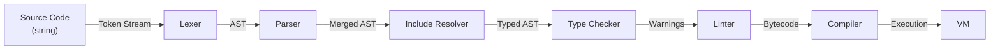
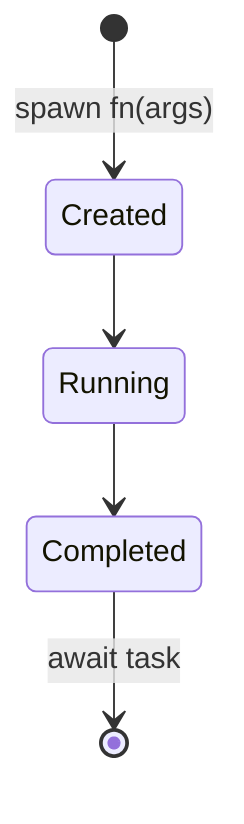
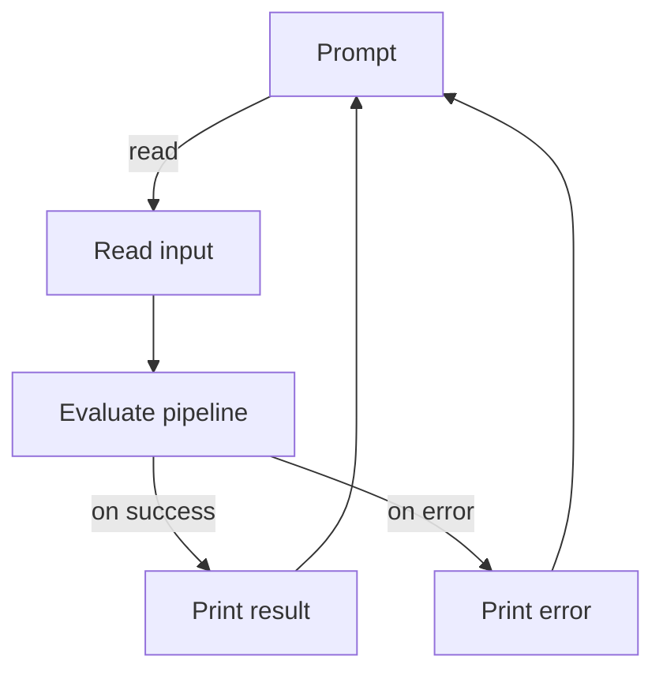

# Luma — Software Architecture

> Software architecture for the Luma programming language interpreter — a command-line application written in modern C++.

---

## Table of Contents

1. [Introduction](#1--introduction)
2. [Design Goals and Constraints](#2--design-goals-and-constraints)
3. [High-Level Architecture](#3--high-level-architecture)
4. [Module Decomposition](#4--module-decomposition)
5. [Data Structures](#5--data-structures)
6. [Processing Pipeline](#6--processing-pipeline)
7. [Bytecode Compiler and Virtual Machine Internals](#7--bytecode-compiler-and-virtual-machine-internals)
8. [Type System Design](#8--type-system-design)
9. [Memory Management Strategy](#9--memory-management-strategy)
10. [Error Handling Strategy](#10--error-handling-strategy)
11. [Standard Library Architecture](#11--standard-library-architecture)
12. [Concurrency Architecture](#12--concurrency-architecture)
13. [REPL Architecture](#13--repl-architecture)
14. [Testing Architecture](#14--testing-architecture)
15. [File Inclusion and Source Management](#15--file-inclusion-and-source-management)
16. [Project File Structure](#16--project-file-structure)
17. [Cross-Platform Considerations](#17--cross-platform-considerations)
18. [Debugger Architecture](#18--debugger-architecture)
19. [Design Decisions and Rationale](#19--design-decisions-and-rationale)

- [See Also](#see-also)

---

## 1 — Introduction

Luma is an interpreted, statically typed, expression-oriented programming language designed for beginners. Its interpreter is a command-line application written in modern C++ that reads Luma source files, analyses them, and executes them directly.

This document describes the internal architecture of the Luma 1.0 interpreter — how it is structured, how its modules interact, and why specific design decisions were made.

### Scope

This architecture covers the complete interpreter: lexical analysis, parsing, static type checking, runtime execution, the standard library, the REPL, the test runner, concurrency support, and the DAP debugger.

### Guiding Principles

Every architectural decision follows the principles defined in the Software Architecture Instructions:

- **KISS** — Choose the simplest design that solves the problem correctly.
- **Single Responsibility** — Each module owns exactly one concern.
- **Separation of Concerns** — Analysis, type checking, and execution are distinct phases.
- **Fail Fast** — Detect and report errors as early as possible in the pipeline.
- **Encapsulation** — Modules expose narrow interfaces; internals remain private.
- **High Cohesion, Low Coupling** — Group related logic together; minimise cross-module dependencies.

---

## 2 — Design Goals and Constraints

### Goals

| Goal                 | Description                                                                              |
| -------------------- | ---------------------------------------------------------------------------------------- |
| Beginner-friendly    | The language and its tooling should feel approachable — no complex setup, no surprises.  |
| Clear error messages | Every error includes the source location, a description, and enough context to act on.   |
| Cross-platform       | The interpreter builds and runs on Windows, Linux (Ubuntu), and macOS.                   |
| Safety               | Static type checking catches errors before execution. No undefined behaviour at runtime. |
| Simplicity           | The codebase should be understandable by a developer who has not seen it before.         |

### Constraints

| Constraint          | Description                                                                                                                         |
| ------------------- | ----------------------------------------------------------------------------------------------------------------------------------- |
| Language            | The interpreter is written in modern C++ (C++20 or later).                                                                          |
| Minimal third-party | Third-party libraries only as exceptions for functionality beyond the C++ standard library and OS APIs (e.g., compression and TLS). |
| Single entry point  | Every Luma program has exactly one `@main`-annotated function.                                                                      |
| Bytecode execution  | The interpreter uses a bytecode compiler and stack-based VM execution backend.                                                      |

---

## 3 — High-Level Architecture

The interpreter follows a classic multi-phase pipeline. Each phase transforms a well-defined input into a well-defined output and passes it to the next phase.



Each phase transforms a well-defined input into a well-defined output. Information flows in one direction, which keeps coupling low and makes each phase independently testable.

### Execution Modes

The CLI module selects one of several modes based on command-line arguments. Each mode drives the same pipeline but stops at a different point or adds behaviour on top.

| Mode            | Command                         | Pipeline Phases Used                                                                            |
| --------------- | ------------------------------- | ----------------------------------------------------------------------------------------------- |
| Run             | `luma <file.luma>`              | Lexer → Parser → Include Resolver → Type Checker → Linter → Compiler → VM                       |
| Type-check only | `luma --check, -c <file.luma>`  | Lexer → Parser → Include Resolver → Type Checker → Linter                                       |
| Strict run      | `luma --strict, -s <file.luma>` | Lexer → Parser → Include Resolver → Type Checker → Linter (warnings are errors) → Compiler → VM |
| Strict check    | `luma --check --strict <file>`  | Lexer → Parser → Include Resolver → Type Checker → Linter (warnings are errors)                 |
| Test            | `luma --test, -t <file.luma>`   | Lexer → Parser → Include Resolver → Type Checker → Linter → Compiler → VM Test Runner           |
| Sandbox         | `luma --box, -b <file.luma>`    | Lexer → Parser → Include Resolver → Type Checker → Linter → Compiler → VM (OS modules disabled) |
| Project init    | `luma init`                     | Creates a `luma.json` project configuration in the current directory                            |
| REPL            | `luma`                          | Loop: Lexer → Parser → Include Resolver → Type Checker → Compiler → VM                          |
| REPL (explicit) | `luma --repl, -r`               | Loop: Lexer → Parser → Include Resolver → Type Checker → Compiler → VM                          |
| Eval (stdin)    | `luma --eval, -e`               | Stdin → Lexer → Parser → Include Resolver → Type Checker → Compiler → VM (no `@main` required)  |

---

## 4 — Module Decomposition

Each module has a single responsibility, a well-defined interface, and minimal knowledge of other modules.

### 4.1 CLI

**Responsibility:** Parse command-line arguments and dispatch to the appropriate execution mode.

**Interface:**

- Input: `argc`, `argv` from `main()`.
- Output: A configuration value describing the selected mode and file path.

**Behaviour:**

- Parses flags: `--test` / `-t`, `--check` / `-c`, `--strict` / `-s`, `--box` / `-b`, `--version` / `-v`, `--help` / `-h`, `--repl` / `-r`, `--eval` / `-e`, `--optimize` / `-O`, `--verify`, and the optional source file path. The `init` subcommand (alias `pkg`) only creates a `luma.json` project file in the current directory; there is no package management.
- Luma's own flags are honoured anywhere on the command line, before or after the `.luma` file, so `luma app.luma --test` tests the file. The first non-flag argument is the file path. Any other argument after the file is forwarded to the program, and everything after a literal `--` is forwarded unchanged, even if it looks like a flag.
- `-O` / `--optimize` takes a level of `0`, `1`, or `2` (`-O2` or `-O 2`). A missing or invalid level is a usage error.
- `validate_file_argument` runs before dispatch. These are usage errors (exit code 5): `--test` or `--check` without a file, a file without the `.luma` extension, a path that does not exist or is not a regular file, and program arguments given without a file.
- On an unknown flag before the file, computes the Levenshtein edit distance against all known flags and suggests the closest match (threshold ≤ 2): `error: unknown option '--hepl'; did you mean '--help'?`. Returns exit code 5 (`usage_error`).
- Delegates to the REPL module (`--repl` / `-r` or no file argument), the standard-input evaluator (`--eval` / `-e`), the pipeline runner (file argument), the test runner (`--test` / `-t`), the type-checker (`--check` / `-c`), the project initialiser (`init` / `pkg`), or information output (`--version` / `-v`, `--help` / `-h`).
- Uses standardised exit codes: 0 (success), 1 (runtime error), 2 (type error), 3 (syntax error), 4 (compile error), 5 (usage error). The `exit_code::from_diagnostic_category()` function maps `DiagnosticCategory` values to their corresponding codes.

**Dependencies:** Source Manager, Lexer, Parser, Include Resolver, Type Checker, Linter, Compiler, VM, Environment, Standard Library, Test Runner, Common (`common/terminal.hpp`).

_Note:_ The CLI module has two roles: parsing command-line arguments (pure logic, no dependencies) and orchestrating the pipeline (depends on all pipeline phases). These are kept in a single module because separating them would add indirection without meaningful benefit — the orchestration logic is a straightforward sequential dispatch.

### 4.2 Source Manager

**Responsibility:** Load source files from disk and track source locations for error reporting.

**Interface:**

- `load(path) → const SourceFile&` — Read a file and return a reference to its stored metadata. Throws `std::runtime_error` if the file cannot be opened. Subsequent calls with the same path return the previously loaded entry without re-reading.
- `is_loaded(path) → bool` — Return `true` if the path has already been loaded.
- `get_line(file_id, line) → string_view` — Retrieve a specific line (1-based) for error context display. Returns an empty view if the file ID or line number is out of range.
- `get_file(file_id) → const SourceFile*` — Return a pointer to the `SourceFile` for a given ID, or `nullptr` if not found.

**Behaviour:**

- Reads source files as raw bytes (binary mode) and treats them as UTF-8 text, so byte offsets into the stored text match the on-disk file identically on every platform.
- Assigns each loaded file a unique `FileId` identifier (starting at 1; 0 is reserved for REPL input with no backing file).
- Maintains a path-to-ID registry so that `load()` is idempotent and `is_loaded()` is O(1). The Include Resolver uses `is_loaded()` to skip already-included files.
- Stores the original source text alongside a compact per-line byte-offset index (rather than a second copy of each line), so that error messages can display the offending line with a caret pointing to the exact column.

**Dependencies:** None.

### 4.3 Lexer

**Responsibility:** Convert a source text string into a flat sequence of tokens.

**Interface:**

- Constructor: `Lexer(source, diagnostics, file_id)` — takes the source text, a `DiagnosticCollector&` that receives every lexical diagnostic, and an optional file identifier (default 0 for REPL/inline use).
- `tokenize() → vector<Token>` — Scan the source text and return all tokens, always ending with `EndOfFile`. Lexical errors are reported to the collector rather than thrown.

**Behaviour:**

- Single-pass, character-by-character scanning from left to right.
- Produces one `Token` per lexical unit: keyword, identifier, literal, operator, punctuation, annotation, or end-of-file.
- Classifies numeric literals as `IntegerLiteral` (no decimal point or exponent) or `NumberLiteral` (contains `.` or `e`/`E`). Hexadecimal (`0x`), binary (`0b`), and octal (`0o`) prefixes are recognised. A decimal point must be followed by a digit (`1.` is not a number), and a literal directly followed by a letter or digit that cannot belong to it (`0b102`, `123abc`) is an error. After `.` or `?.`, only digits are read, so `t.0.1` lexes as two tuple-index accesses.
- Identifiers may contain bytes ≥ 0x80 only when they form well-formed UTF-8 letters; Unicode spaces and control characters are rejected.
- Handles string interpolation by producing a sequence of tokens: `StringStart`, `StringMiddle` (between interpolation slots), and `StringEnd`, with normal expression tokens in between. Plain strings without interpolation produce a single `StringLiteral` token.
- Handles triple-quoted multi-line strings (`"""..."""`) by dedenting the whole literal at once — the common leading whitespace is computed across every piece, including those between interpolations — and dropping the first and last line only when they are blank. Escape sequences are processed as in ordinary strings, after dedenting (`\$` suppresses interpolation). The result uses the same token types as single-line strings.
- Recognises annotations (`@main`, `@test`) as `Annotation` tokens.
- Skips whitespace (spaces, tabs, carriage returns, newlines, semicolons) and comments (`#` to end of line). Semicolons are treated as whitespace because they are optional in Luma. Each token records whether a newline preceded it (`preceded_by_newline`), which the parser uses for its newline rule.
- Attaches a start location (`start_location`) and an end location (`location`, one past the last character) to every token.
- On an unrecognised character, reports a syntax diagnostic anchored at the token start, emits an `Error` token, and continues scanning. Lexing stops after 100 errors.

**Dependencies:** Source Manager (for file identifiers), Diagnostics (for the collector), Common (for resource limits and UTF-8 decoding).

### 4.4 Parser

**Responsibility:** Transform a flat sequence of tokens into an Abstract Syntax Tree.

**Interface:**

- Constructor: `Parser(tokens)` — takes the token stream produced by the Lexer.
- `parse() → Program` — Consume all tokens and return the root `Program` node. Syntax errors are collected as diagnostics (`get_errors()`) rather than thrown; the returned program contains everything that parsed successfully.

**Behaviour:**

- Recursive-descent parser consuming tokens from left to right.
- Parses top-level declarations (`function`, `record`, `choice`, `interface`, `namespace`, `type`, `include`, `use`) and top-level statements.
- Expression parsing uses precedence climbing (see Section 6.3 for the full precedence table).
- Newline rule: Luma has no statement terminator, so a `(` or `[` that starts a new line (`Token::preceded_by_newline`) never continues the previous expression as a call or index — it begins a new statement. Binary operators and `|>` still continue an expression across lines.
- Named arguments (`name: expr`) are parsed as part of call expressions and stored alongside positional arguments.
- Attaches the `SourceLocation` of the primary token to each AST node.
- On a parse error, emits a diagnostic anchored at the offending token's start and throws the internal `ParseFailure` signal to the nearest recovery point. Recovery is local: a block body, namespace body, match-arm list, or choice-variant list catches it and resynchronises at the next statement or member inside the same block (`synchronize_in_block`), so one error does not cascade into false errors for the rest of the function. The top-level loop is the last recovery point (`synchronize`). Parsing stops after 100 errors.

**Dependencies:** Lexer (token stream), AST, Diagnostics, Common (for resource limits).

### 4.5 AST (Abstract Syntax Tree)

**Responsibility:** Define the data structures that represent the syntactic structure of a Luma program.

**Interface:**

- A set of node types (C++ structs/classes) organised into three categories: expressions, statements, and declarations.
- Every node stores its `SourceLocation` for error reporting in later phases.

This module contains only data definitions — no logic.

**Node Categories:**

_Expressions_ (produce a value):

- `ArrayLiteralExpression` — array literal with element expressions.
- `AwaitExpression` — `await task` producing `T`.
- `BinaryExpression` — two operands and an operator (`+`, `-`, `*`, `/`, `//`, `%`, `==`, `!=`, `<`, `>`, `<=`, `>=`, `&&`, `||`, `??`, `&`, `|`, `^`, `<<`, `>>`, `in`). The `in` operator checks membership: element in array, key in dictionary, substring in string, or integer in range. The result type is `boolean`.
- `CallExpression` — function or lambda invocation with positional and named arguments.
- `DictionaryLiteralExpression` — dictionary literal with key-value pairs.
- `DowncastExpression` — `downcast<T>(expr)` keyword expression producing `result<T>`. Parsed as a dedicated AST node, not as a function call.
- `ErrorPipeExpression` — `left !> right` — unwrap `success(v)` from left and pipe `v` into right; short-circuit to `failure(msg)` if left is a failure result.
- `FailureExpression` — `failure(msg)` keyword expression producing `result<T>`. Parsed as a dedicated AST node, not as a function call.
- `FieldAccessExpression` — record field or tuple element access (`expr.field`, `expr.0`).
- `IfExpression` — conditional expression producing a value from both branches.
- `IndexAccessExpression` — array element access (`expr[index]`).
- `IsExpression` — `is<T>(expr)` keyword expression producing `boolean`. Tests whether a value matches a type without binding it. Parsed as a dedicated AST node, not as a function call.
- `LambdaExpression` — anonymous function with parameters, optional return type, and body.
- `LiteralExpression` — integer, number, boolean, string, none.
- `MatchExpression` — pattern-match expression producing a value. Contains a subject expression and a list of `MatchArm` nodes. Each arm has one of the following kinds:
    - `BooleanCase` — `case true` or `case false`.
    - `ChoiceCase` — choice variant pattern with optional destructured field bindings (e.g., `case Shape.Circle(r)`).
    - `Comparison` — operator and value (e.g., `case >= 90`, `case == cutoff`).
    - `Else` — the fallback `else` arm.
    - `IntegerCase` — bare integer literal (e.g., `case 1`, `case 42`).
    - `IntegerRangeCase` — integer range literal, inclusive `case 0..=9` or half-open `case 0..9`. Compiled to the same bounds test as `subject in lo..hi` (`MakeRange`/`MakeRangeInc` + `Contains`); requires an integer subject and an `else` arm.
    - `NoneCase` — `case none`.
    - `SomeCase` — `some(binding)` with a bound variable name.
    - `SuccessResult` / `FailureResult` — `success(binding)` or `failure(binding)` with a bound variable name.
    - `VariantCase` — choice variant without destructuring (e.g., `case Direction.North`).

    Each arm may also carry a list of `AlternativePattern` entries for multi-pattern syntax (`case A | B`). Alternatives are limited to simple pattern kinds (boolean, integer, integer range, choice variant, string, comparison, none).

- `PipeExpression` — left-hand expression piped into right-hand function call.
- `RangeExpression` — `a..b` (exclusive end) or `a..=b` (inclusive end) producing a range value.
- `RecordCreationExpression` — record instantiation with field values.
- `RecordWithExpression` — `record with { field = value, ... }` producing a copy of a record with the given fields overridden.
- `SomeExpression` — `some(expr)` keyword expression producing `optional<T>`. Parsed as a dedicated AST node, not as a function call.
- `SpawnExpression` — `spawn fn(args)` producing `task<T>`.
- `TaskScopeExpression` — `task_scope { ... }` structured concurrency block producing `array<T>` of child task results.
- `StringInterpolationExpression` — string template composed of literal parts and embedded expressions.
- `SuccessExpression` — `success(expr)` keyword expression producing `result<T>`. Parsed as a dedicated AST node, not as a function call.
- `TupleLiteralExpression` — tuple literal with 2–4 element expressions.
- `UnaryExpression` — prefix operator and operand (`!`, `-`, `~`); or postfix propagation operator `?` applied to a `result<T>` or `optional<T>` value.
- `VariableExpression` — variable reference by name.

_Statements_ (perform an action, produce no value):

- `AssignmentStatement` — target (variable, field, index) and value expression.
- `BlockStatement` — a scoped block of statements delimited by `{` and `}`.
- `BreakStatement` / `ContinueStatement` — loop control.
- `CompoundAssignmentStatement` — target, operator (`+=`, `-=`, `*=`, `/=`, `//=`, `%=`, `|=`, `&=`, `^=`, `<<=`, `>>=`), and value expression.
- `ExpressionStatement` — expression evaluated for its side effects (e.g., function call).
- `ForStatement` — loop variable(s), iterable expression (range, array, string, or dictionary), and body block.
- `IfStatement` — condition, then-block, optional else-if chain, optional else-block.
- `IncrementStatement` / `DecrementStatement` — target variable and `++` or `--`.
- `MatchStatement` — subject expression and match arms (for side effects, not value).
- `ReturnStatement` — optional value expression.
- `TryStatement` — try body, optional catch clause (with bound error variable), and optional finally block.
- `TupleDestructuringStatement` — binds tuple elements to named variables.
- `RecordDestructuringStatement` — binds a record's fields to same-named variables by field name (a subset of fields may be listed).
- `VariableDeclaration` — type, name, mutability flag, and initialiser expression. Listed here because variable declarations appear as statements inside function bodies; at the top level, they are treated as declarations.
- `WhileStatement` — condition expression and body block.

_Declarations_ (define names at the top level or within a namespace):

- `ChoiceDeclaration` — name, optional type parameters, and variant definitions. Each variant has a name and optional typed fields. Variants may reference the enclosing choice type (recursive ADTs), including generic self-references (e.g., `List<T>` containing `List<T>` fields). Choice declarations with all unit variants (no data fields) serve the same role as enumerations.
- `FunctionDeclaration` — return type (before the name), name, parameters (with an optional `mutable` modifier and optional defaults; `unique`/`borrow` are part of the parameter's type annotation), body, annotations.
- `IncludeDeclaration` — file path string.
- `InterfaceDeclaration` — name and required field definitions (name + type).
- `NamespaceDeclaration` — name and contained declarations.
- `RecordDeclaration` — name and field definitions (name + type + optional default).
- `TypeAliasDeclaration` — alias name and target type.
- `UseDeclaration` — namespace name or namespace-qualified name.

**Dependencies:** None.

### 4.6 Type System

**Responsibility:** Define the representation of all Luma types and provide operations for type comparison, compatibility checking, and interface satisfaction.

**Interface:**

- `TypeInfo` — A struct with a `Kind` discriminator, an optional name (for choices, records, interfaces), inner types (for generics), and a return type (for function types). Equality is tested via `TypeInfo::operator==`.
- `TypeInfo::to_string() → string` — Human-readable type name for error messages. A cached variant `TypeInfo::to_string_cached()` memoises the result to avoid repeated string allocations during type checking.
- `TypeChecker::is_assignable(target, source) → bool` — Can a value of `source` type be used where `target` is expected? (Method on `TypeChecker`.)
- `TypeChecker::satisfies_interface(record_name, interface_name) → bool` — Does the named record satisfy the named interface? (Method on `TypeChecker`.)
- Common-type promotion (e.g., `integer` + `number` → `number`) is computed inline during type inference in the `TypeChecker`.

**Type Representation:**

| Type Kind             | `TypeInfo::Kind` | Notes                                                                                                                |
| --------------------- | ---------------- | -------------------------------------------------------------------------------------------------------------------- |
| `(T1, T2, ...)`       | `Tuple`          | Inner types hold element types.                                                                                      |
| `array<T>`            | `Array`          | One inner type (element type).                                                                                       |
| `boolean`             | `Boolean`        | Primitive.                                                                                                           |
| `channel<T>`          | `Channel`        | One inner type.                                                                                                      |
| `decimal`             | `Decimal`        | Primitive. Exact base-10 value used by the `Decimal` module.                                                         |
| `dictionary<T>`       | `Dictionary`     | One inner type (value type; key is always `string`).                                                                 |
| `function(P...) -> R` | `Func`           | Inner types are parameter types; `return_type` holds `R`.                                                            |
| `integer`             | `Integer`        | Primitive.                                                                                                           |
| `none`                | `None`           | Primitive. The empty case of `optional<T>`.                                                                          |
| `number`              | `Number`         | Primitive.                                                                                                           |
| `optional<T>`         | `Optional`       | One inner type (the wrapped value type).                                                                             |
| `range`               | `Range`          | Produced by range expressions (`a..b`, `a..=b`).                                                                     |
| `reference<T>`        | `Reference`      | One inner type (the wrapped value type). Shared identity.                                                            |
| `result<T, E>`        | `Result`         | Inner types: success value type and error type. `result<T>` means `result<T, string>`.                               |
| `socket`              | `Socket`         | Opaque handle for network connections.                                                                               |
| `string`              | `String`         | Primitive.                                                                                                           |
| `task<T>`             | `Task`           | One inner type (result type).                                                                                        |
| `void`                | `Void`           | Return type of functions that produce no value.                                                                      |
| `key_value_store<T>`  | `Record`         | Built-in container modelled as the named record `key_value_store`; the element type is kept.                         |
| `queue<T>`            | `Record`         | Built-in container modelled as the named record `queue`; the element type is kept.                                   |
| `set<T>`              | `Record`         | Built-in container modelled as the named record `set`; the element type is kept.                                     |
| `stack<T>`            | `Record`         | Built-in container modelled as the named record `stack`; the element type is kept.                                   |
| `xml`                 | `Record`         | Built-in handle modelled as the named record `xml`.                                                                  |
| Choice                | `Choice`         | Named type; variant names and optional fields stored in the type checker tables. Declared with the `choice` keyword. |
| Interface             | `Interface`      | Named structural type; field types stored in tables.                                                                 |
| Namespace             | `Namespace`      | Internal tag used when a namespace name appears as a symbol.                                                         |
| Record                | `Record`         | Named type; field types stored in the type checker tables.                                                           |
| _(internal)_          | `StdlibAny`      | Internal marker for stdlib returns whose concrete type depends on arguments. Not user-accessible.                    |
| _(internal)_          | `Unknown`        | Error-recovery placeholder during type inference. Unknown type names are errors, not `Unknown`.                      |

A `result` inferred from `success(...)` or from a stdlib signature leaves its error type open (`StdlibAny`). The built-in containers keep their type argument in `inner_types`, so a `queue<integer>` and a `queue<string>` are distinct types.

**Key Rules:**

- `integer` and `number` are distinct types. Mixed arithmetic (`integer op number`) implicitly promotes the `integer` operand to `number` and produces a `number` result. `integer` also widens to `number` in assignments. Arithmetic on two `integer` values stays `integer`: at runtime an overflow raises an error and never silently widens to `number`.
- `none` is the empty case of `optional<T>`. It is assignable to `optional<T>` variables. Use `some(value)` to wrap a value. Assigning `none` to a concrete type such as `integer` is a compile-time error.
- Interface satisfaction is structural — a record satisfies an interface if it has all required fields with assignable types.
- Type aliases are fully transparent — the alias and its underlying type are interchangeable.

**Dependencies:** None.

### 4.7 Include Resolver

**Responsibility:** Process all `include` declarations after parsing, loading and merging included files into a single combined AST.

**Interface:**

- Constructor takes a `SourceManager&` reference (uses the default Lexer/Parser pipeline) or a `SourceManager&` plus a `ParseFileCallback` (enables custom parse implementations or test mocks).
- `resolve(program)` — Walk the AST, load all included files (parsing each via the configured callback), and merge their declarations and top-level statements into `program` in place. Returns `false` if any error diagnostics were emitted.
- `get_diagnostics()` — Returns all errors and warnings from the last `resolve()` call, including diagnostics propagated from included files.
- `k_max_include_depth` — Maximum nesting depth for includes (64).

**Behaviour:**

- Collects all `IncludeDeclaration` nodes from the parsed AST.
- Decodes include paths and `LUMA_PATH` entries as UTF-8 (`path_from_utf8`), so non-ASCII file names resolve on every platform. A path that cannot be represented on the host fails with an error instead of throwing.
- Rejects directory traversal before touching the file system: any `.` or `..` component (so `./x.luma` is rejected too) gives `include rejected: '<path>' contains directory traversal`.
- Resolves the path in a fixed order. An include anchored to a file (it has an including file on disk) tries the including file's directory, then each `LUMA_PATH` directory, and never falls back to the working directory. An unanchored include (REPL input, `--eval`, standard input) tries the working directory first, then `LUMA_PATH`, and must be relative (`include rejected: '<path>' is an absolute path`). A miss reports `cannot load included file '<path>': file not found` with a hint naming the directories searched.
- Containment fails closed: the canonical target must lie inside the including file's directory tree or a `LUMA_PATH` directory (`include rejected: '<path>' resolves outside the allowed directory tree`). If the including file's directory cannot be canonicalised, the include is rejected (`include rejected: cannot resolve the directory of the file including '<path>'`) rather than the check being skipped.
- Rejects symbolic links — emits a compile error with the message `include rejected: '<path>' contains a symbolic link in its path chain`.
- Checks the Source Manager's registry to skip already-loaded files (each file is included at most once, deduplicated by canonical path).
- Maintains an `InclusionStack` depth counter to enforce `k_max_include_depth` and guard against runaway nesting. Circular and self includes need no separate cycle check — the include-once registry above already prevents any file from being entered twice.
- Recursively resolves includes within included files. Uses an RAII `InclusionGuard` to keep the depth counter balanced on early returns.
- Mutates `program` in place: `IncludeDeclaration` nodes are replaced by the declarations from the included files; top-level statements from included files are appended to the program's statement list.

**Dependencies:** Source Manager. Lexer and Parser are injected via `ParseFileCallback` (defaulting to the standard implementation).

### 4.8 Type Checker

**Responsibility:** Walk the merged AST after include resolution and verify that every expression, statement, and declaration is type-correct.

**Implementation files:** The type checker is organised across several focused files: `type_checker.cpp` (core logic, scope management, entry point), `type_info.cpp` (TypeInfo methods — equality, formatting, factory functions), `type_scope.cpp` (TypeScope methods — scope lookup and management), `type_checker_decl.cpp` (declaration registration and checking), `type_checker_resolve.cpp` (type resolution and lookup), `expression_type_checker.cpp` and its sub-files `_access`, `_binary`, `_calls`, `_literals`, `_misc` (expression type inference), `statement_type_checker.cpp` and its sub-files `_control`, `_declarations`, `_misc` (statement checking and match exhaustiveness), `stdlib_type_handler.cpp` (stdlib return-type signatures, refinement, and synthetic type definitions), `generic_resolver.cpp` (generic type parameter binding and inference), and `symbol_exporter.cpp` (symbol table export from stdlib signatures and user definitions).

**Interface:**

- `check(program, require_main) → vector<Diagnostic>` — Analyse the full program and return a list of type errors as `Diagnostic` objects. An empty vector indicates the program is type-correct. The `require_main` flag (default `true`) controls whether the absence of `@main` is an error; set to `false` for test-mode files.

**Behaviour:**

_Name resolution:_

- Resolve every variable reference to its declaration.
- Resolve every function call to its function declaration or lambda.
- Resolve namespace-qualified names (`Geometry.distance`, `Geometry.Point`, `Geometry.Color.Red`).
- Apply `use` declarations to bring names into the current scope.
- Report `undefined variable` or `undefined function` if a name cannot be resolved.

_Type validation:_

- Verify that the right-hand side of every variable declaration matches the declared type.
- Verify that function arguments match parameter types (positional and named).
- Verify that return expressions match the declared return type.
- Verify that if-expressions produce the same type in both branches.
- Verify that match-expression arms all produce the same type.
- Verify that only mutable variables are reassigned, incremented, or decremented.
- Verify that array element types are homogeneous.
- Verify that dictionary keys are strings.
- Verify that tuple literals have 2–4 elements.
- Verify that arithmetic operators are applied only to numeric types.
- Verify that the `?` operator (postfix propagation) is applied only to `result<T>` or `optional<T>` operands; the result type is the inner type `T`.
- Verify that logical operators are applied only to booleans.
- Verify that try-statements are well-typed: the try body is checked; the catch binding (if present) is registered as an immutable `string` in a new scope (it holds the error message string) and the catch body is checked; the optional `finally` body is checked.

_Hard errors (never downgraded to warnings):_

- Unknown type names anywhere a type is written: variable declarations, parameters, return types, record/interface/choice fields, aliases, lambda parameters, and tuple bindings. Bound generic type parameters are exempt, and a bare name inside a namespace finds that namespace's own types.
- A `result<T>` value that is discarded instead of bound, propagated with `?`, or dropped with `_ = expr`.
- A `unique` local that leaves scope without being consumed, or is used after it was consumed.
- Returning a value from a `void` function (returning a `void` call is allowed), and a non-`void` function — including one with an empty body — that can fall off its end without returning.
- Named-argument errors: an unknown name, a parameter given twice, a missing required parameter, or a wrong argument count (`type_check_helpers::map_call_arguments`).
- `??` on a value that is neither `optional` nor `result`; plain `.field` or `[i]` on an `optional<T>` (use `?.`, `?[`, `??`, or `match`).
- Destructuring a value that is not a tuple, in a declaration or a `for` loop.
- A compound assignment (`+=`, `-=`, `*=`, `%=`) that would store a `number` into an `integer` variable.
- `?` whose propagated error type does not fit the enclosing function's error type.
- `assert` with other than one or two arguments, or a non-`boolean` condition (a piped value is the condition).

_Exhaustiveness checking:_

- Match on `boolean` must cover `true` and `false`.
- Match on a choice type must cover all variants. Data-variant arms bind field variables. For generic recursive choices, the type checker pushes the subject's concrete type parameters before resolving variant field types (e.g., matching on `List<integer>` binds fields as `integer` and `List<integer>`).
- Match on `result<T>` must cover `success` and `failure`.
- Match on other types (e.g., `integer`, `string`) is not required to be exhaustive, but must include an `else` arm to be valid. If comparison arms are used without an `else` fallback, the type checker reports an error.
- Missing arms produce a compile-time error.

_Linter warnings:_

- Always-false condition — `while false { ... }` loop body will never execute.
- Discarded value — a non-void function call expression whose return value is not assigned, piped, or otherwise consumed. Suppress with `_ = expr`. (A discarded `result<T>` is a hard error, not a warning.)
- Downcast always fails — `downcast<T>` on a value whose type is incompatible with `T`.
- Floating-point equality — `==` or `!=` on `number` values may give unexpected results due to rounding.
- Function / namespace interpolation — interpolating a function or namespace in a string produces unhelpful output.
- Incompatible comparison — `==` or `!=` between unrelated types (e.g. `integer` and `string`); result is always `false` / `true`.
- Mutable but never mutated — a variable or parameter is declared `mutable` but is never reassigned.
- Not a Luma keyword — using `var` or `let` instead of `define`.
- Optional chain not unwrapped — `?.` or `?[` result assigned to a non-`optional<T>` variable without a `??` fallback.
- Redundant boolean — comparing a boolean with `true` or `false` (e.g. `x == true`, `x != false`) is redundant; use the boolean directly (lint rule W0017, `boolean-literal-comparison`).
- Redundant downcast — `downcast<T>` on a value already known to be `T`.
- Self-assignment — assigning a variable to itself has no effect.
- Shadow variable — a local variable shadows a variable from an outer scope.
- Unconsumed unique parameter — a `unique` parameter is never consumed (an unconsumed `unique` local is a hard error).
- Unnecessary semicolon — Luma does not use semicolons.
- Unreachable code — code appears after a `return`, `break`, or `continue`.
- Unsafe trusted_downcast — `trusted_downcast` on an unrefined stdlib value has no compile-time safety guarantee.
- Unused function — a function is declared but never called.
- Unused parameter — a function parameter is never used.
- Unused variable — a variable is declared but never read.
- Void assignment — a variable is assigned the return value of a function that returns nothing.
- Type mismatch hints — when a type error occurs, suggest a conversion function or corrective action.

By default, linter warnings are informational. With `--strict` (or `-s`), all linter warnings become errors.

_Ownership tracking:_

- Variables declared with `unique` must be consumed exactly once (passed to a function or assigned away). Using a consumed unique variable is a type error. Branches merge conservatively: an `if` without an `else` counts as an empty `else` branch, so a value consumed in the `then` branch stays consumed afterwards.
- Variables declared with `borrow` are read-only references and cannot be consumed or moved.

_Annotation validation:_

- Exactly one `@main` function must exist across all included files when running in normal mode. In test mode (`luma --test`) the `@main` requirement is disabled — test files need not declare `@main`.
- `@main` and `@test` annotations must precede a function declaration.
- `@main` and `@test` functions must take no parameters.

_Interface satisfaction:_

- When a record value is passed where an interface type is expected, verify structural compatibility.

**Dependencies:** AST, Type System.

_Note:_ The Type Checker operates on the merged AST produced by the Include Resolver (Section 4.7). It does not load or parse files itself.

### 4.9 Runtime Value Types and Control Flow

**Responsibility:** Define the runtime value representation, control-flow signals, and arithmetic overflow utilities shared by the VM and standard library.

**Contents:**

- `value.hpp` / `value.cpp` — The `Value` variant type representing all Luma runtime values (integers, numbers, strings, arrays, dictionaries, records, choices, functions, tasks, channels, etc.). Used by the VM stack, the global environment, and native functions.
- `environment.hpp` — The `Environment` class that manages the global scope for standard library bindings and global variables (see §4.10).
- `control_flow.hpp` — The `ExitSignal` struct thrown by `Process.exit()` to unwind the VM and terminate with an exit code. Caught at the top level in `main()`.
- `overflow.hpp` — Arithmetic overflow detection utilities for safe integer operations.
- `lazy_hash_index.hpp` — A lazily-built hash index template (`LazyHashIndex<Key, Hash, Equal>`) used by `DictionaryValue` and `RecordValue` to provide O(1) key lookups while keeping entries in insertion order. Supports heterogeneous lookup (e.g. `std::string_view` keys without allocating `std::string`).
- `recursion_guard.hpp` — RAII guard (`RecursionGuard`) that tracks thread-local recursion depth for value operations (`to_string`, `equals`, `deep_copy`) to detect and prevent stack overflow from cyclic data structures.
- `value_hash.cpp` — Structural deep-hashing implementation (`ValueHash`) for all `Value` types. Uses cross-type int/double normalisation so that `int(42)` and `number(42.0)` hash identically when they compare equal. Dictionaries use order-independent hashing (XOR of entry hashes). Recursion is depth-limited (max depth 8) to prevent pathological cost on deeply nested structures. Constants are from Boost.Hash's `hash_combine` algorithm.
- `runtime_exceptions.hpp` — Typed exception hierarchy for VM runtime errors. Provides `VMError` (with subclasses `StackError` and `BytecodeError`), `ChannelClosedError`, `ChannelFullError`, `ChannelEmptyError`, and `TypeMismatchError`, all inheriting from `RuntimeError`.

**Dependencies:** Source Location (for error reporting on `Value` operations).

### 4.10 Environment

**Responsibility:** Manage the runtime scope chain — variable and function bindings organised in a hierarchy of scopes.

**Interface:**

- `create(parent) → EnvPtr` — Static factory. Create a new scope nested inside `parent` (or a root scope if `parent` is null).
- `define(name, value, is_mutable)` — Bind a name to a value in the current scope. Throws `RuntimeError` if the name is already defined in this scope.
- `get(name, loc) → Value` — Look up a name, walking from the current scope outward. Throws `RuntimeError` if the name is not found.
- `set(name, value, loc)` — Update an existing mutable binding, walking the scope chain. Throws `RuntimeError` if the binding is immutable or does not exist.

**Behaviour:**

- Each scope is a hash map (`string → Binding`) where `Binding` holds the value, its type, and a mutability flag.
- Lookup walks the scope chain from innermost to outermost.
- The global scope is pre-populated at startup by the Standard Library's `register_all`, which binds every built-in function eagerly; there is no on-demand module loading. In sandbox mode the root scope also holds the `SandboxPolicy` that turns a lookup of a blocked module or withheld function into a "not available in sandbox mode" error (§11.5).

**Dependencies:** Errors (for error types), Interpreter/Value (for the `Value` variant).

### 4.11 Standard Library

**Responsibility:** Provide all built-in functions and constants organised into 37 namespaces defined by the language (String, Array, Bits, Calculus, Channel, Compression, Console, Converter, Csv, DateTime, Decimal, Dictionary, Encoder, FileSystem, Hash, Http, Json, KeyValueStore, LinearAlgebra, Log, Math, Optional, Order, Process, Queue, Random, Reference, RegularExpression, Resource, Result, Set, Socket, Stack, Statistics, Task, Terminal, Xml) plus the core built-ins (`print`, `assert`, `type_of`) — 38 registration units in total. Note: `success` and `failure` are language keywords parsed into dedicated AST nodes (`SuccessExpression`, `FailureExpression`), not runtime functions.

**Interface:**

- `register_all(environment, sandbox)` — Populate the global environment with all built-in function bindings, skipping OS-only modules and withholding the OS-touching functions of sandbox-aware modules when `sandbox` is `true`. Registration is always eager (see §11.3).
- Each namespace module exposes one `register_<module>_ns(env)` function (sandbox-aware modules take `(env, sandbox)`) that registers its functions into the environment under the qualified namespace prefix.

**Behaviour:**

- Each built-in function is bound as a `NativeFunctionValue` — a named callable that receives the runtime `Value` arguments and returns a `Value`.
- Native functions validate their arguments at runtime (argument count, argument types). On invalid input, they either return a `result<T>` containing `failure(...)` (for recoverable errors) or throw a C++ exception that the VM catches and converts into a `RuntimeError` with full source location (for unrecoverable errors such as wrong argument count or type).
- Larger modules are split into multiple files for maintainability where doing so keeps each source file focused and testable.
- Namespace functions are registered with their qualified name (e.g., `String.length`, `Array.map`) so that they are accessible via qualified calls and via `use` imports.
- Pure namespace constants (e.g., `Math.pi`, `Math.e`, `Math.tau`, `Math.infinity`) are registered as immutable bindings in the global scope.

See Section 11 for detailed organisation.

**Dependencies:** Environment, Stdlib Catalog (`shared/stdlib/`, for function metadata and sandbox capabilities).

### 4.12 Error Reporter

**Responsibility:** Format and display all errors (lexer errors, parse errors, type errors, runtime errors) in a consistent, human-readable format.

**Interface:**

- `format(error) → string` — Format a single error into a human-readable string.
- `report(error)` — Format and print a single error to `stderr`.
- `report_all(errors)` — Format and print a list of errors to `stderr`.

**Behaviour:**

- Every error includes:
    - A category label: `CompileError`, `SyntaxError`, `TypeError`, `RuntimeError`.
    - The source location: file name, line number, column number.
    - A clear, specific message describing what went wrong.
    - The offending source line with a caret (`^`) pointing to the exact position.
- Diagnostic output is colourised when `stderr` is connected to an interactive terminal (ANSI escape codes). Category labels are bold red (errors) or bold yellow (warnings), source line gutters are cyan, carets are bold red, and hints are bold cyan. Colours are automatically suppressed when output is piped or redirected.
- Control bytes and malformed UTF-8 that come from source files (in messages, source lines, hints, labels, and file names) are printed as `\xNN` escapes (`display_text.hpp`), so a hostile source file cannot send terminal escape sequences.
- Every diagnostic's caret sits on the offending token and underlines it. `DiagnosticBuilder::add_span` anchors a span whose location records a token start (§5.1) at that start and keeps the one-past-the-end column as the span's end, so type-checker, linter, and runtime diagnostics — anchored on AST and source-map locations — report the token's first column and underline the whole token. Lexer and parser diagnostics pass the token's `start_location` and `location` as an explicit span. The language server maps the same span to the diagnostic's range.
- Example output:

    ```text
    TypeError in main.luma:12:5
       |
    12 |     number x = "hello"
       |                ^
    type mismatch: expected 'number', got 'string'
    ```

- Errors are written to `stderr`. Normal output goes to `stdout`.

**Dependencies:** Source Manager (to retrieve source lines), Common (`common/terminal.hpp` for colourised output).

### 4.13 REPL

**Responsibility:** Provide an interactive read-eval-print loop for exploratory programming.

**Interface:**

- `run_repl(sandbox)` — Start the REPL loop (`sandbox` mirrors `--box`). Returns when the user exits.
- `run_eval(sandbox) → int` — Evaluate standard input once (`--eval`) and return the exit code: 2 for a type error, 4 for a compile error (including a failed `include`), 1 for a runtime error.

**Behaviour:**

- Displays a prompt (`luma>`) and reads a line of input.
- The prompt and continuation prompt (`...`) are colourised when `stdout` is connected to an interactive terminal — the main prompt is bold, the continuation prompt is cyan. Expression results are prefixed with a cyan `=>`.
- Runs Lexer → Parser → Include Resolver → Type Checker → Compiler → VM on each input. `include` declarations in REPL input and `--eval` are resolved by `repl_detail::resolve_input_includes`, anchored at the working directory (see §4.7). The type checker checks each input incrementally against the inputs that ran before it (`TypeChecker::check_incremental`), so a line sees earlier definitions and may redefine them.
- Maintains a persistent environment across lines — variables and functions defined in one line are available in subsequent lines. The VM retains each input's compiled function table, since a function declared on one line is called by later ones.
- Prints the result of expressions automatically (prefixed with `=>`).
- Handles REPL commands: `:quit` / `:q`, `:help` / `:h`, `:clear` / `:c`, `:file <path>` / `:f <path>`. `repl_detail::parse_repl_command` matches the command word exactly and trims its argument; a line starting with `:` never reaches the Luma parser. An unknown command or a missing or extra argument prints a usage message (`Usage: :file <path>`, `Unknown command: :foo …`).
- The `:file` command loads a `.luma` file through Lexer → Parser → Include Resolver → Type Checker → Compiler → VM (no Linter), registers its declarations in the REPL environment, and executes its top-level statements. Include warnings are printed. Every `:file` re-reads the file from disk and registers the text under a fresh name (`<path> (reload N)`), so an edited file runs its new contents; includes that were already loaded are not re-read.
- On error, displays the error message and returns to the prompt without crashing.
- Does not require a `@main` function — each line is evaluated directly.

**Dependencies:** Source Manager, Lexer, Parser, Include Resolver, Type Checker, Compiler, VM, Environment, Error Reporter, Common (Terminal).

### 4.14 Test Runner

**Responsibility:** Compile a test file, run every `@test`-annotated function, report results, and set the process exit code.

**Interface:**

- `run_tests_file(path, strict, sandbox) → int` (`cli_tester.cpp`) — The `--test` entry point. Compiles the file with `compile_program` (`require_main = false`, peephole optimisation, `--strict` honoured), registers the standard library with `register_all(global_env, sandbox)`, and runs the tests on a fresh `VM`. Returns exit code 0 when every test passes and 1 (`runtime_error`) otherwise; a compile-time failure returns that phase's exit code before any test runs.
- `VM::execute_tests(functions, top_level) → bool` — Runs the tests and prints the results. Returns `true` when every test passed.

**Behaviour:**

- `execute_tests` first runs the top-level chunk, so declarations and top-level variables are defined.
- It then collects every `CompiledFunction` whose `is_test` flag the compiler set from the `@test` annotation, in function-table order (source order). With none, it prints `no tests found` and succeeds.
- Each test runs on the same VM through `run_top_level`, exactly like `@main`. A test that returns normally passes. Any `std::exception` (a failed `assert`, a runtime error, an uncaught error from a task scope) marks it failed; `Process.exit` throws `ExitSignal`, which is not a `std::exception`, so it still ends the whole run. After a failure the VM truncates its stack, clears its frames and exception handlers, and resets `base_depth_`, so the next test starts cleanly. `run()` has already retired any `task_scope` the failing test left open.
- Results are printed as each test finishes, then a summary line:

    ```text
      pass  test_addition
      FAIL  test_division: assertion failed

    2 test(s): 1 passed, 1 failed
    ```

    `pass` is coloured green and `FAIL` red when `stdout` is connected to an interactive terminal, and the summary counts are coloured the same way.

**Dependencies:** Compiler (via `compile_program`), VM, Environment, Standard Library, Common (`common/terminal.hpp`).

### 4.15 Concurrency Module

**Responsibility:** Provide the runtime infrastructure for tasks (`spawn`/`await`), structured concurrency (`task_scope`), cancellation tokens, and channels.

See Section 12 for detailed design.

**Dependencies:** Environment, Type System.

### 4.16 Common

**Responsibility:** Provide shared, cross-cutting utilities used by multiple modules.

**Interface:**

- `ResourceLimits` — A struct of mutable `static inline` values defining upper bounds for resource consumption (call depth, parser expression depth, string interpolation nesting depth, collection sizes, string size, string repeat count and pad width, regex pattern size, process output size, environment variable name and value size, task queue size, open socket count). Defaults can be overridden at startup from `LUMA_LIMIT_*` environment variables via `ResourceLimits::init_from_env()`. Each override must lie in [1, ceiling]: zero or a non-number is ignored with a warning, and a value above the limit's ceiling (an extra column of the limit X-macro) is clamped with a warning. Fixed bounds that are baked into data-structure sizing or compiled bytecode (e.g. VM value-stack depth, display nesting depth) live in the companion `CompileTimeLimits` namespace as `constexpr` constants.
- Terminal helpers (`terminal.hpp`) — TTY detection (`stderr_is_tty()`, `stdout_is_tty()`), ANSI colour helpers for each stream, and `enable_ansi_escapes()` for Windows virtual terminal processing. Header-only; the old `core/runtime/cli/terminal.hpp` path is a forwarding header.
- UTF-8 helpers (`utf8.hpp`, `utf8_iterator.hpp`) — a strict RFC 3629 decoder (`utf8_decode` returns the code point and its length; overlongs, surrogates, `F5`–`FF` lead bytes, and truncated sequences decode as U+FFFD with length 1) and an iterator whose step always matches the decoded length.
- Path helpers (`path_utils.hpp`) — `path_from_utf8()` / `path_to_utf8()` convert between UTF-8 strings and `std::filesystem::path` on every platform.
- Escape utilities (`escape.hpp`) — Policy-based string escape/unescape functions for JSON, JavaScript, HTML, and XML contexts, used by the JSON, XML, and HTTP stdlib modules to prevent injection attacks during serialization.
- Other shared building blocks: `LruCache` (`lru_cache.hpp`; a capacity of 0 throws `std::invalid_argument`), overflow-checked arithmetic (`overflow.hpp`), `Decimal` arithmetic (`decimal.hpp`), Base64 and other codecs, `ScopeGuard`, and `ScopeStack`.

**Behaviour:**

- Centralises all resource-limit constants in one location so that modules do not scatter magic numbers.
- Limits are intentionally generous for normal programs but prevent pathological inputs from exhausting system resources (denial-of-service prevention).
- Terminal colour functions cache the TTY check result on first call. When `stderr`/`stdout` is not a terminal, colour functions return empty strings so output remains clean in pipes and redirects. Each colour helper follows the TTY state of the stream it writes to.

**Dependencies:** None. Most of the module is header-only; `base64_codec.cpp`, `decimal.cpp`, `resource_limits.cpp`, and `string_utils.cpp` are compiled sources.

The front-end has its own small shared directory, `core/analysis/common/` (`scope_manager.hpp`, `utf8_validation.hpp`), for helpers used only by analysis code.

### 4.17 Compiler

**Responsibility:** Compile a type-checked AST into a bytecode stream (`Chunk`) that the VM executes.

**Interface:**

- `Compiler::compile(program) → CompileResult` — Produces a list of `CompiledFunction` values, a top-level `Chunk`, and any diagnostics. On success, consumers extract a `CompileArtifact` (bytecode only, no diagnostics) for the pipeline artifact and compilation cache.
- `CompiledFunction` — A named function with its `Chunk`, arity, upvalue descriptors, and `is_main`/`is_test` flags.
- `Chunk` — A bytecode container holding the instruction stream (`vector<uint8_t>`), a constant pool (`vector<Value>`), a source-location table (one entry per instruction), and an interned name table for globals and fields.

**Behaviour:**

- Walks every AST node type and emits one or more opcodes per node.
- Binary operator compilation uses a constexpr sparse array (`k_binary_op_lookup`) indexed by `TokenType` for O(1) opcode lookup, replacing a switch-case dispatch. The table is built at compile time via an immediately-invoked lambda.
- Uses precedence-aware expression compilation with stack-effect tracking.
- Emits forward jumps for control flow (`if`, `match`, `for`, `while`) and patches them after the branch body is compiled.
- Resolves upvalues using a CLox-style capture chain: each `CompilerScope` (one per function or lambda) tracks which enclosing locals are captured.
- Non-local exits — `return`, the failure path of `?`, `break`, and `continue` — that leave one or more `try` blocks emit `TryEnd` and compile each pending `finally` body inline before jumping (`emit_try_unwind`). `break`/`continue` run those `finally` bodies before popping the loop's locals (`emit_loop_scope_unwind`), and a value already on the operand stack (the return value, the `?` failure) is protected by a scratch slot while the `finally` bodies run (see §7.6).
- Supports 105 opcodes across 25 categories (see Section 5.5). Some are reserved: the VM and verifier accept them, but the compiler never emits them (see §7.17).
- Operands are big-endian: `u16` for constant-pool, name-table, and local-slot indices; `u32` for jump offsets (and the reserved `ConstantLong`).
- A full constant pool or name table is reported as a compile-error diagnostic, not thrown as an exception.

**Dependencies:** AST, Source Location, Interpreter Value, Diagnostics.

The `compilation_pipeline.hpp` header (with definitions in `compilation_pipeline.cpp`) provides `compile_program()`, a convenience function that orchestrates the full analysis-to-bytecode pipeline (parse → type-check → lint → compile → optional optimize/verify). Its `CompilerProfile` struct configures which passes run and how they behave (including a `compile` flag that stops after type-check/lint for the check-only `luma check` path). The pipeline returns a `CompilationOutcome` containing the `PipelineResult`, the compiled `CompileArtifact` (present on success unless compilation is disabled), an exit code, and a success flag.

### 4.18 Virtual Machine (VM)

**Responsibility:** Execute compiled bytecode using a stack-based dispatch loop, with support for closures, exception handling, and structured concurrency.

**Interface:**

- `VM(env)` — Constructs the root VM over a global environment.
- `VM(env, pool, compiled_fns)` — Constructs a task VM for a spawned task: it shares the parent's thread pool and function table, and `env` is the read-only global snapshot described in §12.5.
- `execute(functions, top_level)` — Run a compiled program (top-level chunk, then `@main`).
- `execute_function(func)` — Execute a single function (used by the REPL).
- `execute_tests(functions, top_level)` — Run the top-level chunk, then every `@test`-annotated function.

**Behaviour:**

- The value stack is a fixed block of 65,536 `Value` slots (`std::unique_ptr<Value[]>` in `VMStack`) addressed by raw `base`/`top`/`limit` pointers, so push and pop never reallocate. Each thread keeps a small pool of spare blocks, so a spawned task reuses a stack instead of allocating several MiB.
- Every path that lowers the stack top other than `pop()` — return, exception unwinding, tail calls, the native-callback error path, string interpolation, test reset — calls `VMStack::truncate_to`, which destroys the values above the new top immediately (§9).
- The call-frame stack holds at most 256 frames. The effective call-depth limit is the smaller of `ResourceLimits::max_call_depth` (overridable through `LUMA_LIMIT_MAX_CALL_DEPTH`) and 256; exceeding it raises `call stack overflow: maximum recursion depth (N) exceeded`.
- `run()` fetches one opcode per iteration and calls its handler through `k_dispatch_table`, a 256-entry table of pointers to `VM` member functions (`op_*`). Every byte value has an entry; undefined opcodes map to `op_invalid`.
- Function calls push a `CallFrame` holding a raw `const CompiledFunction*`, a raw `FunctionValue*` closure, the instruction pointer, the cached end of the chunk, and the frame's `slot_offset` into the value stack.
- Closures capture upvalues by value; mutable captures share a `shared_ptr<Value>` cell so every closure sees the same mutations.
- Exception handling uses a separate handler stack (`VMExceptionHandler`); each handler records the catch IP, frame index, stack depth, and `task_scope` depth for unwinding. A returning (or tail-calling) frame drops its own handlers, and a handler is validated before use.
- Structured concurrency: `Spawn` creates a lightweight task VM that shares the parent's thread pool. `TaskScopeBegin`/`TaskScopeEnd` manage structured task scopes. `Await` blocks until a task completes and pushes its result. `run()` records how many task scopes were open on entry and retires any extra ones on every exit path (§12.4).
- Native stdlib functions call back into user-defined compiled functions through `vm_native_callable_`, enabling higher-order functions like `Array.map` (§7.12).

**Dependencies:** Compiler (Chunk, Opcode), Concurrency (Thread Pool, Task Scope, Cancellation Token), Diagnostics, Interpreter Value, Standard Library (Native Function).

### 4.19 Diagnostics

**Responsibility:** Provide structured diagnostic messages (errors, warnings, hints) with multi-span source locations, suggested fixes, and terminal rendering.

**Interface:**

- `Diagnostic` — A complete diagnostic: severity, category, message, source spans, optional hint, and suggested fixes.
- `DiagnosticBuilder` — Fluent builder: `diag::error("msg").primary(loc).hint("try X").build()`.
- `DiagnosticRenderer` — Formats diagnostics to the terminal with source context and carets.
- `DiagnosticEmitter` — Base class for diagnostic-emitting compiler passes. Each phase (Lexer, Parser, TypeChecker, Linter) inherits from `DiagnosticEmitter` and receives a default category and source tag, providing uniform `emit_error()` and `emit_warning()` methods.

**Behaviour:**

- Supports four severity levels: `Error`, `Warning`, `Hint`, `Info`.
- Primary spans display carets (`^`), secondary spans display dashes, following the Rust `rustc` diagnostic style.
- `Fix` values carry suggested text replacements, enabling future auto-fix tooling.
- Untrusted text (source lines, quoted lexemes, file names) is passed through `display_text.hpp`, which shows control bytes and malformed UTF-8 as `\xNN`.

**Dependencies:** Source Manager, Source Location, Common (`common/terminal.hpp` for colour).

### 4.20 Linter

**Responsibility:** Post-type-check code quality analysis that produces warnings (never errors) for common issues.

**Interface:**

- `Linter::lint(program) → vector<Diagnostic>` — Analyse the AST and return warnings.

**Checks:**

1. Unused variables, parameters, and functions
2. Mutable variables never mutated
3. Self-assignment (`x = x`)
4. Unreachable code after return/break/continue
5. Discarded result values
6. Always-false/always-true conditions (W0008)
7. Incompatible comparisons
8. Floating-point equality
9. Empty blocks
10. Redundant else after return
11. Comparison with a boolean literal, such as `x == true` (W0017 `boolean-literal-comparison`)

A variable's initializer is linted before the new name is declared, so `integer x = x + 1` that shadows an outer `x` counts as a use of the outer variable. `LintPass` runs even after the type checker failed (`run_after_failure()`, §4.21).

**Dependencies:** AST, Diagnostics.

### 4.21 Pipeline

**Responsibility:** Composable, sequential pass pipeline that orchestrates compilation phases and collects diagnostics.

**Interface:**

- `Pass` (abstract) — Virtual interface with `name()`, `run(Program&, PipelineResult&)`, `required_passes()` (returns dependency names using `pass_name::` constants), and `run_after_failure()` (default `false`).
- `Pipeline` — Owns a sequence of passes. `.add(pass)` chains them; `.run(program)` executes them in order. Once a pass reports errors, later passes are skipped unless they opt in through `run_after_failure()`. The advisory `LintPass` opts in, so lint warnings are still reported for a program that failed type checking. Records per-pass timing in `PipelineResult::timings`.

**Behaviour:**

- Each pass can mutate the `Program` AST and append diagnostics via `merge_diagnostics()`.
- `PipelineResult` derives success from `has_errors()` (no separate success flag), and tracks error count, warning count, and per-pass timing.

**Dependencies:** AST (forward-declared), Diagnostics.

### 4.22 Optimizer

**Responsibility:** Rewrite compiled bytecode into a shorter equivalent, without changing any observable behaviour — including which runtime errors are raised and their wording.

**Interface:**

- `Optimizer(level)` — Construct with optimization level: 0 (pass-through), 1 (peephole only), 2 (all passes plus cross-function inlining).
- `optimize(chunk) → size_t` — Optimize a `Chunk` in-place. Returns the number of bytes eliminated.
- `inline_small_functions(caller_chunk, functions) → size_t` — Cross-function inlining (level 2 only). `OptimizerPass` runs it on every chunk before `optimize()`, so the inlined code benefits from the other passes.

**Behaviour:**

- The passes come from a registry (`Optimizer::passes()`), each with a minimum level: `peephole` (level 1), then `constant_fold`, `unary_fold`, `comparison_fold`, `dead_code`, `jump_threading`, `dead_store`, and `tail_call` (level 2). They run repeatedly until none eliminates anything, and then `compact()` removes the dead bytes.
- Peephole: folds `True; Not` / `False; Not`, inverts `Equal; Not` / `NotEqual; Not` (only equality, which is NaN-safe), cancels `Dup; Pop`, `Swap; Swap`, and `None; Pop`, merges repeated `IntToNumber` and `Constant(int); IntToNumber`, and fuses `GetLocal; Return` → `GetLocalReturn` and `SetLocal; GetLocal` (same slot) → `SetLocal; Dup`. It never fuses across a jump target. Arithmetic "identities" such as `x + 0` or `-(-x)` are deliberately not removed, because the operator can raise an error for some runtime values. `One; Add` and `One; Subtract` are not fused into `Increment` / `Decrement`: that would change the overflow message of `x + 1` from "in addition" to "in increment".
- Constant folding: folds `Constant(a); Constant(b); ArithOp` (and unary and comparison forms) into one constant. A fold that would overflow an integer is left in place for the VM, which raises the error at runtime; folding never widens an integer result to `number`. Mixed integer/number equality folds through `Value::equals`, which compares exactly.
- Inlining replaces `MakeClosure; Call 0` with the callee's body only when the callee has no upvalues, ends with its only `Return`, is straight-line code (no jumps, terminators, or other control flow before the final `Return`), uses no chunk-local operands (constants, names, locals, upvalues), and the `Call` is not a jump target.
- Integrated into the pipeline via `OptimizerPass`.

**Dependencies:** Chunk, Opcode.

### 4.23 Bytecode Verifier

**Responsibility:** Validate structural integrity of compiled bytecode before execution, catching compiler bugs and corrupt bytecode early.

**Interface:**

- `BytecodeVerifier::verify(func) → vector<VerifyError>` — Verify a compiled function's chunk. Returns an empty vector on success. `instruction_stack_effect(code, offset)` exposes the per-opcode pops/pushes model.

**Behaviour:**

- Checks that all opcodes are valid and operands are in-bounds.
- Validates that jump targets land on valid instruction boundaries strictly inside the code: a jump to `code.size()` (one past the end) is rejected, as is a `Loop` that would land before the start.
- Checks constant-pool and name-table indices, upvalue indices, and local-slot indices.
- Walks the control flow graph from the entry point (each frame starts with the callee plus its arguments) to detect stack underflows and overflows, following jump, loop, catch-handler, and loop-exhaustion edges and simulating the deepest stack at merge points. Control flow that can run off the end of the chunk without a terminator is reported (`falls off the end of the code`), and so is a loop whose body grows the stack on every iteration. A step budget bounds the walk on crafted input.
- Integrated into the pipeline via `VerifierPass`, and run on every deserialized `.lumc` function; a clean result lets the VM skip operand-truncation and constant-index checks. `--verify` bypasses both compilation caches, so the verifier always sees freshly compiled bytecode.

**Dependencies:** Chunk, CompiledFunction.

### 4.24 Compilation Cache

**Responsibility:** Avoid re-compiling unchanged source files by caching compilation results in memory.

**Interface:**

- `CompilationCache(max_entries)` — Construct with an LRU capacity (default 128).
- `get(path, content, options) → optional<CompileArtifact>` — Look up a cached artifact keyed by path, content hash, and options; misses if a recorded dependency has changed.
- `put(path, content, artifact, options, dependencies)` — Store a compiled artifact with the included files (`SourceDependency` list) it was compiled from.

**Behaviour:**

- Keyed by (absolute path, compilation options, content hash). The options carry the full optimization level (`OptimizationLevel`), so `-O1` and `-O2` artifacts never share an entry. When content or options change, the cached entry is invalidated. Because the key covers only the entry point, each entry also records its included files; `get` re-hashes them (`are_source_dependencies_current`) and misses if any was edited or deleted.
- Uses LRU eviction when the cache exceeds `max_entries`.
- Thread-safe (guarded by mutex) for use by the language server's analysis thread.
- Complements the on-disk `.lumc` cache (§4.25), which persists compiled bytecode across process restarts.

**Dependencies:** Compiler (CompileArtifact).

### 4.25 Bytecode Serializer (On-Disk `.lumc` Cache)

**Responsibility:** Persist compiled bytecode to disk so that unchanged source files skip the lex → parse → type-check → compile pipeline on subsequent runs, giving near-instant startup.

**Interface:** (`BytecodeSerializer`, static methods)

- `serialize(top_level, functions, source_hash, timestamp, dependencies) → vector<uint8_t>` — Encode compiled functions and the program's included-file dependencies to a byte buffer.
- `deserialize(bytes) → DeserializeResult` — Decode a buffer, returning a typed error code on failure.
- `write_file(path, top_level, functions, source_hash, timestamp, dependencies) → bool` — Serialize and write a `.lumc` file.
- `read_file(path, expected_source_hash) → DeserializeResult` — Read, validate, and decode a `.lumc` file. The caller still checks the decoded `dependencies`.
- `hash_source(source) → uint64` — FNV-1a 64-bit content hash used for invalidation.
- `cache_path_for(source) → path` — The cache path for a source file; replaces the source extension with `.lumc` (e.g. `app.luma` → `app.lumc`).

**Behaviour:**

- After a successful compile, `run_file` (in `cli_runner.cpp`) writes the bytecode to a `<source>.lumc` file **next to the source**. On the next run it first checks the in-memory `CompilationCache` (§4.24), then attempts `read_file`; a valid hit executes the deserialized bytecode without recompiling. `--strict` and `--verify` skip both caches.
- **Invalidation:** the disk cache key mixes the FNV-1a source hash with the optimization level, so editing the source or changing `-O` produces a miss. `read_file` rejects a stale or damaged file — recompiling from source — on bad magic, format-version mismatch, source-hash mismatch, or corruption (see `DeserializeError`). `run_file` then re-hashes every recorded dependency (each `include`d file) and recompiles if one was edited or deleted. A newly created file that would shadow a resolved include is not detected until a dependency or the entry point changes.
- `.lumc` files are a **transparent cache, not a distribution format**: bumping `k_bytecode_format_version` (currently 9) simply rejects old files (`DeserializeError::VersionMismatch`) rather than migrating them. The version is also bumped for codegen fixes, so stale caches never keep running miscompiled code. They are safe to delete and are git-ignored.
- Only normal program runs produce `.lumc` files; `--check` and `--test` compile in memory and write nothing. A failed write (e.g. a read-only directory) emits a warning to stderr and execution continues.

**File format:** A 28-byte header (`"LUMC"` magic, u32 format version, u32 flags, u64 FNV-1a source hash, u64 timestamp), a dependency table (count + per-dependency path and u64 content hash), and a function table (count + per-function metadata, bytecode chunk, constant pool, source map, and name table). Each source-map entry is 24 bytes: the instruction offset plus the location's file id, line, column, start line, and start column, so runtime errors from cached bytecode keep their caret on the token.

**Dependencies:** Chunk, CompiledFunction, `common/hash.hpp` (FNV-1a).

### 4.26 Debugger (DAP)

**Responsibility:** Provide interactive debugging of Luma programs via the Debug Adapter Protocol (DAP).

**Interface:**

- The `luma_dap` binary communicates over standard input/output using Content-Length framed JSON messages.
- Supports `initialize`, `launch`, `setBreakpoints`, `configurationDone`, `threads`, `stackTrace`, `scopes`, `variables`, `continue`, `next`, `stepIn`, `stepOut`, `pause`, `evaluate`, `disconnect`, and `terminate` requests.

**Behaviour:**

- Embeds the full Luma compilation pipeline (Lexer → Parser → Include Resolver → Type Checker → Compiler) and VM. (The debugger does not run the Linter pass.)
- Runs two threads: a protocol I/O thread for reading/writing DAP messages, and a VM execution thread that runs the target program with debug hooks.
- The VM pauses at breakpoints and step targets by calling a pause callback that blocks the execution thread until the DAP client sends a resume command.
- Breakpoints are resolved by matching source file paths to compiler file IDs. Pending breakpoints set before launch are applied once the program is compiled.
- Stack traces, scopes, and variables are read directly from the VM's call frame stack.
- Program output (`print`) is redirected to DAP `output` events via a `streambuf` redirect.

**Dependencies:** Compiler, VM, Source Manager, Lexer, Parser, Include Resolver, Type Checker, JSON (reuses `shared/json/json.hpp`).

---

## 5 — Data Structures

This section defines the core data structures that flow between modules.

### 5.1 SourceLocation

Attached to every token and every AST node. Carries the information needed to produce accurate error messages.

```text
SourceLocation {
    file_id      : integer # identifies the source file in the Source Manager
    line         : integer # 1-based line number
    column       : integer # 1-based column number
    start_line   : integer # where the token it was copied from begins (0 = unknown)
    start_column : integer # (0 = unknown)
}
```

A token carries two locations (see §5.2). AST nodes use the location of their primary token. A location copied from a token points one past the token's last character, and the lexer also stamps the token's start into `start_line`/`start_column`, so every copy — AST nodes, compiler source maps — still knows where the token begins. `start()` returns that start (or the location itself when it is unknown); equality and ordering compare only `file_id`, `line`, and `column`.

### 5.2 Token

Produced by the Lexer, consumed by the Parser.

```text
Token {
    type                : TokenType       # keyword, operator, literal, identifier, etc. (defaults to Error)
    lexeme              : string          # the token text (processed for string literals)
    literal             : optional<Value> # pre-computed value for literals (integer, number, string, boolean)
    location            : SourceLocation  # one past the token's last character; start_line/start_column = its first character
    start_location      : SourceLocation  # the token's first character (line 0 = unset, synthesised token)
    preceded_by_newline : bool            # at least one newline separates it from the previous token
}
```

`location` keeps the historical one-past-the-end convention, but also records the token's start (§5.1), so every diagnostic anchored on a token-derived location puts its caret on the token itself; for string literals, whose lexeme is processed, the start cannot be reconstructed from `location` and the lexeme width. `preceded_by_newline` drives the parser's newline rule (§4.4).

**Token types** (grouped by category):

| Category      | Token Types                                                                                                                                                                                                                                                                                                                                                                                                                                                                             |
| ------------- | --------------------------------------------------------------------------------------------------------------------------------------------------------------------------------------------------------------------------------------------------------------------------------------------------------------------------------------------------------------------------------------------------------------------------------------------------------------------------------------- |
| Annotations   | `Annotation` (carries the annotation name, e.g., `main`, `test`)                                                                                                                                                                                                                                                                                                                                                                                                                        |
| Identifiers   | `Identifier`                                                                                                                                                                                                                                                                                                                                                                                                                                                                            |
| Interpolation | `InterpolationStart` (`${`), `InterpolationEnd` (`}` closing an interpolation)                                                                                                                                                                                                                                                                                                                                                                                                          |
| Keywords      | `Await`, `Borrow`, `Break`, `Case`, `Catch`, `Choice`, `Continue`, `Downcast`, `Else`, `Failure`, `Finally`, `For`, `Function`, `If`, `In`, `Include`, `Interface`, `Internal`, `Is`, `Match`, `Mutable`, `Namespace`, `Record`, `Return`, `Some`, `Spawn`, `Success`, `TaskScope`, `TrustedDowncast`, `Try`, `Type`, `Unique`, `Use`, `While`, `With`                                                                                                                                  |
| Literals      | `BooleanLiteral`, `IntegerLiteral`, `NoneLiteral`, `NumberLiteral`, `StringEnd`, `StringLiteral`, `StringMiddle`, `StringStart`                                                                                                                                                                                                                                                                                                                                                         |
| Operators     | `AmpersandAmpersand`, `Arrow`, `Bang`, `BangEquals`, `BangGreater`, `DotDot`, `DotDotEquals`, `Equals`, `EqualsEquals`, `Greater`, `GreaterEquals`, `GreaterGreater`, `Less`, `LessEquals`, `Minus`, `MinusEquals`, `MinusMinus`, `Percent`, `PercentEquals`, `Pipe`, `PipeGreater`, `PipePipe`, `Plus`, `PlusEquals`, `PlusPlus`, `QuestionBracket`, `QuestionDot`, `QuestionMark`, `QuestionQuestion`, `Slash`, `SlashEquals`, `SlashSlash`, `SlashSlashEquals`, `Star`, `StarEquals` |
| Punctuation   | `Colon`, `ColonColon`, `Comma`, `Dot`, `LeftBrace`, `LeftBracket`, `LeftParen`, `RightBrace`, `RightBracket`, `RightParen`                                                                                                                                                                                                                                                                                                                                                              |
| Special       | `EndOfFile`, `Error` (synthetic recovery token emitted when the lexer meets unrecognised input)                                                                                                                                                                                                                                                                                                                                                                                         |
| Type keywords | `ArrayType`, `BooleanType`, `DecimalType`, `DictionaryType`, `IntegerType`, `NumberType`, `OptionalType`, `ResultType`, `StringType` (container/handle types such as `queue`, `set`, `task`, `xml` are ordinary identifiers, not keyword tokens)                                                                                                                                                                                                                                        |

### 5.3 AST Nodes

Defined in Section 4.5. All nodes are allocated using `std::unique_ptr` to express single ownership. Child nodes are owned by their parent.

### 5.4 Runtime Value

The central runtime data type. Implemented as a `std::variant` in C++.

```text
Value = variant {
    NoneValue           : (no data)
    bool                : boolean primitive
    double              : number primitive
    int64_t             : integer primitive
    string              : string (stored inline, not heap-allocated)
    ArrayValue          : shared_ptr<Array>          # Array = { vector<Value> }
    ChannelValue        : shared_ptr<Channel>        # Channel = { thread-safe queue }
    ChoiceValue         : shared_ptr<Choice>         # Choice = { type_name, variant_name, fields }
    DictionaryValue     : shared_ptr<Dictionary>     # Dictionary = { vector<pair<string, Value>>, hash index }
    FunctionValue       : shared_ptr<Function>       # Function = { name, parameters, body, closure }
    KeyValueStoreValue  : shared_ptr<KeyValueStore>  # KeyValueStore = { path, entries }
    NativeFunctionValue : shared_ptr<NativeFunction> # NativeFunction = { name, callable }
    QueueValue          : shared_ptr<Queue>          # Queue = { deque<Value> }
    RangeValue          : shared_ptr<Range>          # Range = { start, end, inclusive }
    RecordValue         : shared_ptr<Record>         # Record = { type_name, vector<pair<string, Value>> }
    ReferenceValue      : shared_ptr<Reference>      # Reference = { shared mutable cell }
    ResultValue         : shared_ptr<Result>         # Result = { is_ok, shared_ptr<Value> inner }
    SetValue            : shared_ptr<Set>            # Set = { vector<Value> }
    SocketValue         : shared_ptr<Socket>         # Socket = { OS socket handle }
    StackValue          : shared_ptr<Stack>          # Stack = { vector<Value> }
    TaskValue           : shared_ptr<Task>           # Task = { future<Value> }
    TupleValue          : shared_ptr<Tuple>          # Tuple = { vector<Value> }
    XmlValue            : shared_ptr<Xml>            # Xml = { DOM tree }
}
```

**Ownership rules:**

- Primitive values (`none`, `boolean`, `integer`, `number`) are stored inline — no heap allocation.
- Strings are stored inline as `std::string` — no heap indirection beyond the string's own internal buffer.
- Compound values (`array`, `channel`, `choice`, `dictionary`, `function`, `key_value_store`, `queue`, `range`, `record`, `reference`, `result`, `set`, `socket`, `stack`, `task`, `tuple`, `xml`) use `std::shared_ptr` for shared ownership within the interpreter (e.g., closures capturing outer variables, channels shared between tasks).

### 5.5 Bytecode Data Structures

Used by the bytecode compiler and VM.

```text
Chunk {
    code      : vector<uint8_t>       # bytecode instruction stream
    constants : vector<Value>         # constant pool (literals, function refs)
    locations : vector<SourceLocation> # one per instruction for error reporting
    names     : vector<string>        # interned name table (globals, fields)
}

CompiledFunction {
    name           : string
    chunk          : Chunk            # the function's bytecode
    arity          : integer          # total number of parameters
    required_arity : integer          # parameters without a default value
    param_names    : vector<string>   # for named-argument reordering
    upvalues       : vector<Upvalue>  # captured variables from enclosing scopes
    is_main        : bool
    is_test        : bool
}

Upvalue {
    index      : uint16_t             # slot index in the enclosing frame
    is_local   : bool                 # true if captured from the immediately enclosing scope
    is_mutable : bool                 # true if the captured variable is mutable (shared cell)
}

CallFrame {
    function        : const CompiledFunction* # the function being executed
    closure         : FunctionValue*          # raw pointer; the callee value in slot 0 keeps it alive
    ip              : const uint8_t*          # instruction pointer into the chunk's code
    code_end        : const uint8_t*          # one past the chunk's last byte (cached for jumps)
    slot_offset     : size_t                  # index of the frame's slot 0 in the value stack
    global_bindings : vector<Binding*>*       # lazily resolved per-function global inline cache
}
```

**Opcode categories (105 opcodes):**

Opcodes marked _reserved_ are defined, decoded by the disassembler, and accepted by the VM and verifier, but the compiler never emits them.

| Category        | Count | Opcodes                                                                                                   |
| --------------- | ----- | --------------------------------------------------------------------------------------------------------- |
| Stack           | 6     | `Constant`, `ConstantLong` (reserved), `Pop`, `Dup`, `Dup2`, `Swap`                                       |
| Variables       | 6     | `GetLocal`, `SetLocal`, `GetUpvalue`, `SetUpvalue`, `GetGlobal`, `SetGlobal`                              |
| Literals        | 5     | `None`, `True`, `False`, `Zero`, `One`                                                                    |
| Arithmetic      | 9     | `Add`, `Subtract`, `Multiply`, `Divide`, `IntDivide`, `Modulo`, `Negate`, `Increment`, `Decrement`        |
| Comparison      | 6     | `Equal`, `NotEqual`, `Less`, `LessEqual`, `Greater`, `GreaterEqual`                                       |
| Logical         | 3     | `Not`, `And` (reserved), `Or` (reserved)                                                                  |
| Strings         | 2     | `Concatenate`, `Interpolate`                                                                              |
| Collections     | 8     | `MakeArray`, `MakeDict`, `MakeTuple`, `MakeRange`, `MakeRangeInc`, `IndexGet`, `IndexSet`, `IndexGetOpt`  |
| Records         | 5     | `MakeRecord`, `GetField`, `SetField`, `GetFieldOpt`, `RecordWith`                                         |
| Choice          | 2     | `MakeChoice`, `MakeChoiceConstructor`                                                                     |
| Result/Optional | 8     | `MakeSuccess`, `MakeFailure`, `MakeSome`, `Unwrap`, `ResultInner`, `IsSuccess`, `IsSome`, `EnsureSuccess` |
| Downcast        | 3     | `Downcast`, `TrustedDowncast`, `IsType`                                                                   |
| Control flow    | 5     | `Jump`, `JumpIfFalse`, `JumpIfTrue`, `Loop`, `NullCoalesce`                                               |
| Functions       | 5     | `Call`, `CallNamed`, `TailCall`, `Return`, `MakeClosure`                                                  |
| Pipe            | 2     | `Pipe` (reserved), `ErrorPipe` (reserved) — pipes compile to ordinary calls (§7.8)                        |
| Exception       | 3     | `TryCatch`, `TryEnd`, `Rethrow`                                                                           |
| Match           | 3     | `MatchStart`, `MatchArm`, `MatchEnd` (reserved — match compiles to jumps)                                 |
| Containment     | 1     | `Contains`                                                                                                |
| Concurrency     | 4     | `Spawn`, `Await`, `TaskScopeBegin`, `TaskScopeEnd`                                                        |
| Iteration       | 3     | `ForIterInit`, `ForIterStep`, `ForIterStepKV`                                                             |
| Misc            | 3     | `Print`, `Assert`, `TypeOf`                                                                               |
| Fused           | 4     | `IncrementLocal`, `DecrementLocal`, `SetLocalPop`, `GetLocalReturn`                                       |
| Conversions     | 3     | `IntToNumber`, `WidenNumber`, `Clone`                                                                     |
| Copy-on-write   | 5     | `UniqueLocal`, `UniqueUpvalue`, `UniqueGlobal`, `GetFieldUnique`, `IndexGetUnique`                        |
| Module          | 1     | `EndModule`                                                                                               |

> **Note:** `Break` and `Continue` are not opcodes. Each first runs the `finally` bodies of any `try` blocks it leaves inside the loop, then emits scope-cleanup `Pop`s for the loop's locals, then a forward `Jump` (break, patched at loop exit) or a backward `Loop` (continue).

### 5.6 Binding

Stored in each Environment scope, wrapping a value with additional metadata.

```text
Binding {
    value          : Value
    type           : string # type name, derived from the value at definition time
    is_mutable     : bool
    from_namespace : bool   # true when registered as a bare namespace alias via 'use'
}
```

---

## 6 — Processing Pipeline

This section traces the complete path of a Luma program from source text to execution, illustrating how each module contributes.

### 6.1 Phase 1 — Source Loading

The CLI validates the path and then the Source Manager reads the file from disk:

1. Validate that the file path has the `.luma` extension and names an existing regular file (performed by the CLI's `validate_file_argument` before invoking the Source Manager; a failure is a usage error, exit code 5).
2. Read the file contents as a byte stream into a string. Strip the UTF-8 BOM if present. No further UTF-8 validation is performed.
3. Assign a unique `FileId` identifier (starting at 1; 0 is reserved for REPL input).
4. Split the source text into lines for error context display.
5. Return a `SourceFile` reference containing the path, text, lines, and file identifier.

### 6.2 Phase 2 — Lexical Analysis

The Lexer scans the source text and produces a token stream:

1. Initialise the cursor at position (line 1, column 1).
2. Skip whitespace and comments.
3. Match the longest valid token at the current position.
4. For string literals:
    - If the string contains `${`, produce `StringStart`, then `InterpolationStart`, tokenize the embedded expression normally, produce `InterpolationEnd`, continue with `StringMiddle` or `StringEnd`.
    - If no interpolation, produce a single `StringLiteral`.
5. For triple-quoted strings (`"""`), consume until the closing `"""`, compute the common leading whitespace across the whole literal (every piece, including those between interpolations), strip it, drop the first and last line if they are blank, then process escape sequences, and produce the content using the same interpolation token sequence.
6. Attach a start location and an end location to each token, and record whether a newline preceded it.
7. Append an `EndOfFile` token.
8. Return the completed token stream.

**Error recovery:** On an unrecognised character or malformed literal, report a diagnostic to the `DiagnosticCollector`, emit an `Error` token, and keep scanning, so one run reports every lexical error. Scanning stops after 100 errors.

### 6.3 Phase 3 — Parsing

The Parser transforms the token stream into an AST:

1. Consume tokens from left to right using a recursive descent parser.
2. Top level: parse declarations (`function`, `record`, `choice`, `interface`, `namespace`, `type`, `include`, `use`) and statements.
3. Within function bodies: parse statements and expressions.
4. Expression parsing uses precedence climbing to correctly handle operator precedence and associativity.

**Operator precedence** (lowest to highest):

| Level        | Operators                                      | Associativity  |
| ------------ | ---------------------------------------------- | -------------- |
| 1 (lowest)   | `\|>` `!>`                                     | Left           |
| 2            | `??`                                           | Left           |
| 3            | `\|\|`                                         | Left           |
| 4            | `&&`                                           | Left           |
| 5            | `==` `!=`                                      | Left           |
| 6            | `<` `>` `<=` `>=` `in`                         | Left           |
| 7            | `+` `-`                                        | Left           |
| 8            | `*` `/` `//` `%`                               | Left           |
| 9            | `-` `!` (unary prefix)                         | Right (prefix) |
| 10 (highest) | `()` `[]` `.` `?.` `?[` `..` `..=` postfix `?` | Left           |

Luma has no bitwise operators: the lexer rejects `&`, `^`, `~`, and `<<` with a diagnostic pointing at the equivalent `Bits` module function, and `>>` is lexed only to close nested generic type arguments.

1. The pipe operator (`|>`) is parsed as a left-associative binary operator that rewrites into a function call (the left-hand value becomes the first argument).
2. Named arguments (`name: expr`) are parsed as part of call expressions and stored alongside positional arguments.
3. Each AST node receives the `SourceLocation` of its primary token.
4. Newlines are significant only at one point: a `(` or `[` that starts a new line begins a new statement instead of calling or indexing the previous expression. Binary operators and `|>` at the start of a line still continue the expression.

**Error recovery:** On a parse error, emit a diagnostic and resynchronise locally — at the next statement or member inside the enclosing block body, namespace body, match-arm list, or choice-variant list, or at the next top-level declaration. Parsing continues, so a single run reports independent errors from different functions without cascading false errors. Parsing stops after 100 errors. The pipeline still does not type-check a program with syntax errors (§10.3).

### 6.4 Phase 4 — Include Resolution

After parsing the main file, includes are resolved before type checking. This keeps include handling separate from type analysis (Separation of Concerns):

1. Walk the AST and collect all `IncludeDeclaration` nodes.
2. For each included path: a. Reject traversal (`.` or `..` components) and, for unanchored input, absolute paths. b. Search the including file's directory and then `LUMA_PATH` — or, for REPL and `--eval` input, the working directory and then `LUMA_PATH` (§4.7). c. Check containment and symbolic links on the canonical path. d. Check the Source Manager's registry — if already loaded, skip (each file is included at most once, which also makes circular includes harmless). e. Load, lex, and parse the included file (phases 1–3). f. Recursively resolve any includes within the included file, up to a depth of 64. g. Merge the included file's declarations into the main program's declaration list.
3. The result is a single merged AST containing declarations from all files.

### 6.5 Phase 5 — Type Checking

The Type Checker walks the merged AST and validates all type constraints:

1. Build a scope stack mirroring the lexical structure.
2. Register all top-level declarations in three passes — type-like declarations (records, choices, interfaces, type aliases, namespaces) first, then `use` declarations, then function signatures — so that a signature can reference a type declared later in the file. During namespace registration, any member declared with the `internal` keyword is recorded in the `internal_members_` set using its fully qualified name (e.g., `"Geometry.helper"`).
3. Resolve `use` declarations by importing names into the current scope, skipping any names in `internal_members_`.
4. Walk each function body, validating every expression and statement:
    - Infer the type of each expression bottom-up.
    - Compare inferred types against declared types.
    - When resolving a namespace-qualified access (`Namespace.member`), check whether the qualified name is in `internal_members_`. If so, and if the current namespace context (`current_namespace_`) does not match the target namespace, emit a type error.
    - Record the resolved type on each AST node (producing the Typed AST).
5. Check exhaustiveness of `match` expressions on booleans, choice types, and results.
6. Verify `@main` annotation uniqueness and that annotated functions have no parameters.
7. Collect all type errors and return them together — do not stop at the first error.

### 6.6 Phase 6 — Compilation and Execution

The Compiler translates the type-checked AST into bytecode and the VM executes it:

1. The Compiler walks the AST and emits bytecode into `Chunk` containers — one per function, lambda, and the top-level script.
2. Upvalue resolution links closures to captured variables using a CLox-style capture chain.
3. Forward jumps for control flow (`if`, `match`, `for`, `while`) are emitted and patched after the branch body is compiled.
4. The VM creates the global environment and registers the standard library.
5. The VM loads the compiled functions and begins executing the top-level chunk.
6. After the top-level chunk finishes, the VM locates the function marked `@main` (its `is_main` flag) and invokes it directly through its internal call machinery — the same path used by the `Call` opcode, not a dedicated opcode. The VM dispatch loop fetches, decodes, and executes one opcode per iteration.
7. On runtime error, the VM formats the error with source location (from the chunk's source map) and terminates with the category-specific exit code (1 for runtime, 2 for type, 3 for syntax, 4 for compile).
8. On `Process.exit(code)`, an `ExitSignal` propagates up to `main()`, terminating with the specified exit code.
9. On successful completion, exit with code 0.

---

## 7 — Bytecode Compiler and Virtual Machine Internals

This section provides a detailed technical reference for the bytecode compiler and virtual machine — the two components that transform a type-checked AST into running code.

### 7.1 Compilation Model

The compiler translates a type-checked AST into a flat bytecode stream that a stack-based VM can execute. The design follows the CLox tradition (Crafting Interpreters, Robert Nystrom): one-pass AST walk, scope-local variable resolution by stack slot, forward-jump patching, and upvalue capture chains for closures.

**Key design choices:**

- **One compilation unit per function.** Each function, lambda, and the top-level script produces its own `CompiledFunction` containing a `Chunk` (bytecode + constant pool + source map + name table).
- **Two-pass top-level compilation.** Pass 1 compiles all declarations (functions, records, choices, interfaces, namespaces) to register them as globals. Pass 2 compiles top-level statements. This allows forward references between top-level functions.
- **No intermediate representation.** The compiler emits bytecode directly from the AST — there is no SSA or control-flow-graph IR. Optimisation is a separate, optional step that rewrites the finished bytecode (`-O1`/`-O2`, see §4.22); a few constant expressions are also folded during the AST walk (`ConstFolder`).

### 7.2 Compiler Architecture

```text
CompilerScope                          CompileResult
┌───────────────────────────┐          ┌──────────────────────────┐
│ function : CompiledFunction│         │ top_level : CompiledFunction│
│ locals   : vector<Local>  │         │ functions : vector<CompiledFunction>│
│ scope_depth : int         │         │ diagnostics : vector<Diagnostic>│
│ loops    : vector<LoopInfo>│        │ success : bool            │
│ enclosing : CompilerScope*│         └──────────────────────────┘
└───────────────────────────┘
```

The compiler maintains a linked list of `CompilerScope` values — one per function or lambda being compiled. The innermost scope is `current_`. When a nested function or lambda is entered, a new scope is pushed; when it finishes, `end_function()` pops it and appends the completed `CompiledFunction` to `compiled_functions_`.

**Scope management:**

- `begin_scope()` / `end_scope()` — Increment/decrement `scope_depth`. On `end_scope()`, any locals at the closing depth are popped from the stack via `Pop` instructions.
- `begin_function(name, arity)` / `end_function()` — Push/pop a `CompilerScope`. Slot 0 is always reserved for the callee reference ("self").
- `declare_local(name, is_mutable)` — Adds a `Local` to the current scope's locals vector. The local's slot index is its position in the vector.

### 7.3 Variable Resolution

Variables are resolved at compile time using a three-tier lookup:

1. **Local** — `resolve_local()` searches the current scope's `locals` vector from top to bottom. If found, emits `GetLocal`/`SetLocal` with the slot index.
2. **Upvalue** — `resolve_upvalue()` walks the `CompilerScope` chain toward the enclosing scope. If the variable is found in an enclosing scope's locals, it marks that local as `is_captured = true` and records an `Upvalue` descriptor with `is_local = true`. If it was already captured as an upvalue in an intermediate scope, a forwarding descriptor is recorded with `is_local = false`.
3. **Global** — Falls back to `GetGlobal`/`SetGlobal` with a name-table index.

### 7.4 Operand Encoding

All multi-byte operands are encoded in **big-endian** byte order.

| Format            | Size     | Description                          | Used by                                                                                          |
| ----------------- | -------- | ------------------------------------ | ------------------------------------------------------------------------------------------------ |
| (none)            | 1 byte   | Opcode only, no operands             | `Pop`, `Dup`, `Add`, `Return`, etc.                                                              |
| u8                | 2 bytes  | Opcode + 1-byte operand              | `Interpolate`, `Call`, `TailCall`, `Spawn`, `Print`, `Assert`, `MakeChoiceConstructor`           |
| u16               | 3 bytes  | Opcode + 2-byte operand (big-endian) | `Constant`, `GetLocal`, `SetLocal`, `GetField`, `MakeArray`, `MakeDict`, `MakeTuple`, etc.       |
| u32               | 5 bytes  | Opcode + 4-byte operand (big-endian) | `Jump`, `JumpIfFalse`, `JumpIfTrue`, `Loop`, `NullCoalesce`, `TryCatch`, `ConstantLong`          |
| u8 + u8           | 3 bytes  | Opcode + two 1-byte operands         | `CallNamed` (pos_count, named_count)                                                             |
| u16 + u8          | 4 bytes  | Opcode + u16 + u8                    | `MakeClosure` (func_index, upvalue_count)                                                        |
| u16 + u8 + inline | variable | Opcode + u16 + u8 + inline u16s      | `MakeRecord` (type_name, field_count, then field name indices)                                   |
| u8 + inline       | variable | Opcode + u8 + inline u16s            | `RecordWith` (override_count, then field name indices)                                           |

**Jump encoding:**

- Forward jumps (`Jump`, `JumpIfFalse`, `JumpIfTrue`, `NullCoalesce`): The u32 operand is a **forward offset** added to the instruction pointer after reading the operand bytes.
- Backward jumps (`Loop`): The u32 operand is a **backward offset** subtracted from the instruction pointer after reading the operand. The offset includes the 4 operand bytes themselves.
- `TryCatch`: The u32 operand is the forward offset from the end of the instruction to the catch block entry point.

32-bit offsets let a single function body exceed 64 KB.

### 7.5 Jump Patching

Forward jumps require backpatching because the target offset is not known when the jump instruction is emitted.

```text
1. emit_jump(Op::JumpIfFalse)
   → emits: JumpIfFalse 0xFF 0xFF 0xFF 0xFF   (k_jump_placeholder)
   → returns: offset of the first placeholder byte

2. [compile the body that the jump skips over]

3. patch_jump(offset)
   → calculates: distance = current_code_size - offset - 4
   → writes distance as big-endian u32 at the placeholder offset
```

`emit_loop(loop_start)` writes `Loop` with the backward distance `code_size_after_opcode - loop_start + 4`.

Break statements inside loops use the same mechanism: each `break` emits `Jump 0xFF 0xFF 0xFF 0xFF` and stores the placeholder offset in the enclosing `LoopInfo::breaks` vector. When the loop body compilation finishes, all break offsets are patched to jump past the loop exit.

The compiler's `emit_jump`, `patch_jump`, and `emit_loop` wrappers all clear `last_was_return`. That flag lets a function body that already ends in `Return` skip the implicit `None; Return`; a patched jump can land at the current end of the code, so after any patch the implicit return must still be emitted, or the jump would target one past the last instruction.

### 7.6 Control Flow Compilation

#### If/Else

```text
[condition]
JumpIfFalse → else_label      # skip then-body if false
Pop                            # discard condition (truthy path)
[then_body]
Jump → end_label               # skip else-body
else_label:
Pop                            # discard condition (falsy path)
[else_body]
end_label:
```

#### While Loop

```text
loop_start:
[condition]
JumpIfFalse → exit_label       # exit if false
Pop                            # discard condition
[body]
Loop → loop_start              # backward jump to re-evaluate condition
exit_label:
Pop                            # discard condition (false)
```

The compiler pushes a `LoopInfo{start: loop_start, scope_depth}` before the body and pops it after, patching all break jumps.

#### For Loop (Iterator-Based)

```text
[iterable expression]
ForIterInit                    # convert iterable → (iterable, index=0) state tuple
; declare hidden __iter__ local (slot N)
None                           # placeholder for loop variable
; declare loop_var local (slot N+1)
None                           # placeholder for index/key variable (only for `for i, x in …`)
; declare index_var local (slot N+2)
loop_start:
GetLocal __iter__              # load iterator state
ForIterStep                    # → (element, true) or (false)
                               #   indexed loops use ForIterStepKV → (value, key, true) or (false)
JumpIfFalse → exit_label       # exhausted?
Pop                            # discard the true flag
; indexed loops only: SetLocal index_var; Pop   (store the key/index)
SetLocal loop_var              # store element
Pop                            # discard the copy left by SetLocal
; destructuring loops: GetLocal loop_var; Constant i; IndexGet; SetLocal var_i; Pop (per variable)
[body]
Loop → loop_start
exit_label:
Pop                            # discard the false flag
```

`ForIterInit` creates an internal tuple `(iterable, 0)` as iterator state. `ForIterStep` advances the index and pushes either `(element, true)` or `(false)`. A loop with an index or key variable (`for i, x in array`, `for key, value in dict`) uses `ForIterStepKV` instead, which pushes `(value, key, true)` or `(false)`; for arrays and strings the key is the element index, so the compiler never increments the index itself. A destructuring loop (`for (a, b) in pairs`) stores each element in a hidden local and unpacks it with `IndexGet`.

#### Break and Continue

These are not opcodes. They compile to cleanup followed by jump instructions (`emit_loop_scope_unwind`):

1. **Run pending `finally` bodies.** For every `try` block entered inside the loop, emit `TryEnd` and compile its `finally` body inline, innermost first (`emit_try_unwind`). This happens _before_ the loop's locals are popped, because a `finally` body may read those locals and is compiled against the current slot layout.
2. **Pop the loop's locals.** Emit `Pop` for each local deeper than the loop's `scope_depth`.
3. **Jump.** `break` emits a forward `Jump` (placeholder stored in `LoopInfo::breaks` and patched when the loop finishes); `continue` emits `Loop` with a backward offset to `loop_start`.

#### Try/Catch/Finally

`try`/`catch` without `finally`:

```text
TryCatch → catch_label         # push exception handler
[try_body]
TryEnd                         # pop handler (normal exit)
Jump → end_label
catch_label:                   # VM pushes the error message string
; declare catch_var local
[catch_body]
; scope end pops catch_var
end_label:
```

`try`/`finally` without `catch` runs the `finally` body on both paths and re-raises the error on the error path:

```text
TryCatch → cleanup_label
[try_body]
TryEnd
Jump → finally_label
cleanup_label:                 # error string on the stack
; declare hidden __error__ local
[finally_body]
GetLocal __error__
Rethrow                        # propagate the original error
finally_label:
[finally_body]                 # normal path
```

`try`/`catch`/`finally` is lowered as two nested single-handler layers, `try { try A catch(e) B } finally C`, so `C` also runs when the catch body `B` throws, returns, breaks, or continues:

```text
TryCatch → outer_cleanup       # outer handler (protects A and B)
TryCatch → inner_catch         # inner handler (protects A)
[A]
TryEnd                         # pop inner handler
Jump → inner_done
inner_catch:                   # error string on the stack
; declare catch_var local
[B]
inner_done:
TryEnd                         # pop outer handler
Jump → outer_done
outer_cleanup:                 # error escaped A or B
; declare hidden __error__ local
[C]
GetLocal __error__
Rethrow
outer_done:
[C]                            # normal path
```

A `return`, the failure path of `?`, or a `break`/`continue` inside a protected body emits `TryEnd` plus the pending `finally` bodies before it leaves (`emit_try_unwind`). Each handler is detached while its own `finally` is compiled, so a non-local exit inside a `finally` still runs the enclosing `finally` bodies without recursing forever. The value already on the operand stack (the return value, or the failure that `?` propagates) is covered by a scratch slot (`ScratchSlotGuard`) while the `finally` bodies are compiled, so a local declared in a `finally` body gets its own slot instead of the return value's. In `@main`, which has no caller to return a failure to, `?` compiles to a plain `Unwrap`: a failure raises a `RuntimeError` carrying the failure text (`none` raises the standard unwrap-on-none message), so an enclosing `catch` receives it and an uncaught one ends the program with exit code 1. This applies only to `@main` itself, not to lambdas declared inside it.

The VM's `ExceptionHandler` records the catch IP, the frame index, the stack depth, and the `task_scope` depth. On error, the VM unwinds frames, task scopes, and the stack back to the handler state, pushes the error message as a string, and jumps to the catch IP (§7.13).

#### Match Statement

Match compiles to a chain of test-and-jump sequences — not to the `MatchStart`/`MatchArm`/`MatchEnd` opcodes (which are defined but unused).

```text
; subject stored as hidden local __match_stmt_subject__
; for each arm:
GetLocal __match_stmt_subject__    # duplicate subject for test
[pattern test]                     # e.g., Constant + Equal, IsSuccess, IsType
JumpIfFalse → next_arm
Pop                                # discard test result
[optional bindings via ResultInner, IndexGet]
[arm body]
Jump → end_label
next_arm:
Pop                                # discard test result
; ... next arm ...
end_label:
```

**Pattern test opcodes by arm kind:**

| Arm Kind       | Test Opcodes                                                              |
| -------------- | ------------------------------------------------------------------------- |
| Integer/String | `Constant(val)` + `Equal`                                                 |
| Integer range  | `Constant(lo)` + `Constant(hi)` + `MakeRange`/`MakeRangeInc` + `Contains` |
| Boolean        | `True`/`False` + `Equal`                                                  |
| None           | `None` + `Equal`                                                          |
| Comparison     | `[expr]` + comparison op                                                  |
| success(v)     | `IsSuccess`                                                               |
| failure(m)     | `IsSuccess` + `Not`                                                       |
| some(v)        | `IsSome`                                                                  |
| Choice variant | `IsType(name_idx)`                                                        |
| else           | No test; falls through directly                                           |

Bindings are extracted using `ResultInner` (for success/failure/some) or `IndexGet` with positional indices (for choice variant fields).

### 7.7 Closure Compilation

When a function or lambda is compiled, the compiler:

1. Calls `begin_function(name, arity)` to create a new `CompilerScope`.
2. Declares each parameter as a local in the new scope.
3. Compiles the function body into the scope's `Chunk`.
4. Emits `Op::None` + `Op::Return` as the implicit return.
5. Calls `end_function()` which pops the scope and produces a `CompiledFunction`.
6. Appends the `CompiledFunction` to the global `compiled_functions_` vector.
7. In the **enclosing** scope, emits:

    ```text
    MakeClosure <u16 func_index> <u8 upvalue_count>
    ```

At runtime, `MakeClosure` creates a `FunctionValue` referencing the compiled function and captures upvalues:

- `is_local = true`: Copy the value directly from the enclosing frame's stack slot.
- `is_local = false`: Forward from the enclosing frame's own upvalue array (for variables captured from grandparent scopes).

**Capture semantics:** Luma uses **value capture**. The captured value is copied at closure-creation time. The original local can be popped normally when its scope ends. This differs from CLox's heap-allocated open-upvalue model but simplifies the implementation and avoids garbage collection. The exception is a capture of a `mutable` variable (`Upvalue::is_mutable`): it is stored in a shared `shared_ptr<Value>` cell (`FunctionValue::upvalue_cells`), so every closure that captures it observes the others' writes.

### 7.8 Pipe Operator Compilation

#### Standard Pipe (`|>`)

The pipe `left |> right(args...)` rewrites the call so `left` becomes the first argument:

```text
[callee]                       # e.g., GetGlobal "Array.filter"
[left expression]              # piped value becomes first argument
[additional args]
Call(1 + N)                    # total argument count
```

#### Error Pipe (`!>`)

The error pipe short-circuits on failure and unwraps success:

```text
[left]
Dup                            # [val, val]
IsSuccess                      # [val, bool]
JumpIfFalse → fail_label       # [val, bool]
Pop                            # [val]       (discard bool)
Unwrap                         # [inner]     (extract success value)
[callee]                       # [inner, func]
Swap                           # [func, inner]
[additional args]
Call(1 + N)
Jump → end_label
fail_label:
Pop                            # [val]       (discard bool; failure stays on stack)
end_label:
```

### 7.9 Virtual Machine Architecture

The VM is a stack-based bytecode interpreter with a table-driven dispatch loop.

```text
VM
┌──────────────────────────────────────────────────────────────┐
│ stack_  : VMStack                                            │
│   storage : unique_ptr<Value[]>  (65,536 slots, pooled)      │
│   base / top / limit : Value*                                │
│   frames  : vector<CallFrame>    (max 256)                   │
│ exception_handler_ : VMExceptionHandler                      │
│ global_env_ : EnvPtr                                         │
│ compiled_functions_ : const vector<CompiledFunction>*        │
│ task_manager_ : VMTaskManager (task_scopes, pool, ids)       │
│ cancel_token_ : shared_ptr<CancellationToken> (task VMs)     │
│ base_depth_ : size_t                                         │
│ vm_native_callable_ : NativeCallable                         │
│ global_cache_ / global_index_cache_                          │
└──────────────────────────────────────────────────────────────┘
```

**Stack:** A fixed block of `Value` slots (`VMStack::storage`) shared by all call frames and addressed through raw `base`/`top`/`limit` pointers, so push and pop never reallocate. Each frame owns a contiguous region starting at `slot_offset`; slot 0 holds the callee, the following slots hold parameters and locals. Constructing a VM takes a block from a small per-thread pool and destroying it returns the block, so the many short-lived task VMs do not each allocate several MiB. `VMStack::truncate_to(new_top)` is the only way, apart from `pop()`, to lower the top: it destroys every value above the new top (§9).

**Call frames:** A `vector<CallFrame>`, one per active function invocation. Each frame contains:

- A raw pointer to its `CompiledFunction` (bytecode and metadata).
- A raw `FunctionValue*` closure for upvalue access. The callee value in the frame's slot 0 keeps it alive.
- An instruction pointer (`ip`) into the function's `Chunk::code`, plus the cached end of that code (`code_end`) for bounds checks on jumps.
- A `slot_offset`: the index of slot 0 in the value stack. Locals are read as `stack_.base[slot_offset + slot]`.
- A lazily resolved per-function global inline cache (`global_bindings`).

**Exception handlers:** A stack of `ExceptionHandler` records, each holding:

- `catch_ip` — The instruction to jump to on error.
- `frame_index` — Which call frame owns this handler.
- `stack_depth` — Stack depth to restore on error.
- `task_scope_depth` — Number of open task scopes to keep on error.

### 7.10 Execution Lifecycle

```text
execute(functions, top_level)
├── run_top_level(top_level)        # register declarations as globals
│   ├── wrap in FunctionValue, push it, call_closure()
│   └── run()                       # until the frame returns
├── find @main in functions
└── run_top_level(@main)            # execute @main function
    ├── wrap in FunctionValue, push it, call_closure()
    └── run()
```

`run_top_level(func)` wraps the compiled function in a `FunctionValue`, pushes it as the callee, enters it with `call_closure()` (which pushes the `CallFrame`), and calls `run()`. When `Return` pops the frame back to `base_depth_`, `run()` exits and returns the result value.

`run()` is the core loop. Each iteration:

1. Checks the debugger's pause flag (one relaxed atomic load when no debugger is attached).
2. Bounds-checks the instruction pointer, so crafted bytecode that runs off the end raises a runtime error instead of reading out of bounds.
3. Fetches the next opcode byte and calls its handler through `k_dispatch_table`, a 256-entry `std::array` of pointers to `VM` member functions (`(this->*k_dispatch_table[opcode])()`). Undefined byte values map to `op_invalid`.
4. Returns when a terminator handler (`Return`, `GetLocalReturn`, `EndModule`) has set `dispatch_return_value_`.
5. On `RuntimeError` (or `std::runtime_error` from a native function), calls `handle_exception`. If a valid handler exists at or above `base_depth_`, the VM unwinds to it and continues; otherwise the exception propagates.

`run()` records the number of open task scopes on entry. On every way out other than a normal return — an uncaught error, any other C++ exception such as `ExitSignal`, or debugger termination — it retires the scopes opened since (`unwind_task_scopes_to`): cancel, join, and pop. This covers every caller: the top-level entry points, native callbacks, spawned tasks, and `@test` runs.

`run_to_return()` is used when the VM must run a frame it has already pushed to completion from inside a handler. It lowers `base_depth_` to the surrounding frame depth, calls `run()`, and restores the previous base depth even on exception, so nested `run()` activations stay balanced.

### 7.11 Function Calling Convention

```text
Before Call:
    stack: [...] [callee] [arg0] [arg1] ... [argN]

Call(N+1):
    1. Check call depth, cancellation, and that N+1 ≥ required_arity
    2. Pad missing optional parameters with none (the callee's own
       bytecode then computes their default values)
    3. Push a CallFrame:
         function    = callee.compiled
         closure     = callee (raw FunctionValue*)
         ip          = function.chunk.code.data()
         code_end    = ip + function.chunk.code.size()
         slot_offset = stack_size - arg_count - 1

During execution:
    slot[0] = callee (self reference)
    slot[1] = arg0
    slot[2] = arg1
    ...
    slot[N+1] = first local variable

Return:
    1. Pop return value from stack
    2. Drop this frame's exception handlers
    3. Pop CallFrame
    4. truncate_to(callee's slot_offset) — destroys all of the frame's slots
    5. Push return value
```

`TailCall` checks arity the same way, drops the current frame's handlers, moves the callee and arguments down over the current frame, and reuses the `CallFrame` in place.

Every frame-pushing path calls `validate_call_depth()`. The effective limit is `min(ResourceLimits::max_call_depth, 256)`: `LUMA_LIMIT_MAX_CALL_DEPTH` can lower it but never raise it past the frame stack's capacity.

**Native function calls** pop the arguments into a `vector<Value>`, pop the callee, invoke the native C++ function directly, and push the result. No `CallFrame` is created.

### 7.12 Native Callback Mechanism

Standard library higher-order functions (e.g., `Array.map`, `Array.filter`, `Array.reduce`) accept user-defined compiled functions as arguments. When a native function needs to call a compiled user function, it uses the VM's `vm_native_callable_` (a `NativeCallable` installed by `init_call_fn()`):

1. The callable pushes the callee and arguments onto the VM stack.
2. It sets `base_depth_` to the current frame count and calls `call_value`, which pushes a new `CallFrame` for a compiled callee.
3. It calls `run()`, which enters a nested dispatch loop and returns when that frame returns.
4. The result is returned to the native function. On an exception, the callable pops the frames it pushed, discards their exception handlers, truncates the stack back to its saved size, restores `base_depth_`, and rethrows. `run()` has already retired any task scope the callback opened.

The `NativeCallableScope` RAII guard installs this callable in the standard library's thread-local slot for the duration of `execute()`, `execute_function()`, `execute_tests()`, and each spawned task.

### 7.13 Exception Handling at Runtime

```text
TryCatch <catch_offset>         # Push ExceptionHandler {catch_ip, frame_index, stack_depth, task_scope_depth}
[try body]
TryEnd                          # Pop ExceptionHandler (normal exit)
Jump → after

catch_label:                    # (entered via exception)
[catch body]

after:
```

When a `RuntimeError` is thrown (or a `std::runtime_error` from a native function):

1. Check if the handler stack is non-empty and the top handler's `frame_index >= base_depth_`.
2. Pop the handler and validate it: its frame must still exist, its stack and task-scope depths must not exceed the current ones, and its catch IP must lie inside that frame's code. An invalid handler (possible only in crafted bytecode, because a returning frame drops its handlers) is treated as "no handler".
3. Retire task scopes opened after the handler was installed (`unwind_task_scopes_to(task_scope_depth)`).
4. Unwind: pop frames until `frames_.size() == handler.frame_index + 1`.
5. Restore the stack with `truncate_to(handler.stack_depth)`, destroying the abandoned values.
6. Push the error message as a `Value{string}` (a typed error payload is converted to its text).
7. Set `frames_.back().ip = handler.catch_ip`.
8. Continue the dispatch loop (now executing catch-block bytecode).

If no handler is found (or the handler belongs to an outer execution context below `base_depth_`), the exception propagates through the C++ call stack.

### 7.14 Concurrency Execution Model

**Spawn:** The `Spawn` opcode pops the callee and arguments (non-primitive values are deep-copied for thread safety) and creates a `std::promise<Value>`. It gives the task its own `CancellationToken`, whose parent is the enclosing `task_scope`'s token (or, outside any scope, the spawning task's own token). It enqueues the task on the thread pool and pushes a `TaskValue` wrapping the shared future. The task constructs a lightweight task VM (`VM(env, pool, compiled_fns)`) that shares the parent's thread pool and function table. Its `env` is a read-only, deep-copied snapshot of the globals (`spawn_environment()`), shared by every task spawned from the same globals (§12.5). The task VM executes the callee and sets the promise.

**Await:** Checks for cancellation (throwing `CancelledException`), pops the `TaskValue`, and waits for the future inside a `ThreadPool::BlockingRegion`, so the pool can start a compensating worker if every worker is blocked (§12.2). A task VM re-checks its own cancellation every 10 ms while it waits. Pushes the result. Awaiting the same task again returns the same result.

**Cancellation points:** A task VM checks its token at loop back-edges, calls, tail calls, and `await`. Blocking `Channel` operations (`send`, `receive`, `send_all`, `consume`, `select`) also give up when the task is cancelled.

**Task scopes:** `TaskScopeBegin` creates a `TaskScope` whose token is chained to the running task's token, links it to the enclosing scope, and makes it the thread's current scope (`VMTaskManager::current_scope`). Tasks spawned within this scope are registered as its children. `TaskScopeEnd` calls `join_all()` and pushes the results as an array in spawn order. The join collects children in completion order: the first child that fails with a real error cancels its siblings at once, and that error is rethrown after every child has finished. A child cancelled on its own contributes `none` and is not a failure. `TaskScopeEnd` refuses to end a scope that is not the current one.

### 7.15 REPL Execution Model

The REPL creates a single `VM` instance that persists across input lines. Each line is independently lexed, parsed, type-checked and compiled into a `CompiledFunction`; the line's function table is handed to `VM::retain_compiled_functions`, which keeps it for the VM's lifetime because closures the line binds to globals outlive it. Each `FunctionValue` records the table it came from, so a closure created inside an earlier line's function resolves its `MakeClosure` index against that line's table. The VM then calls `execute_function(func, functions)`, which:

1. Saves the current stack size, frame count, handler count, and base depth.
2. Calls `run(func)`.
3. On error, restores all saved state so the VM remains usable for the next input.

The top-level scope's last expression is compiled with `Return` instead of `Pop` (REPL mode), allowing the REPL to display the result.

### 7.16 Bytecode Disassembly

The `Chunk::disassemble(name)` method produces a human-readable listing of the bytecode stream:

```text
=== @main ===
0000 Constant             0 (42)
0003 SetGlobal            0 (x)
0006 GetGlobal            0 (x)
0009 Print                1
0011 None
0012 Return
```

Each line shows the byte offset, the opcode name, operand values, and (where applicable) the resolved constant value or name in parentheses.

### 7.17 Opcode Reference

The complete opcode set (105 opcodes) with stack effects. Stack notation: `(before → after)`, where the top of stack is rightmost. Opcodes marked **reserved** are defined, disassembled, and accepted by the VM and verifier, but the compiler never emits them; they keep their numbers so the opcode table and the `.lumc` format stay stable.

#### Stack Manipulation

| Opcode         | Operands  | Stack Effect      | Description                                                       |
| -------------- | --------- | ----------------- | ----------------------------------------------------------------- |
| `Constant`     | u16 index | `(→ value)`       | Push `constants[index]` onto the stack.                           |
| `ConstantLong` | u32 index | `(→ value)`       | **Reserved.** Push `constants[index]`; the pool is capped at u16. |
| `Pop`          | —         | `(value →)`       | Discard top of stack.                                             |
| `Dup`          | —         | `(a → a a)`       | Duplicate top of stack.                                           |
| `Dup2`         | —         | `(a b → a b a b)` | Duplicate top two stack values.                                   |
| `Swap`         | —         | `(a b → b a)`     | Swap top two values.                                              |

#### Variables

| Opcode       | Operands     | Stack Effect      | Description                                                |
| ------------ | ------------ | ----------------- | ---------------------------------------------------------- |
| `GetLocal`   | u16 slot     | `(→ value)`       | Push the value at stack slot `slot_offset + slot`.         |
| `SetLocal`   | u16 slot     | `(value → value)` | Store top-of-stack into the slot (value remains).          |
| `GetUpvalue` | u16 index    | `(→ value)`       | Push captured upvalue at `index`.                          |
| `SetUpvalue` | u16 index    | `(value → value)` | Store top-of-stack into upvalue at `index`.                |
| `GetGlobal`  | u16 name_idx | `(→ value)`       | Look up `names[name_idx]` in the global environment.       |
| `SetGlobal`  | u16 name_idx | `(value → value)` | Define/update `names[name_idx]` in the global environment. |

#### Literals

| Opcode  | Operands | Stack Effect | Description          |
| ------- | -------- | ------------ | -------------------- |
| `None`  | —        | `(→ none)`   | Push the none value. |
| `True`  | —        | `(→ true)`   | Push boolean true.   |
| `False` | —        | `(→ false)`  | Push boolean false.  |
| `Zero`  | —        | `(→ 0)`      | Push integer 0.      |
| `One`   | —        | `(→ 1)`      | Push integer 1.      |

#### Arithmetic

| Opcode      | Operands | Stack Effect     | Description                                                                                                                                                  |
| ----------- | -------- | ---------------- | ------------------------------------------------------------------------------------------------------------------------------------------------------------ |
| `Add`       | —        | `(a b → result)` | Add. Integer + integer → integer; any number mix → number; string + string → string. Integer overflow raises `integer overflow in addition`.                 |
| `Subtract`  | —        | `(a b → result)` | Subtract. Integer or number operands. Integer overflow raises `integer overflow in subtraction`.                                                             |
| `Multiply`  | —        | `(a b → result)` | Multiply. Integer or number operands. Integer overflow raises `integer overflow in multiplication`.                                                          |
| `Divide`    | —        | `(a b → result)` | True division. Always yields a `number`, even for two integers (`7 / 2` is `3.5`). Raises on division by zero and on overflow to infinity.                   |
| `IntDivide` | —        | `(a b → result)` | Floor division (`//`), rounding toward −∞. Both operands must be integers.                                                                                   |
| `Modulo`    | —        | `(a b → result)` | Truncating remainder (`%`): the result takes the sign of the dividend. Integer or number operands (`number` uses `fmod`).                                    |
| `Negate`    | —        | `(a → -a)`       | Negate. Integer or number. Negating the minimum integer raises `integer overflow in negation`.                                                               |
| `Increment` | —        | `(a → a+1)`      | Increment integer by 1 (`++`). Overflow raises `integer overflow in increment`.                                                                              |
| `Decrement` | —        | `(a → a-1)`      | Decrement integer by 1 (`--`). Overflow raises `integer overflow in decrement`.                                                                              |

Integer arithmetic never silently widens to `number`; an overflowing result is always a runtime error. Finite `number` operands that overflow to infinity raise `number overflow in <operation>`.

#### Comparison

| Opcode         | Operands | Stack Effect   | Description                                                 |
| -------------- | -------- | -------------- | ----------------------------------------------------------- |
| `Equal`        | —        | `(a b → bool)` | Structural equality via `Value::equals()`.                  |
| `NotEqual`     | —        | `(a b → bool)` | Negation of `Equal`.                                        |
| `Less`         | —        | `(a b → bool)` | Integer fast path; string lexicographic; otherwise numeric. |
| `LessEqual`    | —        | `(a b → bool)` | Same type dispatch as `Less`.                               |
| `Greater`      | —        | `(a b → bool)` | Same type dispatch as `Less`.                               |
| `GreaterEqual` | —        | `(a b → bool)` | Same type dispatch as `Less`.                               |

`Value::equals()` compares an integer and a number exactly: they are equal only if the number is a whole value equal to the integer, even above 2⁵³. Functions, native functions, sockets, XML nodes, and key-value stores compare by identity (so a value always equals itself); a function's identity is set when its closure is created and kept by value-semantics copies, so a `mutable` copy of a function equals the original. Channels and tasks compare their shared state.

#### Logical

| Opcode | Operands | Stack Effect   | Description                                                                |
| ------ | -------- | -------------- | -------------------------------------------------------------------------- |
| `Not`  | —        | `(a → bool)`   | Logical negation via `is_truthy()`.                                        |
| `And`  | —        | `(a b → bool)` | **Reserved.** Logical AND; `&&` short-circuits with `JumpIfFalse` instead. |
| `Or`   | —        | `(a b → bool)` | **Reserved.** Logical OR; `\|\|` short-circuits with `JumpIfTrue` instead. |

#### Strings

| Opcode        | Operands | Stack Effect                 | Description                                          |
| ------------- | -------- | ---------------------------- | ---------------------------------------------------- |
| `Concatenate` | —        | `(a b → string)`             | Concatenate two values as strings via `to_string()`. |
| `Interpolate` | u8 count | `(part₁ ... partₙ → string)` | Pop `count` values, concatenate as strings.          |

#### Collections

| Opcode         | Operands  | Stack Effect                          | Description                                                                                                             |
| -------------- | --------- | ------------------------------------- | ----------------------------------------------------------------------------------------------------------------------- |
| `MakeArray`    | u16 count | `(elem₁ ... elemₙ → array)`           | Create array from `count` stack values.                                                                                 |
| `MakeDict`     | u16 count | `(key₁ val₁ ... keyₙ valₙ → dict)`    | Create dictionary from `count` key-value pairs.                                                                         |
| `MakeTuple`    | u16 count | `(elem₁ ... elemₙ → tuple)`           | Create tuple from `count` stack values.                                                                                 |
| `MakeRange`    | —         | `(start end → range)`                 | Create exclusive range `[start, end)`.                                                                                  |
| `MakeRangeInc` | —         | `(start end → range)`                 | Create inclusive range `[start, end]`.                                                                                  |
| `IndexGet`     | —         | `(container index → value)`           | Index into array, dict, string, tuple, or choice. Supports range slicing.                                               |
| `IndexSet`     | —         | `(container index value → container)` | Set element in array or dictionary. Returns the modified container.                                                     |
| `IndexGetOpt`  | —         | `(container index → value\|none)`     | Optional index (`a?[b]`). Pushes `none` when the container is `none`, the index is out of range, or the key is missing. |

#### Records

| Opcode        | Operands                                                | Stack Effect                    | Description                                                                  |
| ------------- | ------------------------------------------------------- | ------------------------------- | ---------------------------------------------------------------------------- |
| `MakeRecord`  | u16 type_name, u8 field_count, inline u16×N field_names | `(val₁ ... valₙ → record)`      | Create record with named fields. Field name indices follow inline.           |
| `GetField`    | u16 name_idx                                            | `(obj → value)`                 | Access field on record, tuple (numeric index), or choice.                    |
| `SetField`    | u16 name_idx                                            | `(obj value → obj)`             | Set field on record. Returns the modified record.                            |
| `GetFieldOpt` | u16 name_idx                                            | `(obj → value\|none)`           | Optional field access (`a?.field`). Pushes `none` when the object is `none`. |
| `RecordWith`  | u8 count, inline u16×N field_names                      | `(base val₁ ... valₙ → record)` | Clone record with field overrides (`record with { ... }`).                   |

#### Choice Types

| Opcode                  | Operands       | Stack Effect                                | Description                                                                                                                                                                                                                                                           |
| ----------------------- | -------------- | ------------------------------------------- | --------------------------------------------------------------------------------------------------------------------------------------------------------------------------------------------------------------------------------------------------------------------- |
| `MakeChoice`            | —              | `(type_name variant_name → choice)`         | Create a unit choice variant (no fields).                                                                                                                                                                                                                             |
| `MakeChoiceConstructor` | u8 field_count | `(type_name variant_name → constructor_fn)` | Create a constructor function for a data choice variant. The function captures type/variant names and accepts `field_count` arguments, returning a choice value. Emitting strings avoids storing non-serialisable `NativeFunctionValue` objects in the constant pool. |

#### Result / Optional

| Opcode          | Operands | Stack Effect       | Description                                                             |
| --------------- | -------- | ------------------ | ----------------------------------------------------------------------- |
| `MakeSuccess`   | —        | `(value → result)` | Wrap value in `success(...)`.                                           |
| `MakeFailure`   | —        | `(value → result)` | Wrap value in `failure(...)` with source location.                      |
| `MakeSome`      | —        | `(value → value)`  | No-op — non-null values are already "some".                             |
| `Unwrap`        | —        | `(value → inner)`  | Extract success value; runtime error on failure or none.                |
| `ResultInner`   | —        | `(value → inner)`  | Extract inner value regardless of success/failure (for match bindings). |
| `IsSuccess`     | —        | `(value → bool)`   | True if value is a successful result (or non-null non-result).          |
| `IsSome`        | —        | `(value → bool)`   | True if value is not null.                                              |
| `EnsureSuccess` | —        | `(value → result)` | Wrap TOS in `success()` if it is not already a result.                  |

#### Downcast / Is

| Opcode            | Operands      | Stack Effect       | Description                                                             |
| ----------------- | ------------- | ------------------ | ----------------------------------------------------------------------- |
| `Downcast`        | u16 type_name | `(value → result)` | Returns `success(value)` if type matches, `failure(message)` otherwise. |
| `TrustedDowncast` | u16 type_name | `(value → value)`  | No-op pass-through (trusted by the type checker).                       |
| `IsType`          | u16 type_name | `(value → bool)`   | True if value's type or variant name matches.                           |

#### Control Flow

| Opcode         | Operands   | Stack Effect             | Description                                                                                                                                                                  |
| -------------- | ---------- | ------------------------ | ---------------------------------------------------------------------------------------------------------------------------------------------------------------------------- |
| `Jump`         | u32 offset | `(→)`                    | Unconditional forward jump: `ip += offset`.                                                                                                                                  |
| `JumpIfFalse`  | u32 offset | `(value → value)`        | Jump if top is falsy. Does **not** pop.                                                                                                                                      |
| `JumpIfTrue`   | u32 offset | `(value → value)`        | Jump if top is truthy. Does **not** pop.                                                                                                                                     |
| `Loop`         | u32 offset | `(→)`                    | Backward jump: `ip -= offset`.                                                                                                                                               |
| `NullCoalesce` | u32 offset | `(value → value\|inner)` | `a ?? b`. If TOS is `success(v)`, replace it with `v` and jump; if it is `failure(...)` or `none`, fall through to pop it and evaluate `b`; any other value jumps unchanged. |

#### Functions

| Opcode        | Operands                  | Stack Effect                       | Description                                                      |
| ------------- | ------------------------- | ---------------------------------- | ---------------------------------------------------------------- |
| `Call`        | u8 arg_count              | `(callee arg₁ ... argₙ → [frame])` | Call a function. Pushes a new `CallFrame`.                       |
| `CallNamed`   | u8 pos, u8 named          | `(callee args... → [frame])`       | Call with named arguments (simplified dispatch).                 |
| `TailCall`    | u8 arg_count              | `(callee arg₁ ... argₙ → [frame])` | Tail call. Reuses the current `CallFrame`.                       |
| `Return`      | —                         | `([frame] → result)`               | Return from function. Pops frame, restores stack, pushes result. |
| `MakeClosure` | u16 func_idx, u8 uv_count | `(→ closure)`                      | Create a `FunctionValue` with captured upvalues.                 |

#### Pipe Operators

Both pipe opcodes are **reserved**: `a |> f(b)` compiles to an ordinary `Call` with `a` as the first argument, and `a !> f` to the `Dup`/`IsSuccess`/`JumpIfFalse` sequence in §7.8.

| Opcode      | Operands | Stack Effect                       | Description                                                                                                                                      |
| ----------- | -------- | ---------------------------------- | ------------------------------------------------------------------------------------------------------------------------------------------------ |
| `Pipe`      | —        | `(value callee → [call])`          | Call `callee(value)`. Reorders stack and calls.                                                                                                  |
| `ErrorPipe` | —        | `(value callee → [call]\|failure)` | `a !> f`. Call `callee` with the unwrapped value of a `success`, or with a non-result value; a `failure` short-circuits and is pushed unchanged. |

#### Exception Handling

| Opcode     | Operands         | Stack Effect | Description                                           |
| ---------- | ---------------- | ------------ | ----------------------------------------------------- |
| `TryCatch` | u32 catch_offset | `(→)`        | Push an `ExceptionHandler`.                           |
| `TryEnd`   | —                | `(→)`        | Pop the `ExceptionHandler` (normal completion).       |
| `Rethrow`  | —                | `(value →)`  | Re-throw TOS as `RuntimeError` (used by try/finally); `none` re-throws a task cancellation. |

#### Match (Reserved)

`match` compiles to test-and-jump sequences (§7.6), so the compiler never emits these opcodes.

| Opcode       | Operands | Stack Effect | Description                             |
| ------------ | -------- | ------------ | --------------------------------------- |
| `MatchStart` | —        | `(→)`        | No-op. Match compiles to jumps instead. |
| `MatchArm`   | —        | `(→)`        | No-op.                                  |
| `MatchEnd`   | —        | `(→)`        | No-op.                                  |

#### Containment

| Opcode     | Operands | Stack Effect                 | Description                                            |
| ---------- | -------- | ---------------------------- | ------------------------------------------------------ |
| `Contains` | —        | `(element container → bool)` | Element-in-array, key-in-dict, or substring-in-string. |

#### Concurrency

| Opcode           | Operands     | Stack Effect                    | Description                                                 |
| ---------------- | ------------ | ------------------------------- | ----------------------------------------------------------- |
| `Spawn`          | u8 arg_count | `(callee arg₁ ... argₙ → task)` | Spawn a task on the thread pool. Deep-copies all arguments. |
| `Await`          | —            | `(task → value)`                | Block until task completes; push result.                    |
| `TaskScopeBegin` | —            | `(→)`                           | Create a `TaskScope` for structured concurrency.            |
| `TaskScopeEnd`   | —            | `(→ array)`                     | Join all tasks in scope; push results as array.             |

#### Iteration

| Opcode          | Operands | Stack Effect                                    | Description                                                                            |
| --------------- | -------- | ----------------------------------------------- | -------------------------------------------------------------------------------------- |
| `ForIterInit`   | —        | `(iterable → state)`                            | Convert iterable to `(iterable, 0)` iterator state.                                    |
| `ForIterStep`   | —        | `(state → element true)` or `(state → false)`   | Advance iterator. Two values if not exhausted, one if exhausted.                       |
| `ForIterStepKV` | —        | `(state → value key true)` or `(state → false)` | Advance iterator for key-value pairs. Three values if not exhausted, one if exhausted. |

#### Miscellaneous

| Opcode      | Operands     | Stack Effect                   | Description                                                |
| ----------- | ------------ | ------------------------------ | ---------------------------------------------------------- |
| `Print`     | u8 arg_count | `(arg₁ ... argₙ → none)`       | Print arguments separated by spaces, followed by newline.  |
| `Assert`    | u8 arg_count | `(condition [message] → none)` | Runtime error if condition is falsy.                       |
| `TypeOf`    | —            | `(value → string)`             | Push the type name of the value.                           |
| `EndModule` | —            | `(→)`                          | End of bytecode stream. Returns `none` from dispatch loop. |

**Fused opcodes (superinstructions):**

The compiler emits `IncrementLocal`/`DecrementLocal` for `++`/`--` on a local and `SetLocalPop` for an assignment to a local; the peephole pass produces `GetLocalReturn`. A fusion must keep the runtime error wording of the code it replaces, which is why `x + 1` is never fused into `Increment` (§4.22).

| Opcode           | Operands | Stack Effect | Description                                                    |
| ---------------- | -------- | ------------ | -------------------------------------------------------------- |
| `IncrementLocal` | u16 slot | `(→)`        | Equivalent to `GetLocal slot; Increment; SetLocal slot; Pop`.  |
| `DecrementLocal` | u16 slot | `(→)`        | Equivalent to `GetLocal slot; Decrement; SetLocal slot; Pop`.  |
| `SetLocalPop`    | u16 slot | `(value →)`  | Equivalent to `SetLocal slot; Pop`.                            |
| `GetLocalReturn` | u16 slot | `(→ result)` | Equivalent to `GetLocal slot; Return` — returns `local[slot]`. |

**Conversion opcodes:**

| Opcode        | Operands     | Stack Effect     | Description                                                                                                                                                          |
| ------------- | ------------ | ---------------- | -------------------------------------------------------------------------------------------------------------------------------------------------------------------- |
| `IntToNumber` | —            | `(int → number)` | Convert integer on top of stack to number (double). No-op if already number.                                                                                         |
| `WidenNumber` | u16 name_idx | `(a → a')`       | Deep integer → number widening by a type pattern (e.g. `array<number>`), emitted where the type checker marked an integer flowing into a nested `number` context. |
| `Clone`       | —            | `(a → a')`       | Deep-copy top of stack (value semantics for mutable bindings).                                                                                                       |

**Copy-on-write opcodes:**

Copying a value shares its storage, so a write must first make sure no other value still uses the storage it is about to change. The compiler emits these opcodes only for the container path of an assignment, compound-assignment, or `++`/`--` target: `points[0].x = 5` compiles to `UniqueLocal` on `points`, the usual `GetLocal`, the index, `IndexGetUnique`, the new value, and `SetField x`. Each step replaces a shared array, dictionary, or record with a shallow copy it owns (`Value::make_exclusive`), so reads stay free and a copy is made only on the first write to shared storage. A target rooted in a temporary rather than a variable (`make_point().x = 5`) is a type error; for compilation that bypasses the type checker (debugger expression evaluation), the compiler copies the temporary first.

| Opcode           | Operands     | Stack Effect                | Description                                                                          |
| ---------------- | ------------ | --------------------------- | ------------------------------------------------------------------------------------ |
| `UniqueLocal`    | u16 slot     | `(→)`                       | Make `local[slot]`'s storage exclusive before a write through it.                    |
| `UniqueUpvalue`  | u16 index    | `(→)`                       | Make the upvalue's storage exclusive before a write through it.                      |
| `UniqueGlobal`   | u16 name_idx | `(→)`                       | Make the global's storage exclusive before a write through it.                       |
| `GetFieldUnique` | u16 name_idx | `(record → field)`          | `GetField`, first making the field's storage exclusive within the (exclusive) record. |
| `IndexGetUnique` | —            | `(container index → elem)`  | `IndexGet`, first making the element's storage exclusive within the container.       |

---

## 8 — Type System Design

### 8.1 Static Typing Model

Luma uses a **static, strong, manifest** type system:

- **Static:** All types are checked before execution. No type-related surprises at runtime (except for `downcast`).
- **Strong:** No implicit type coercions between unrelated types. `integer` and `number` are distinct. Mixing them in arithmetic implicitly promotes the `integer` operand to `number` — this is the only automatic numeric promotion in the language and is not a general coercion. An `integer` result is never widened at runtime: integer overflow raises an error.
- **Manifest:** Variable types are explicitly declared by the programmer (e.g., `integer x = 10`). There is no type inference for variable declarations.

### 8.2 Type Compatibility Rules

| Source Type | Target Type     | Allowed?                                                           |
| ----------- | --------------- | ------------------------------------------------------------------ |
| `integer`   | `number`        | Implicit in assignments and arithmetic (integer widens to number). |
| `none`      | `none`          | Always (identity, or as `optional<T>`).                            |
| `Record`    | `Interface`     | If the record has all required fields with assignable types.       |
| `T`         | `T`             | Always (identity).                                                 |
| Type alias  | Underlying type | Always (transparent).                                              |

### 8.3 Generic Types

Luma supports user-defined generic type parameters on functions, records, interfaces, and type aliases. Declare with `<T>` after the name; the type parameter is resolved at each call or construction site. Built-in generic types (`array<T>`, `dictionary<T>`, `result<T>`, `task<T>`, `channel<T>`, `function(...) -> T`) use the same syntax. Dictionary keys are always `string` — `T` is the value type.

The type parameter `T` is checked at each usage site:

- `Array.push(array, v)` — `v` must match the array's element type.
- `Result.unwrap(r)` — the return type matches the result's value type.
- `Channel.send(ch, v)` — `v` must match the channel's element type.

#### Bounded Generics

A type parameter may carry interface bounds (`<T: Comparable>` or `<T: A + B>`). The Type Checker verifies that the concrete type passed at each call site structurally satisfies every listed interface before allowing the substitution. Bounds are stored in the `TypeParam` struct alongside the parameter name and checked during inference.

#### Inference

`GenericResolver::infer_call(func, fn_name, call, arg_types, named_arg_types)` binds type parameters at a call site. It reuses the argument types the caller has already inferred (positional and named), so no argument is type-checked twice, and it maps arguments to parameters through `type_check_helpers::map_call_arguments`, which also reports arity and named-argument errors. Inference looks inside nested types: tuples, function types (including the return type), generic records, interfaces and choices, built-in containers, and the error type of `result<T, E>`. A value piped into a generic function (`x |> f()`) takes part in inference as the first argument.

#### Turbofish — Explicit Type Arguments

When type inference is insufficient (e.g. a function's return type depends on `T` but no argument constrains it), the caller may supply explicit type arguments using the turbofish operator: `func::<integer>(args)`. The Lexer emits a `ColonColon` token, the Parser detects `::` followed by `<` to enter `parse_turbofish_call`, and the Type Checker binds the supplied types directly instead of running inference.

### 8.4 Structural Interface Checking

Interface satisfaction is checked structurally, not nominally. A record `R` satisfies an interface `I` if and only if for every field `(name, type)` in `I`, the record `R` has a field with the same name and an assignable type (`integer` satisfies a `number` field, for example).

No registration, no `implements` keyword, no runtime cost. The check is performed entirely at compile time by the Type Checker when a record value is passed as an interface-typed parameter.

---

## 9 — Memory Management Strategy

The interpreter uses C++ RAII and smart pointers for fully automatic memory management. There is no manual allocation and no garbage collector. Reference counting reclaims values deterministically; the only construct that can form a cycle — and therefore leak — is `reference<T>`, which is diagnosable via the `LUMA_DIAGNOSE_REFERENCE_CYCLES` shutdown detector (see §19.4).

Values on the VM stack are released deterministically too. Every path that lowers the stack top — a return, exception unwinding, a tail call, the native-callback error path, string interpolation, a test reset — goes through `VMStack::truncate_to`, which destroys the values above the new top at once. A returned function's locals therefore release their resources (an open socket, a large array) immediately, and no stale copy keeps a reference count high enough to force a needless copy-on-write copy.

### 9.1 Ownership Model

| Value Kind       | C++ Ownership     | Rationale                                                                                                                        |
| ---------------- | ----------------- | -------------------------------------------------------------------------------------------------------------------------------- |
| Primitives       | Stored by value   | Small types (`bool`, `double`, `int64_t`); no heap allocation.                                                                   |
| Strings          | Stored by value   | Stored inline as `std::string`; no shared-pointer indirection beyond the string's own internal buffer.                           |
| Arrays           | `std::shared_ptr` | Arrays can be shared; standard library returns new arrays.                                                                       |
| AST nodes        | `std::unique_ptr` | Single ownership — the parent node owns its children.                                                                            |
| Channels         | `std::shared_ptr` | Channels are shared between producer and consumer tasks.                                                                         |
| Choices          | `std::shared_ptr` | Choice values carry variant name and optional fields.                                                                            |
| Dictionaries     | `std::shared_ptr` | Same as arrays.                                                                                                                  |
| Environments     | `std::shared_ptr` | Scope chains use shared pointers so child scopes can reference their parent. Closures deep-copy the environment at capture time. |
| Lambdas/closures | `std::shared_ptr` | Closures own a deep-copied environment snapshot that must outlive them.                                                          |
| Records          | `std::shared_ptr` | Records can be passed by reference to functions.                                                                                 |
| Results          | `std::shared_ptr` | Results flow through pipelines and match arms.                                                                                   |
| Stdlib values    | `std::shared_ptr` | Queue, Stack, Set, KeyValueStore, Xml, Reference — all use shared pointers.                                                      |
| Tasks            | `std::shared_ptr` | Tasks are shared between the spawning scope and the thread pool.                                                                 |
| Tuples           | `std::shared_ptr` | Same as arrays.                                                                                                                  |

### 9.2 Immutability and Copy Semantics

- **Immutable variables** (the default) can never be reassigned. The binding is effectively `const`.
- **Mutable variables** allow reassignment and compound assignment, but the value itself may still be a shared pointer. Mutations to array elements or record fields operate on the shared data in place.
- **Standard library functions** that "modify" collections (e.g., `Array.push`, `Dictionary.set`) return new values. The original remains unchanged. This is consistent with Luma's default immutability and avoids side effects.
- **Channel send** deep-copies the value before enqueuing (copy-on-send semantics) so that sender and receiver have independent copies.

---

## 10 — Error Handling Strategy

### 10.1 Error Categories

| Category       | When               | Examples                                                                  |
| -------------- | ------------------ | ------------------------------------------------------------------------- |
| `CompileError` | Include resolution | Missing include file, rejected include path, include depth exceeded.      |
| `RuntimeError` | Execution          | Division by zero, index out of bounds, unwrap on failure, channel errors. |
| `SyntaxError`  | Lexing or parsing  | Unexpected token, unterminated string, invalid character.                 |
| `TypeError`    | Type checking      | Type mismatch, undefined variable, non-exhaustive match.                  |

### 10.2 Error Representation

Runtime errors are represented by `RuntimeError`, which inherits from `std::runtime_error`:

```text
RuntimeError {
    message  : string           # human-readable description
    location : SourceLocation   # file, line, column
    hint     : optional<string> # suggestion for how to fix the issue
    payload  : optional<any>    # typed error value (for result<T,E> propagation)
}
```

Analysis-phase errors (syntax, type, compile, lint) are represented as `Diagnostic` objects collected by the `DiagnosticEmitter` base class and aggregated in a `DiagnosticCollector`.

### 10.3 Error Reporting Principles

1. **Report as many errors as possible per phase, without cascades.** The lexer and parser collect diagnostics and recover — the parser locally, at the next statement or member inside the same block — so independent syntax errors in different functions are reported together while one error does not produce a chain of false ones. Each stops after 100 errors. The type checker collects all type errors before stopping. This minimises the number of compile-fix-compile cycles.
2. **Never run a dependent phase on a broken program.** If the lexer or parser reported errors, the type checker is not invoked; if the type checker reported errors, nothing is compiled. The pipeline skips every pass after a failure unless the pass opts in through `Pass::run_after_failure()`. Only the advisory linter does, so its warnings are still shown for a program with type errors. This prevents confusing cascading errors.
3. **Every error includes a source location.** The Error Reporter uses the Source Manager to display the offending line and mark the precise column.
4. **Messages are specific and actionable.** "Type mismatch: expected `number`, got `string`" is better than "type error." Include the names of the expected and actual types, the variable name, or the function name wherever relevant.

### 10.4 Runtime Error Propagation

Runtime errors in Luma are surfaced through two mechanisms:

- **`result<T>` values** — Functions that can fail return `result<T>`. The caller handles the failure explicitly via `match`, `??`, `Result.unwrap_or`, or `Result.is_success`. This is the primary and preferred mechanism.
- **Hard runtime errors** — Conditions that cannot be expressed as `result<T>` (division by zero on raw arithmetic, integer overflow, index out of bounds with `[]`, `Result.unwrap` on a `failure` value) terminate execution immediately with a `RuntimeError` including the full source location, unless a `try`/`catch` catches it. The channel layer signals closed, full, and empty channels internally with `RuntimeError` subclasses (`ChannelClosedError`, `ChannelFullError`, `ChannelEmptyError`); the `Channel` module translates them into `false` or `failure` return values, so apart from invalid arguments only an unbounded channel reaching its maximum queue size surfaces as a runtime error.

Luma has no `throw` statement and no exception objects. Code can intercept a hard runtime error with `try`/`catch`, which binds only the error message as a `string` (§7.13).

Ordinary control flow never uses C++ exceptions. `break` and `continue` compile to `Pop`s followed by a `Jump` or `Loop`, after inlining any pending `finally` bodies. `return` compiles to the `Return` opcode (or `TailCall`). Inside the interpreter, C++ exceptions carry only genuinely exceptional conditions:

- `RuntimeError` (and `std::runtime_error` from native functions) for runtime errors. `run()` dispatches them to the nearest Luma `catch` handler, or lets them propagate to the CLI, which reports them with exit code 1.
- `ExitSignal` for `Process.exit(code)`, caught in `main()`.
- `CancelledException` for cooperative task cancellation (§12.4).
- `ParseFailure`, which the parser uses only to unwind to its nearest recovery point (§4.4).

---

## 11 — Standard Library Architecture

### 11.1 Organisation

The standard library is organised as a flat collection of namespace modules. Each module is a separate source file in the interpreter codebase that registers its functions during startup.

```text
Standard Library
├── Array module             — Array.map, Array.filter, Array.push, ...
├── Bits module              — Bits.and, Bits.or, Bits.xor, Bits.not, Bits.shift_left, ...
├── Calculus module          — Calculus.derivative, Calculus.integrate, Calculus.root, ...
├── Channel module           — Channel.new, Channel.send, Channel.receive, ...
├── Compression module       — Compression.deflate, Compression.inflate, Compression.gzip, Compression.encode_rle, ...
├── Console module           — Console.prompt, Console.read_from_stdin, Console.write_to_stdout, ...
├── Converter module         — Converter.to_string, Converter.to_integer, ...
├── Core built-ins           — print, assert, type_of
├── Csv module               — Csv.deserialize, Csv.serialize, Csv.deserialize_records, Csv.header, ...
├── DateTime module          — DateTime.milliseconds_since_start, DateTime.now_iso_string, DateTime.to_iso_string, DateTime.add_months, DateTime.difference_days, DateTime.to_offset, DateTime.from_offset, DateTime.to_iso_string_offset, DateTime.from_parts_offset, DateTime.offset_hours, ...
├── Decimal module           — Decimal.from_string, Decimal.add, Decimal.subtract, Decimal.round, ...
├── Dictionary module        — Dictionary.get, Dictionary.set, Dictionary.keys, ...
├── Encoder module           — Encoder.encode_base64, Encoder.decode_base64, Encoder.encode_base64url, Encoder.encode_url, ...
├── FileSystem module        — FileSystem.list_directories, FileSystem.create_directory, FileSystem.delete_directory, FileSystem.rename_directory, ...
├── Hash module              — Hash.md5, Hash.sha256, Hash.sha512, Hash.hmac_sha256, Hash.verify, ...
├── Http module              — Http.get, Http.post, Http.parse_url, Http.download, ...
├── Json module              — Json.serialize, Json.deserialize, Json.is_valid, ...
├── KeyValueStore module     — KeyValueStore.open, KeyValueStore.get, KeyValueStore.set, KeyValueStore.save, ...
├── LinearAlgebra module     — LinearAlgebra.add, LinearAlgebra.dot, LinearAlgebra.solve, ...
├── Log module               — Log.information, Log.warning, Log.error, Log.set_level, ...
├── Math module              — Math.floor, Math.square_root, Math.pi, ...
├── Optional module          — Optional.is_some, Optional.is_none, Optional.unwrap, Optional.unwrap_or, ...
├── Order module             — Order.of, Order.reverse, Order.then, Order.to_number, Order.from_number, Order.is_less, ...
├── Process module           — Process.run, Process.get_environment_variable, Process.exit, ...
├── Queue module             — Queue.new, Queue.enqueue, Queue.dequeue, Queue.peek, ...
├── Random module            — Random.generate_number, Random.generate_integer, Random.choice, ...
├── Reference module         — Reference.new, Reference.get, Reference.set, Reference.update, Reference.swap, ...
├── RegularExpression module — RegularExpression.matches, RegularExpression.find, RegularExpression.replace, ...
├── Resource module          — Resource.with
├── Result module            — Result.is_success, Result.unwrap, Result.map_number, ...
├── Set module               — Set.from_array, Set.length, Set.contains, Set.union, Set.intersection, Set.add, Set.remove, ...
├── Socket module            — Socket.connect, Socket.listen, Socket.accept, Socket.send, Socket.receive, Socket.close, ...
├── Stack module             — Stack.new, Stack.push, Stack.pop, Stack.peek, ...
├── Statistics module        — Statistics.mean, Statistics.median, Statistics.standard_deviation, ...
├── String module            — String.length, String.uppercase, String.trim, String.byte_length, String.is_whitespace, ...
├── Task module              — Task.all, Task.race, Task.timeout, Task.delay, Task.retry, ...
├── Terminal module           — Terminal.move_to, Terminal.move_to_row, Terminal.color, Terminal.read_key, Terminal.enable_mouse, ...
└── Xml module               — Xml.deserialize, Xml.element, Xml.serialize, Xml.find, ...
```

Two in-tree developer guides document the registration machinery for contributors: `core/runtime/stdlib/MODULE_DEVELOPMENT_KIT.md` (step-by-step module creation) and `core/runtime/stdlib/STDLIB_MODULE_REGISTRATION_GUIDE.md` (when to use each module builder).

### 11.2 Native Function Interface

Every built-in function is bound as a `NativeFunctionValue`:

```text
NativeFunctionValue {
    name     : string         # qualified name, e.g. "String.length"
    function : NativeFunction # (span<const Value> args, SourceLocation) → Value
}
```

Type information does not live on the runtime value. The `StdlibCatalog` (`shared/stdlib/stdlib_catalog.hpp`) is the single source of truth for every function's arity, parameter types, return type, and sandbox capability; the type checker and the language server both read it, and the conformance test checks that every registered function appears in it.

Modules register functions through a fluent builder (`function_builder.hpp`):

- `ModuleBuilder{"Module", env}` qualifies names with the module prefix. `.func(name, arity)` returns a `FuncBuilder`; `.constant(name, value)` binds an immutable constant; `.native(name, fn)` and `.func_if(condition, …)` register raw functions.
- `FuncBuilder::extract_body(extractor, body)` registers a method-style function through `define_method` (`native_function.hpp`): it checks the arity, extracts the first argument with the given `expect_*` extractor, and passes it to `body` as `self`. The extracted value is bound with `decltype(auto)`, so a string or container extractor yields a reference into the argument rather than a copy. `raw_unary`, `raw_binary`, and `raw_body` register functions that take the argument span directly, with an arity check.
- Every argument after the first must also go through an `expect_*` helper, so a wrong type reports a located, readable error rather than an internal one.

### 11.3 Registration Flow

```text
main()
  → create global Environment
  → register_all(environment, sandbox)
      → register_core(environment)               # print, assert, type_of
      → for each entry in kModules:              # stdlib_registry.hpp
          sandbox-aware → register_<module>_ns(environment, sandbox)
          os_only       → skipped when sandbox, else register_<module>_ns(environment)
          otherwise     → register_<module>_ns(environment)
      → register_stdlib_postamble(environment, sandbox)
          # stdlib choice variants; sandbox-blocked modules and withheld functions
  → load and execute user program
```

`kModules` is the single module table: 25 always-available modules, 4 sandbox-aware modules (Compression, Hash, Log, Terminal), and 8 OS-only modules. Registration is always eager: every executable entry point (CLI run, test runner, REPL, `--eval`, and the debugger) calls `register_all`, which binds every active module before any user code runs. There is no deferred or on-demand loading path; a name lookup that misses the global environment is simply an undefined name, or a sandbox denial (§11.5).

### 11.4 Security Boundaries

Several standard library modules interact with the operating system. These modules validate all inputs at their boundary:

| Module              | Security Measures                                                                                                                                                                                                                                          |
| ------------------- | ---------------------------------------------------------------------------------------------------------------------------------------------------------------------------------------------------------------------------------------------------------- |
| `Csv`               | Validate file paths for `read_file` / `write_file`. Return `result<T>` on failure.                                                                                                                                                                         |
| `FileSystem`        | Validate file paths. Reject path traversal sequences. Reject absolute paths outside the working directory where appropriate. Return `result<T>` on failure.                                                                                                |
| `Http`              | Validate header names and values — reject CRLF characters to prevent header injection. Return `result<T>` on failure.                                                                                                                                      |
| `Console`           | Return `result<T>` on failure.                                                                                                                                                                                                                             |
| `Log`               | Validate file paths for `set_output`. Return `result<T>` on failure.                                                                                                                                                                                       |
| `Process`           | Commands are tokenized and run without a shell (`.bat`/`.cmd` refused on Windows). Pids are range-checked. Pipes and handles are RAII-owned and not inherited by children. Timeouts kill the child's whole process tree.                                   |
| `RegularExpression` | Limit pattern size (`max_regex_pattern_size`). Uses C++ `std::regex` (ECMAScript dialect). A ReDoS guard on the cleaned pattern rejects nested or overlapping quantified groups. Outputs are bounded by size limits.                                       |
| `Socket`            | Validate host and port inputs. Return `result<T>` on connection failure. Try every resolved address. Connect times out (30 s default); receive/accept block unless `Socket.set_timeout` is called. Close-on-exec. Limit open sockets (`max_open_sockets`). |
| `Xml`               | Validate file paths for `parse_file` / `write_file`. Return `result<T>` on failure.                                                                                                                                                                        |

The numeric values behind these limits (`max_regex_pattern_size`, `max_array_size`, `max_open_sockets`, and the rest) and their `LUMA_LIMIT_*` overrides are listed in the canonical [resource-limit table](Luma_Performance_Guide.md#6--resource-limits) in the Performance Guide.

Further rules that apply across modules:

- File reads enforce the size limit while reading (`read_file_bounded`), not only by checking the file size first, and Console line reads use one bounded reader.
- On POSIX, socket waits use `poll()`; `select()` with `FD_SET` would write past its buffer for a descriptor of 1024 or more.
- Sockets and child-process pipes are created close-on-exec (non-inheritable on Windows, where a child inherits only its own stdout/stderr pipe ends).
- An HTTP response that is truncated, oversized, or malformed fails with `Http.Error.Malformed`; chunked transfer encoding takes precedence over `Content-Length`.

### 11.5 Sandbox Mode

When the interpreter is started with `--box` (or `-b`), the `register_all` function skips registration of all modules that interact with the operating system. The following modules are disabled in sandbox mode:

- `Console` — console I/O (stdin, stdout, stderr)
- `Csv` — CSV file I/O
- `FileSystem` — file reading, writing, directory listing, file deletion, copying
- `Http` — HTTP requests and downloads
- `KeyValueStore` — persistent file-backed storage
- `Process` — command execution, environment variables, exit
- `Socket` — TCP and UDP networking
- `Xml` — XML file I/O

All other modules (`Array`, `Bits`, `Calculus`, `Channel`, `Compression`, `Converter`, `DateTime`, `Decimal`, `Dictionary`, `Encoder`, `Hash`, `Json`, `LinearAlgebra`, `Log`, `Math`, `Optional`, `Order`, `Queue`, `Random`, `Reference`, `RegularExpression`, `Resource`, `Result`, `Set`, `Stack`, `Statistics`, `String`, `Task`, `Terminal`) remain available. Four of them are sandbox-aware and withhold individual functions that reach the host:

- `Compression`, `Hash`, and `Log` withhold their file I/O: `Compression.gunzip_file`, `Compression.gzip_file`, `Compression.gzip_file_with`, `Hash.digest_file`, `Hash.md5_file`, `Hash.sha1_file`, `Hash.sha256_file`, `Hash.sha512_file`, and `Log.set_output`.
- `Terminal` withholds its console-input functions: `Terminal.enable_raw_mode`, `Terminal.enable_mouse`, `Terminal.read_key`, `Terminal.read_key_timeout`, `Terminal.get_input`, `Terminal.read_line`, and `Terminal.get_cursor_position`. Output, state queries, the `disable_*` functions, and the headless `test_*` functions stay available.

The withheld functions are left out at registration; `register_stdlib_postamble` finds them by registering each sandbox-aware module into a scratch environment (`sandbox_withheld_functions()`) and blocks them by name, so calling one reports the same "not available in sandbox mode" error as a blocked module. Programs running in sandbox mode can perform pure computation and produce output via `print`, but cannot access the file system, network, console input, or spawn processes.

Attempting to call a function from a sandbox-blocked module produces a clear error message (`'Module.function' is not available in sandbox mode (--box)`) instead of the generic "undefined variable" error. The `Environment` class maintains a set of blocked module prefixes that is checked during variable lookup.

Sandbox mode is combinable with `--test` (`luma --box --test <file>`) to run test suites in a restricted environment.

---

## 12 — Concurrency Architecture

### 12.1 Overview

Luma provides structured concurrency through three primitives:

- **Tasks** — background computations launched with `spawn` and joined with `await`.
- **Task scopes** — structured lifetime blocks (`task_scope { ... }`) that guarantee all child tasks complete before the scope exits.
- **Channels** — thread-safe message queues for communication between tasks.

### 12.2 Thread Pool

The interpreter maintains a thread pool that executes spawned tasks. The root VM creates it lazily on the first `spawn` and shuts it down when the VM is destroyed; task VMs share their parent's pool.

```text
ThreadPool {
    workers         : vector<thread>    # base workers plus compensating workers
    task_queue      : thread-safe queue # pending work items
    worker_count    : integer           # base size defaults to hardware concurrency
    blocked_workers : atomic<size_t>    # workers inside a BlockingRegion
}
```

- `spawn fn(args)` enqueues a work item (the function call) onto the task queue and returns a `TaskValue` handle immediately.
- Worker threads dequeue work items and execute them.
- The task handle wraps a `std::shared_future<Value>` that the caller can `await`.
- **Compensating workers.** A worker that waits for other pool work — `await`, a `task_scope` join, a blocking `Channel` operation, or a blocking `Task` function — enters a `ThreadPool::BlockingRegion`, which counts it as blocked. When every worker is blocked and work is still queued, the pool starts one more worker, up to 256 above the base size. Without this, a fixed-size pool deadlocks as soon as every worker waits on a task that is still queued, for example a nested `task_scope` on a single-core machine. On a thread that is not a pool worker (the main VM thread), a `BlockingRegion` does nothing.

### 12.3 Task Lifecycle



- **Created:** The task is enqueued in the thread pool but has not started yet.
- **Running:** A worker thread is executing the function.
- **Completed:** The function has returned. The result (a `Value`) is stored in the future.

Every task belongs to a `task_scope` (a bare `spawn` is a compile error), so normally every task is joined when its scope ends. When the root VM is destroyed at program exit, the `ThreadPool` destructor sets `should_stop_` and joins all worker threads. The worker loop drains the pending task queue before exiting, so all enqueued tasks that have not yet started are still executed to completion. Tasks that are already running are allowed to finish before the thread is joined.

### 12.4 Structured Concurrency — `task_scope`

A `task_scope { ... }` block provides structured task lifetimes:

```text
task_scope {
    spawn A()
    spawn B()
    spawn C()
}
# All three tasks have completed (or been cancelled) here.
```

**Implementation:**

- `TaskScope` owns a `CancellationToken` and a list of child `TaskValue` handles. The scope's token is chained to the token of the task that opened it (none for a scope on the main thread), so cancelling that task also cancels the scope's children.
- Each `spawn` inside a scope registers its task as a child. The task gets **its own** token whose parent is the scope's token: `Task.cancel(t)` cancels only `t`, while cancelling the scope reaches every child.
- At scope exit, `join_all()` collects the children **in completion order**. The first child that fails with a real error cancels its remaining siblings at once (`cancel_all()`); that error is rethrown after every child has completed or been cancelled. A child that was cancelled on its own contributes `none` and is not a failure. Results are returned in spawn order as an `array<T>`.
- If an error escapes `run()` while scopes opened by that activation are still open — for example, out of a lambda passed to `Array.map` — `run()` retires them: it cancels, joins, and pops each one, so later spawns never attach to a dead scope (§7.10). The exception dispatcher does the same for scopes opened inside a `try` block it unwinds.
- `~VM` touches the thread's current scope only if the VM still owns open scopes, and then restores the scope that was current before them, so a scratch VM (the debugger's conditional-breakpoint evaluator) never disturbs the debuggee's scope.

**Cancellation model — cooperative:**

- `CancellationToken` wraps an `atomic<bool>` plus an optional parent token; `is_cancelled()` is true when the token or any ancestor is cancelled. Tokens form a tree: scope → task → nested scope → task.
- A task VM checks its token at loop back-edges, calls, tail calls, and `await`. Blocking `Channel` operations (`send`, `receive`, `send_all`, `consume`, `select`) and waits inside `await` re-check it every 10 ms while blocked.
- Cancellation does not forcefully terminate threads — a cancelled task throws `CancelledException` at its next check, and `await` on a cancelled task raises `CancelledException`.
- A task's own cancellation skips its `catch` handlers but runs its `finally` handlers (the compiled form of `finally`, recognised by `is_cleanup_handler()` from their closing `Rethrow`). The handler receives `none` as its error value, so its `Rethrow` re-raises `CancelledException` instead of a `RuntimeError`, and it runs shielded from further cancellation checks until then. A task that ends with any error while its token is cancelled completes as cancelled, so `join_all`, `await`, and the `Task.*` waits never count it as a failure.

**Thread-local tracking:**

- `VMTaskManager::current_scope` (thread-local) points to the active `TaskScope` on the current thread. A task starts with no current scope and restores the worker's previous value when it finishes.
- Outside any scope, a spawned task's token is parented to the spawning task's token (or has no parent on the main thread), and the task runs unstructured.
- The type checker rejects `spawn` outside a `task_scope` with a compile-time error — in programs, test files and the REPL alike. Only compilation that bypasses the type checker (debugger expression evaluation) could still reach the unstructured runtime path.

### 12.5 Task Environment Isolation

Each spawned task runs against a **read-only, deep-copied snapshot** of the global environment taken at the point of spawning (`VM::spawn_environment()`). Tasks never share mutable state with the spawning code or with each other through globals:

- The snapshot has two layers. The immutable bindings — the whole standard library — are copied into a base layer, rebuilt only when the number of globals changes. The mutable user globals are copied into a small top layer, rebuilt only after the parent VM writes a global. A rebuild deep-copies only the bindings written since the previous snapshot (each `Binding` records a write version); every other binding shares its earlier copy. Sibling tasks share the same snapshot, which is safe because it is never written.
- A task that assigns a global raises `cannot assign to global variable 'x' from a spawned task`. Type-checked programs never do this — functions cannot reach top-level variables — so only unchecked code (the REPL, debugger evaluation, C++ embedding) can hit it.
- A task spawned from inside a task reuses its parent's snapshot.
- Arguments and the callee are deep-copied as well (§7.14).

One known limit remains: a closure stored in a global that carries captured mutable state shares that state between tasks that call it concurrently, because the snapshot copies the closure once.

Communication between tasks happens exclusively through channels (copy-on-send semantics).

### 12.6 Channel Implementation

```text
Channel<T> {
    buffer    : thread-safe deque<Value>
    capacity  : integer (0 = unlimited / unbuffered)
    is_closed : atomic<bool>
    mutex     : mutex
    not_empty : condition_variable
    not_full  : condition_variable
}
```

- **Unbuffered channel** (`Channel.new()`): `capacity` is `0`, meaning the queue is unlimited. `send` never blocks (it always enqueues immediately); `receive` blocks only until a value is available or the channel is closed.
- **Buffered channel** (`Channel.new_buffered(n)`): `send` blocks only when the buffer is full; `receive` blocks only when the buffer is empty.
- **Closing** (`Channel.close(ch)`): After closing, `send` returns `false` and `receive` returns `failure(...)` once the buffer is drained.
- **Copy-on-send:** Values are deep-copied before being placed into the channel's buffer. Sender and receiver operate on independent copies.

---

## 13 — REPL Architecture

### 13.1 REPL Loop



### 13.2 REPL-Specific Behaviour

- **Persistent state:** The environment persists across inputs. Variables, functions, records, and choice types defined on one line remain available.
- **Expression auto-print:** If the input is a standalone expression (not an assignment or declaration), the result is printed automatically with `=>` prefix.
- **No `@main` requirement:** The REPL evaluates input directly without requiring a main function.
- **Error isolation:** Errors in one input do not corrupt state. The REPL catches errors and returns to the prompt.
- **Commands:** Lines starting with `:` are REPL commands, never Luma code. The command word must match exactly; an unknown command or a wrong argument prints a usage message:
    - `:quit` / `:q` — Exit the REPL.
    - `:help` / `:h` — Print available commands.
    - `:clear` / `:c` — Reset the environment.
    - `:file <path>` / `:f <path>` — Load and execute a `.luma` file in the current session. The file is re-read from disk every time.
- **Includes:** `include` declarations work in REPL input and in `--eval`, resolved from the working directory and then `LUMA_PATH`.

---

## 14 — Testing Architecture

### 14.1 Test Discovery

The `--test` mode drives the full pipeline (Lexer → Parser → Include Resolver → Type Checker → Linter → Compiler) without requiring `@main`. The compiler sets `is_test` on the `CompiledFunction` of every function carrying the `@test` annotation, and `VM::execute_tests` collects those functions from the function table (§4.14).

### 14.2 Test Execution

Each test function is executed independently:

1. The top-level chunk runs once, before any test, defining declarations and top-level variables.
2. Each test is called with no arguments on the same VM, through the same entry path as `@main`.
3. If the function returns normally → `pass`.
4. If `assert` fails or a runtime error escapes the test → `FAIL`, with the error message printed. The VM resets its stack, frames, and exception handlers before the next test.

### 14.3 Test Isolation

Each test runs in its own call frame. Variables declared inside a test function are locals of that frame — they exist only for the duration of that test and are destroyed when it ends. However, all tests share one global environment, so mutations to top-level mutable variables are visible to subsequent tests. Execution order is deterministic (source order), but tests must not depend on order.

### 14.4 Assert Mechanism

`assert(condition)` and `assert(condition, message)` are core built-in functions:

- If `condition` is `true`, they do nothing.
- If `condition` is `false`, they raise a `RuntimeError` with the message `"assertion failed"` (or the custom message). The Test Runner catches this error and records the test as failed.

---

## 15 — File Inclusion and Source Management

### 15.1 Include Resolution

```luma
include "utils.luma"
```

The `include` declaration instructs the interpreter to load and compile another source file. Include resolution is performed as a dedicated phase between parsing and type checking (see Phase 4 in Section 6.4):

1. Resolve the path: first relative to the directory of the _including_ file, then against each `LUMA_PATH` directory. Input with no file (REPL, `--eval`) searches the working directory first, then `LUMA_PATH`. A file-anchored include never falls back to the working directory. The resolved file must stay inside the including directory's tree or a `LUMA_PATH` directory (§4.7).
2. Check the Source Manager's registry to see if this file has already been loaded.
    - If already loaded, skip it (each file is included at most once).
    - If not loaded, load, lex, and parse it.
3. Recursively resolve any includes within the included file.
4. Merge the included file's declarations into the main program's declaration list.
5. The type checker processes all declarations (from all files) together so that cross-file references resolve correctly.

### 15.2 Circular Inclusion Prevention

Circular includes are handled gracefully by the include-once registry rather than reported as errors. Before entering a file, the resolver asks the Source Manager whether that file's canonical path has already been loaded; if so, the repeated include is skipped. Because every file is entered at most once, a cycle such as `main.luma → utils.luma → main.luma` resolves the second reference to `main.luma` as a no-op — each file's declarations are merged exactly once and no error is raised.

As a backstop against pathological nesting (for example a very deep chain of distinct files), the resolver tracks the current nesting depth with an `InclusionStack` counter and rejects includes beyond `k_max_include_depth` (64):

```text
CompileError in file_64.luma:1:1
  include depth limit exceeded (64) while including 'file_65.luma'
```

---

## 16 — Project File Structure

The source tree mirrors the module decomposition: each module is a self-contained directory of header/source pairs. The map below is **directory-level** — for the responsibilities of the modules within each directory, see [§4 — Module Decomposition](#4--module-decomposition). The per-file inventories for the debugger and language server are maintained in their own documents (the single source of truth) and cross-linked below rather than mirrored here.

```text
luma/
├── cmake/               # CMake helper modules (compiler flags, packaging, code generation)
├── core/                # the luma interpreter
│   ├── main.cpp         # entry point — parses CLI args and dispatches
│   ├── analysis/        # front-end: source text → typed AST
│   │   ├── ast/         # AST node type definitions (§4.5)
│   │   ├── common/      # helpers shared by analysis code only (scope manager, UTF-8 validation)
│   │   ├── diagnostics/ # structured diagnostics and terminal rendering (§4.19)
│   │   ├── errors/      # RuntimeError — VM/stdlib runtime exception type
│   │   ├── lexer/       # tokenisation (§4.3)
│   │   ├── linter/      # post-type-check code-quality warnings (§4.20)
│   │   ├── parser/      # recursive-descent AST construction (§4.4)
│   │   ├── pipeline/    # composable compilation-pass pipeline (§4.21)
│   │   ├── source/      # source loading and location tracking (§4.2)
│   │   └── types/       # static type checker and stdlib signatures (§4.6, §4.8)
│   ├── common/          # shared utilities — terminal, caches, resource limits, codecs, UTF-8 (§4.16)
│   └── runtime/         # back-end: bytecode compilation and execution
│       ├── cli/         # argument parsing, pipeline orchestration, test runner (§4.1, §4.14)
│       ├── compiler/    # AST-to-bytecode compiler, optimizer, verifier, caches (§4.17, §4.22–§4.25)
│       ├── concurrency/ # channels, task_scope, thread pool (§4.15)
│       ├── include/     # file inclusion and deduplication (§4.7)
│       ├── interpreter/ # runtime Value variant, environment, control flow (§4.9, §4.10)
│       ├── repl/        # interactive read-eval-print loop (§4.13)
│       ├── stdlib/      # built-in standard library modules (§4.11)
│       └── vm/          # stack-based virtual machine (§4.18)
├── shared/              # libraries shared by the interpreter, language server, and debugger
│   ├── json/            # JSON value type, parser, and serialiser
│   ├── protocol/        # Content-Length framed transport (LSP and DAP)
│   ├── stdlib/          # stdlib metadata catalog shared with the language server
│   └── symbols/         # shared symbol kinds and qualified-name helpers
├── debugger/            # Debug Adapter Protocol (DAP) adapter — luma_dap
│   ├── source/          # implementation — see Luma_Debugger.md (File Layout)
│   └── tests/           # DAP unit and integration tests
├── language-server/     # Language Server Protocol (LSP) server — luma_lsp
│   ├── source/          # implementation — see Luma_Language_Server.md (File Layout)
│   └── tests/           # LSP unit and protocol tests
├── tests/               # C++ and Luma test suites (§14 — Testing Architecture)
│   ├── analysis/        # analysis front-end unit tests (with golden snapshots)
│   ├── runtime/         # runtime back-end unit tests
│   ├── integration/     # full-pipeline integration tests
│   ├── features/        # Luma @test suites — language/ and stdlib/
│   └── platform/        # platform-specific tests (e.g. Win32 UTF-8)
├── examples/            # example Luma programs (applications, debug, design-patterns, language-features)
├── benchmarks/          # Luma benchmark programs and shared harness
├── fuzz/                # LibFuzzer targets (Clang only)
├── extensions/          # editor extensions — vscode and zed — and shared assets
├── external/            # vendored third-party libraries (mbedTLS, miniz)
├── scripts/             # build, test, and code-generation helper scripts
├── instructions/        # coding and tooling guidelines
└── documents/           # project design and reference documents (this set)
```

The three executables enter at `core/main.cpp` (`luma`), `language-server/source/main.cpp` (`luma_lsp`), and `debugger/source/main.cpp` (`luma_dap`). Root-level configuration and metadata files — `CMakeLists.txt`, `CMakePresets.json`, `.clang-format`, `.clang-tidy`, `DIRECTORY.md`, `LICENSE`, and similar — sit alongside these directories.

### Naming Conventions

| Element             | Convention    | Example                     |
| ------------------- | ------------- | --------------------------- |
| Classes / structs   | `PascalCase`  | `TypeChecker`, `Token`      |
| Constants           | `snake_case`  | `max_call_frames`           |
| Directories         | `snake_case`  | `interpreter`               |
| Enum variants       | `PascalCase`  | `TokenType::IntegerLiteral` |
| Functions / methods | `snake_case`  | `tokenize`, `check_type`    |
| Macros              | `UPPER_SNAKE` | `LUMA_UNREACHABLE`          |
| Namespaces (C++)    | `snake_case`  | `luma::lexer`               |
| Source files        | `snake_case`  | `type_checker.cpp`          |

---

## 17 — Cross-Platform Considerations

### 17.1 Build System

CMake is the single build system. A single `CMakeLists.txt` at the project root defines the build for all platforms. Platform-specific code is isolated behind preprocessor guards or CMake conditions — never scattered across the codebase.

### 17.2 Platform Abstractions

Most of the interpreter is platform-independent (lexer, parser, type checker, interpreter, standard library logic). The following areas require platform-specific handling:

| Area              | Abstraction Strategy                                                                      |
| ----------------- | ----------------------------------------------------------------------------------------- |
| Console I/O       | Use `std::cin` / `std::cout` / `std::cerr`. Handle UTF-8 console mode on Windows.         |
| File system paths | Use `std::filesystem` (C++17) for all path operations. Normalise separators internally.   |
| Process execution | Use `std::system` or platform APIs behind a wrapper. Sanitise inputs.                     |
| Threading         | Use `std::thread`, `std::mutex`, `std::condition_variable`, `std::future` (C++ standard). |
| Time              | Use `std::chrono` for all timing. Use OS APIs only for wall-clock timestamps.             |

### 17.3 Supported Platforms

| Platform       | Compiler Requirement |
| -------------- | -------------------- |
| Linux (Ubuntu) | GCC 13 or later      |
| macOS          | Clang 15 or later    |
| Windows        | MSVC 2022 or later   |

All three compilers support C++20, which is the minimum language standard for the project.

---

## 18 — Debugger Architecture

The Luma debugger is a standalone executable (`luma_dap`) that implements the [Debug Adapter Protocol](https://microsoft.github.io/debug-adapter-protocol/) (DAP). It enables interactive debugging of Luma programs in VS Code, Zed, and any other DAP-capable editor. See [Luma_Debugger.md](Luma_Debugger.md) for the full design document.

### 18.1 Overview

The debugger embeds the complete Luma compilation pipeline and VM. It communicates with the editor over standard input/output using Content-Length framed JSON messages — the same base protocol used by the LSP server. The debugger's module and file breakdown — transport, protocol dispatch, breakpoint management, execution engine, and inspection — is documented in [Luma_Debugger.md](Luma_Debugger.md), the single source of truth for the implementation.

### 18.2 Threading Model

The debugger runs two threads:

1. **Protocol thread** — reads DAP requests from stdin, dispatches them, and writes responses/events to stdout.
2. **Execution thread** — runs the Luma VM with a debug hook that pauses at breakpoints and step targets.

The threads synchronise via `std::mutex` and `std::condition_variable`. The VM's pause callback blocks the execution thread until the protocol thread signals a resume, step, or terminate command.

### 18.3 Supported Capabilities

The debugger implements a focused DAP capability set — breakpoints (line, conditional, hit-count, log, and exception), stepping (over, into, out), variable inspection and modification, expression evaluation, and concurrent debugging (each `task_scope` task mapped to its own DAP thread). See [Luma_Debugger.md §5 — Supported DAP Requests](Luma_Debugger.md#5--supported-dap-requests) for the authoritative, complete list.

---

## 19 — Design Decisions and Rationale

This section records the key design decisions and the reasoning behind each one, following the architectural principles.

### 19.1 Bytecode VM Execution Backend

**Decision:** The interpreter uses a bytecode compiler and stack-based VM as its sole execution backend.

**Rationale (KISS, Pragmatism):**

- The bytecode backend compiles the AST into a compact instruction stream and executes it via a stack-based dispatch loop, offering good performance for all programs.
- The VM reuses the existing `Value` type, keeping it compatible with the standard library implementation.
- Spawned tasks in the VM create lightweight per-thread VM instances that share the parent's thread pool, enabling structured concurrency with minimal overhead.
- A single execution path simplifies the codebase and eliminates the maintenance burden of keeping two backends in sync.

### 19.2 Recursive Descent Parser (Not Parser Generator)

**Decision:** The parser is a hand-written recursive descent parser, not generated from a grammar file.

**Rationale (KISS, Explicit Over Implicit):**

- Recursive descent parsers are straightforward to write and produce the clearest error messages.
- A hand-written parser gives full control over error recovery and synchronisation.
- No external tool dependency (no YACC, Bison, ANTLR).
- The Luma grammar is simple enough that a recursive descent parser handles it comfortably.

### 19.3 `std::variant` for Runtime Values (Not Class Hierarchy)

**Decision:** Runtime values are represented as a `std::variant` rather than a polymorphic class hierarchy.

**Rationale (KISS, Explicit Over Implicit):**

- A variant makes all possible value types visible in one place.
- Pattern matching on variants (via `std::visit`) is explicit and exhaustive — the compiler warns if a case is missing.
- No virtual dispatch overhead. No need to manage an inheritance tree.
- Primitives are stored inline without heap allocation.

### 19.4 Shared Pointers for Heap Values (Not Garbage Collection)

**Decision:** Heap-allocated values use `std::shared_ptr`. There is no custom garbage collector.

**Rationale (KISS, Occam's Razor):**

- `std::shared_ptr` provides automatic, deterministic memory management via reference counting.
- It integrates naturally with C++ RAII and requires no runtime infrastructure.
- The value model is acyclic for every type **except `reference<T>`**: primitives and compound values have value semantics (operations return new copies) and closures deep-copy their captures, so ordinary values can never form cycles.
- A garbage collector would add significant complexity without proportional benefit for version 1.0.

**Reference cycles — the one leak vector.** `reference<T>` is the only mutable, shared, aliasing cell, so it is the only way a program can build a cycle in the value graph: reassigning a cell (via `Reference.set` / `update` / `swap`) to a structure that transitively contains the reference itself forms a `shared_ptr` cycle that reference counting cannot reclaim. For short-lived scripts this is harmless — the OS reclaims everything at exit — but a long-running process that repeatedly builds and drops such cycles leaks steadily.

Rather than pay for a cycle collector (whose correctness is delicate in the presence of cross-task references), Luma provides a lightweight **detector**: `ReferenceLeakTracker` (`core/runtime/interpreter/reference_leak_tracker.hpp`) counts live reference cells with two relaxed atomic operations per `Reference.new` and per cell destruction. Setting the `LUMA_DIAGNOSE_REFERENCE_CYCLES` environment variable makes the interpreter print a one-line leak summary at shutdown when reference cells remain alive after the program's environment has been torn down — those cells are, by construction, leaked cycles. The detector never frees anything, so it cannot cause a use-after-free. Programs break a cycle the same way they build one, by reassigning the cell (for example `Reference.set(r, none)`) before dropping the last handle to it. The `soak_test` suite (`tests/runtime/soak_test.cpp`) pins this behaviour: it proves acyclic reference workloads reach a steady state and that breaking a cycle reclaims the cells.

### 19.5 Copy-on-Send for Channels (Not Shared Memory)

**Decision:** Values sent through channels are deep-copied before being placed in the channel buffer.

**Rationale (Secure by Default, Fail Fast):**

- Deep copying eliminates data races between sender and receiver — each side owns its data independently.
- This matches Luma's default immutability philosophy.
- The simplicity gain outweighs the performance cost for the targeted use cases.

### 19.6 Read-Only Snapshots for Task Environments (Not Shared State)

**Decision:** Each spawned task runs against a read-only, deep-copied snapshot of the globals, and receives deep copies of its callee and arguments. Writing a global from a task is a runtime error.

**Rationale (Secure by Default, Explicit Over Implicit):**

- Shared mutable state between threads is the primary source of concurrency bugs.
- Deep copying makes each task self-contained and race-free by construction. Making the snapshot read-only lets sibling tasks share one copy, and the two-layer cache (immutable stdlib bindings copied once, mutable user globals re-copied only after a write, and then only the bindings that were written) keeps `spawn` cheap.
- Rejecting a global write from a task, rather than letting it modify a private copy, turns a silent lost update into a clear error.
- Communication between tasks is explicit — via channels — not implicit through shared variables.

### 19.7 Multi-Phase Pipeline (Not Single-Pass)

**Decision:** The interpreter uses a strict multi-phase pipeline (Lex → Parse → Include Resolution → Type Check → Execute) with phase boundaries that prevent proceeding on error.

**Rationale (Separation of Concerns, Fail Fast, Single Responsibility):**

- Each phase has a single, clear responsibility.
- Errors are caught at the earliest possible phase — syntax errors during parsing, type errors during checking — before execution begins.
- Each phase can be tested independently.
- The strict boundary (stop on error) prevents cascading errors that confuse the user. Within a phase, the lexer and parser recover locally and keep collecting diagnostics; across phases, only the advisory linter runs after a failure (`run_after_failure()`).

### 19.8 No Exceptions in User Code (Result-Based Error Handling)

**Decision:** Luma exposes `result<T>` as the primary error-handling mechanism. No exceptions are visible to the user.

**Rationale (Explicit Over Implicit, Fail Fast):**

- `result<T>` makes error handling explicit — the caller must handle the failure case.
- Exceptions create invisible control-flow paths that are hard to reason about, especially for beginners.
- `match` with `success`/`failure` arms is more readable and harder to get wrong than try/catch.
- C++ exceptions are used only _internally_ within the interpreter, for runtime errors, `Process.exit`, and task cancellation — never for `break`, `continue`, or `return`, which compile to jumps and `Return` (§10.4). The programmer sees only the error message, through `try`/`catch`.

---

## See Also

- [User Manual](Luma_User_Manual.md) — the language the interpreter implements
- [Error Handling](Luma_Error_Handling.md) — error categories and the interpreter's implementation policy
- [Performance Guide](Luma_Performance_Guide.md) — runtime performance characteristics and optimisation advice
- [Debugger](Luma_Debugger.md) — Debug Adapter Protocol design and architecture
- [Language Server](Luma_Language_Server.md) — Language Server Protocol design and architecture
- [Sandbox and Threat Model](Luma_Sandbox.md) — the sandbox-mode security model and how the interpreter enforces it
- [Coding Guidelines](Luma_Coding_Guidelines.md) — Luma coding style and conventions
- [Initial Concept](Luma_Initial_Concept.md) — original language design goals and motivation
